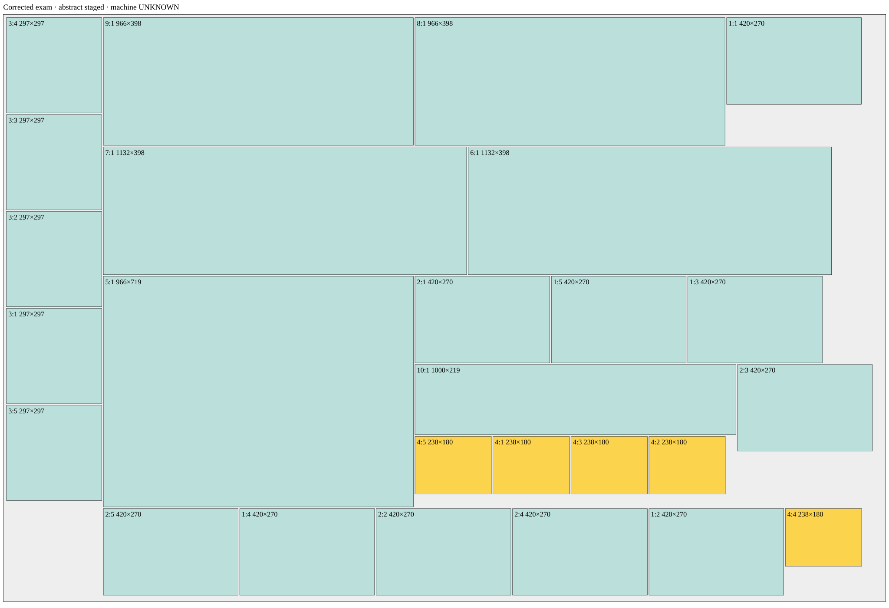
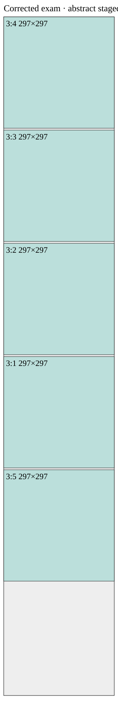
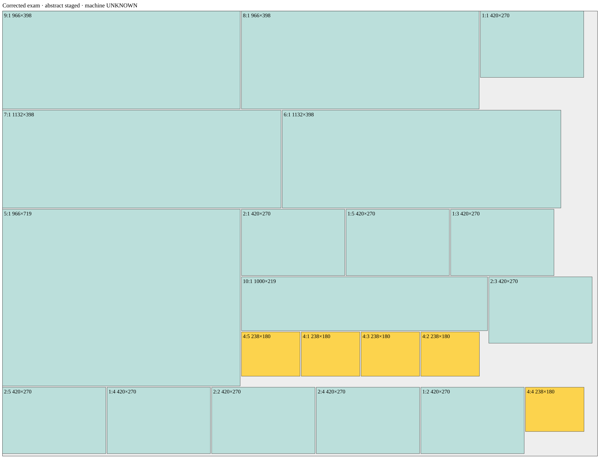

# Исправленный экзамен БАЗИС — 26 деталей

**Найдены два раскроя на одном листе**, без изменения исходного файла bazis-26-corrected.json. Во всех 26 деталях сохранена ориентация относительно материала.

Статусы обеих карт: geometryValid=true; abstractStagedValid=true; machineFeasibility=unknown. Физические операции воспроизведены в явно заданных абстрактных моделях. Соответствие БАЗИС или конкретному станку не подтверждено.

| Модель | Листы | Резы с обрезкой | Длина, мм | Повороты | Все операции | Стадии | Крупнейший остаток, мм² |
|---|---:|---:|---:|---:|---:|---:|---:|
| Прежний строгий якорь | 1 | 48 | 33905 | 18 | 115 | 6 | 117068 |
| Отделяемые полосы без обязательного якоря | 1 | 44 | 35179 | 14 | 103 | 7 | 89100 |

У вариантов разные преимущества. Расширенная модель сокращает резы и повороты; строгая даёт более короткие пропилы и больший остаток. Оптимальность по совокупности критериев не доказана.

## Ввод

Использован исключительно новый набор: 10 строк / 26 деталей; №4 — **238×180, 5 шт.**, №5 — 966×719, №8 и №9 — 966×398. Старые контрольные файлы не менялись и не использовались как вход нового поиска. Лист 2750×1830, керф 5, обрезка 10 взяты из нового JSON; в его benchmarkNotes керф/обрезка обозначены как предположения, не подтверждённые для реального задания БАЗИС. Сравнение с прежними 25/26 деталями по экономии некорректно.

## Проверка искусственных ограничений

Одна ведущая деталь точно по ширине первичной полосы — ограничение раннего профиля, а не установленное универсальное правило БАЗИС. Новое задание разрешает исследовать расширенную модель отдельно. В новом профиле abstract-staged-detached-strips-exam-v1:

- выбирается первоначальный распуск V без поворота сырого листа;
- все рабочие полосы **физически отделяются** сквозными параллельными резами до endPrimary;
- низкая часть становится рабочей полосой, высокая продолжает первичный распуск без поворота;
- последний остаток остаётся отходом и никогда не объявляется полосой;
- точный единичный якорь не требуется, произвольный поворот основного остатка по-прежнему запрещён;
- отделённые заготовки допускают не более одного поворота на ID, дети получают независимые счётчики;
- пределы стадий, подачи, удержания неизвестны; они не выдумываются ради результата.

В найденной карте первая рабочая полоса — **297×1810**, вторая — **2418×1810** в рабочей области. Остаток — **5×1810**. Реальная сырая высота при первичном распуске 1830 мм; верх/низ каждой полосы затем обрезаются. Ширина 2418 не приписывается выдуманной детали: это честно объявленная ширина рабочей полосы нового профиля.

Прежний строгий профиль исключает именно эту карту, но **не исключает возможность одного листа на исправленном наборе**: сравнительный поиск нашёл отдельную карту из полос H шириной 270, 719, 398, 398 с настоящими якорями. Поэтому нельзя объявлять якорное ограничение единственной причиной прошлых неудач на другом наборе.

## Поиск и независимая проверка

src/exam-search.js: детерминированный многовариантный поиск двух отделяемых рабочих полос, перестановок деталей и внутренних гильотинных разбиений. Резервируется 5 мм конечного отхода, плюс реальные керфы. Эта дополнительная потеря не меняет входные параметры; она отражена в дереве. Исследуется ограниченный класс ширин первой полосы из размеров заказа; остаток формирует вторую полосу. Это не полный перебор.

Seed=1, 30000 стартов для каждого метода. Расширенный поиск: 42 геометрических однолистовых кандидата, 8297 мс. Строгий: 15 кандидатов, 12797 мс. Замеры V8, одинаковый ввод; разные алгоритмы не эквивалентны по числу внутренних состояний.

src/exam-validator.js не импортирует генератор: физический replay независимо восстанавливает геометрию и координаты, затем новый валидатор выводит роли MAIN/WORK по фактическим первичным резам, проверяет барьер, запрет поворота основного остатка и 0/1 поворот рабочих заготовок. Каждый принятый кандидат проходит полную проверку. Экспорт дополнительно проверяет пересечение керфа с деталями текущего blankId.

## Артефакты

[Покадровый HTML: 44 CUT](../benchmarks/bazis-corrected-exam-frames.html) · [JSON результата и всех операций](../benchmarks/bazis-corrected-exam-result.json) · [JSON независимой проверки](../benchmarks/bazis-corrected-exam-verification.json) · [Альтернативная строгая карта](BAZIS-CORRECTED-STRICT.md).

Крупнейший остаток расширенной карты — 297×300 = 89100 мм². Все остатки, локальные координаты и последующие действия находятся в JSON/HTML.

## Все операции расширенной карты

| Шаг | Действие | CUT | Входной ID | Размер на столе | Ориентация | Материальный рез | Выходные ID |
|---:|---|---:|---|---|---|---|---|
| 1 | load | — | s0/raw | 2750×1830 | 0 | —  |  |
| 2 | cut | 1 | s0/raw | 2750×1830 | 0 | V 5 | s0/side0, s0/side-rem |
| 3 | feed | — | s0/side-rem | 2740×1830 | 0 | —  |  |
| 4 | cut | 2 | s0/side-rem | 2740×1830 | 0 | V 2740 | s0/body, s0/side1 |
| 5 | feed | — | s0/body | 2730×1830 | 0 | —  |  |
| 6 | cut | 3 | s0/body | 2730×1830 | 0 | V 307 | s0/strip1, s0/rip-rem0 |
| 7 | feed | — | s0/rip-rem0 | 2428×1830 | 0 | —  |  |
| 8 | cut | 4 | s0/rip-rem0 | 2428×1830 | 0 | V 2730 | s0/strip2, s0/rip-rem1 |
| 9 | endPrimary | — | — | —×— | — | —  | s0/strip1, s0/strip2 |
| 10 | feed | — | s0/strip1 | 297×1830 | 0 | —  |  |
| 11 | rotate | — | s0/strip1 | 1830×297 | 90 | —  | s0/strip1 |
| 12 | cut | 5 | s0/strip1 | 1830×297 | 90 | H 5 | s0/strip1/after-top, s0/strip1/top |
| 13 | feed | — | s0/strip1/after-top | 1820×297 | 90 | —  |  |
| 14 | cut | 6 | s0/strip1/after-top | 1820×297 | 90 | H 1820 | s0/strip1/bottom, s0/strip1/work |
| 15 | feed | — | s0/strip1/work | 1810×297 | 90 | —  |  |
| 16 | cut | 7 | s0/strip1/work | 1810×297 | 90 | H 307 | s0/strip1/work/1, s0/strip1/work/0 |
| 17 | feed | — | s0/strip1/work/1 | 1508×297 | 90 | —  |  |
| 18 | cut | 8 | s0/strip1/work/1 | 1508×297 | 90 | H 609 | s0/strip1/work/1/1, s0/strip1/work/1/0 |
| 19 | feed | — | s0/strip1/work/1/1 | 1206×297 | 90 | —  |  |
| 20 | cut | 9 | s0/strip1/work/1/1 | 1206×297 | 90 | H 911 | s0/strip1/work/1/1/1, s0/strip1/work/1/1/0 |
| 21 | feed | — | s0/strip1/work/1/1/1 | 904×297 | 90 | —  |  |
| 22 | cut | 10 | s0/strip1/work/1/1/1 | 904×297 | 90 | H 1213 | s0/strip1/work/1/1/1/1, s0/strip1/work/1/1/1/0 |
| 23 | feed | — | s0/strip1/work/1/1/1/1 | 602×297 | 90 | —  |  |
| 24 | cut | 11 | s0/strip1/work/1/1/1/1 | 602×297 | 90 | H 1515 | s0/strip1/work/1/1/1/1/1, s0/strip1/work/1/1/1/1/0 |
| 25 | feed | — | s0/strip2 | 2418×1830 | 0 | —  |  |
| 26 | rotate | — | s0/strip2 | 1830×2418 | 90 | —  | s0/strip2 |
| 27 | cut | 12 | s0/strip2 | 1830×2418 | 90 | H 5 | s0/strip2/after-top, s0/strip2/top |
| 28 | feed | — | s0/strip2/after-top | 1820×2418 | 90 | —  |  |
| 29 | cut | 13 | s0/strip2/after-top | 1820×2418 | 90 | H 1820 | s0/strip2/bottom, s0/strip2/work |
| 30 | feed | — | s0/strip2/work | 1810×2418 | 90 | —  |  |
| 31 | cut | 14 | s0/strip2/work | 1810×2418 | 90 | H 408 | s0/strip2/work/1, s0/strip2/work/0 |
| 32 | feed | — | s0/strip2/work/0 | 398×2418 | 90 | —  |  |
| 33 | rotate | — | s0/strip2/work/0 | 2418×398 | 180 | —  | s0/strip2/work/0 |
| 34 | cut | 15 | s0/strip2/work/0 | 2418×398 | 180 | V 1278 | s0/strip2/work/0/1, s0/strip2/work/0/0 |
| 35 | feed | — | s0/strip2/work/0/1 | 1447×398 | 180 | —  |  |
| 36 | cut | 16 | s0/strip2/work/0/1 | 1447×398 | 180 | V 2249 | s0/strip2/work/0/1/1, s0/strip2/work/0/1/0 |
| 37 | feed | — | s0/strip2/work/0/1/1 | 476×398 | 180 | —  |  |
| 38 | cut | 17 | s0/strip2/work/0/1/1 | 476×398 | 180 | V 2674 | s0/strip2/work/0/1/1/1, s0/strip2/work/0/1/1/0 |
| 39 | feed | — | s0/strip2/work/0/1/1/0 | 420×398 | 180 | —  |  |
| 40 | rotate | — | s0/strip2/work/0/1/1/0 | 398×420 | 270 | —  | s0/strip2/work/0/1/1/0 |
| 41 | cut | 18 | s0/strip2/work/0/1/1/0 | 398×420 | 270 | H 280 | s0/strip2/work/0/1/1/0/0, s0/strip2/work/0/1/1/0/1 |
| 42 | feed | — | s0/strip2/work/1 | 1407×2418 | 90 | —  |  |
| 43 | cut | 19 | s0/strip2/work/1 | 1407×2418 | 90 | H 811 | s0/strip2/work/1/1, s0/strip2/work/1/0 |
| 44 | feed | — | s0/strip2/work/1/0 | 398×2418 | 90 | —  |  |
| 45 | rotate | — | s0/strip2/work/1/0 | 2418×398 | 180 | —  | s0/strip2/work/1/0 |
| 46 | cut | 20 | s0/strip2/work/1/0 | 2418×398 | 180 | V 1444 | s0/strip2/work/1/0/1, s0/strip2/work/1/0/0 |
| 47 | feed | — | s0/strip2/work/1/0/1 | 1281×398 | 180 | —  |  |
| 48 | cut | 21 | s0/strip2/work/1/0/1 | 1281×398 | 180 | V 2581 | s0/strip2/work/1/0/1/1, s0/strip2/work/1/0/1/0 |
| 49 | feed | — | s0/strip2/work/1/1 | 1004×2418 | 90 | —  |  |
| 50 | cut | 22 | s0/strip2/work/1/1 | 1004×2418 | 90 | H 1535 | s0/strip2/work/1/1/1, s0/strip2/work/1/1/0 |
| 51 | feed | — | s0/strip2/work/1/1/0 | 719×2418 | 90 | —  |  |
| 52 | rotate | — | s0/strip2/work/1/1/0 | 2418×719 | 180 | —  | s0/strip2/work/1/1/0 |
| 53 | cut | 23 | s0/strip2/work/1/1/0 | 2418×719 | 180 | V 1278 | s0/strip2/work/1/1/0/1, s0/strip2/work/1/1/0/0 |
| 54 | feed | — | s0/strip2/work/1/1/0/1 | 1447×719 | 180 | —  |  |
| 55 | rotate | — | s0/strip2/work/1/1/0/1 | 719×1447 | 270 | —  | s0/strip2/work/1/1/0/1 |
| 56 | cut | 24 | s0/strip2/work/1/1/0/1 | 719×1447 | 270 | H 1086 | s0/strip2/work/1/1/0/1/0, s0/strip2/work/1/1/0/1/1 |
| 57 | feed | — | s0/strip2/work/1/1/0/1/0 | 270×1447 | 270 | —  |  |
| 58 | rotate | — | s0/strip2/work/1/1/0/1/0 | 1447×270 | 0 | —  | s0/strip2/work/1/1/0/1/0 |
| 59 | cut | 25 | s0/strip2/work/1/1/0/1/0 | 1447×270 | 0 | V 1703 | s0/strip2/work/1/1/0/1/0/0, s0/strip2/work/1/1/0/1/0/1 |
| 60 | feed | — | s0/strip2/work/1/1/0/1/0/1 | 1022×270 | 0 | —  |  |
| 61 | cut | 26 | s0/strip2/work/1/1/0/1/0/1 | 1022×270 | 0 | V 2128 | s0/strip2/work/1/1/0/1/0/1/0, s0/strip2/work/1/1/0/1/0/1/1 |
| 62 | feed | — | s0/strip2/work/1/1/0/1/0/1/1 | 597×270 | 0 | —  |  |
| 63 | cut | 27 | s0/strip2/work/1/1/0/1/0/1/1 | 597×270 | 0 | V 2553 | s0/strip2/work/1/1/0/1/0/1/1/0, s0/strip2/work/1/1/0/1/0/1/1/1 |
| 64 | feed | — | s0/strip2/work/1/1/0/1/1 | 444×1447 | 270 | —  |  |
| 65 | rotate | — | s0/strip2/work/1/1/0/1/1 | 1447×444 | 0 | —  | s0/strip2/work/1/1/0/1/1 |
| 66 | cut | 28 | s0/strip2/work/1/1/0/1/1 | 1447×444 | 0 | V 2283 | s0/strip2/work/1/1/0/1/1/0, s0/strip2/work/1/1/0/1/1/1 |
| 67 | feed | — | s0/strip2/work/1/1/0/1/1/0 | 1000×444 | 0 | —  |  |
| 68 | rotate | — | s0/strip2/work/1/1/0/1/1/0 | 444×1000 | 90 | —  | s0/strip2/work/1/1/0/1/1/0 |
| 69 | cut | 29 | s0/strip2/work/1/1/0/1/1/0 | 444×1000 | 90 | H 1310 | s0/strip2/work/1/1/0/1/1/0/1, s0/strip2/work/1/1/0/1/1/0/0 |
| 70 | feed | — | s0/strip2/work/1/1/0/1/1/0/1 | 220×1000 | 90 | —  |  |
| 71 | cut | 30 | s0/strip2/work/1/1/0/1/1/0/1 | 220×1000 | 90 | H 1495 | s0/strip2/work/1/1/0/1/1/0/1/1, s0/strip2/work/1/1/0/1/1/0/1/0 |
| 72 | feed | — | s0/strip2/work/1/1/0/1/1/0/1/0 | 180×1000 | 90 | —  |  |
| 73 | rotate | — | s0/strip2/work/1/1/0/1/1/0/1/0 | 1000×180 | 180 | —  | s0/strip2/work/1/1/0/1/1/0/1/0 |
| 74 | cut | 31 | s0/strip2/work/1/1/0/1/1/0/1/0 | 1000×180 | 180 | V 1521 | s0/strip2/work/1/1/0/1/1/0/1/0/1, s0/strip2/work/1/1/0/1/1/0/1/0/0 |
| 75 | feed | — | s0/strip2/work/1/1/0/1/1/0/1/0/1 | 757×180 | 180 | —  |  |
| 76 | cut | 32 | s0/strip2/work/1/1/0/1/1/0/1/0/1 | 757×180 | 180 | V 1764 | s0/strip2/work/1/1/0/1/1/0/1/0/1/1, s0/strip2/work/1/1/0/1/1/0/1/0/1/0 |
| 77 | feed | — | s0/strip2/work/1/1/0/1/1/0/1/0/1/1 | 514×180 | 180 | —  |  |
| 78 | cut | 33 | s0/strip2/work/1/1/0/1/1/0/1/0/1/1 | 514×180 | 180 | V 2007 | s0/strip2/work/1/1/0/1/1/0/1/0/1/1/1, s0/strip2/work/1/1/0/1/1/0/1/0/1/1/0 |
| 79 | feed | — | s0/strip2/work/1/1/0/1/1/0/1/0/1/1/1 | 271×180 | 180 | —  |  |
| 80 | cut | 34 | s0/strip2/work/1/1/0/1/1/0/1/0/1/1/1 | 271×180 | 180 | V 2250 | s0/strip2/work/1/1/0/1/1/0/1/0/1/1/1/1, s0/strip2/work/1/1/0/1/1/0/1/0/1/1/1/0 |
| 81 | feed | — | s0/strip2/work/1/1/0/1/1/1 | 442×444 | 0 | —  |  |
| 82 | cut | 35 | s0/strip2/work/1/1/0/1/1/1 | 442×444 | 0 | V 2708 | s0/strip2/work/1/1/0/1/1/1/0, s0/strip2/work/1/1/0/1/1/1/1 |
| 83 | feed | — | s0/strip2/work/1/1/0/1/1/1/0 | 420×444 | 0 | —  |  |
| 84 | rotate | — | s0/strip2/work/1/1/0/1/1/1/0 | 444×420 | 90 | —  | s0/strip2/work/1/1/0/1/1/1/0 |
| 85 | cut | 36 | s0/strip2/work/1/1/0/1/1/1/0 | 444×420 | 90 | H 1361 | s0/strip2/work/1/1/0/1/1/1/0/1, s0/strip2/work/1/1/0/1/1/1/0/0 |
| 86 | feed | — | s0/strip2/work/1/1/1 | 280×2418 | 90 | —  |  |
| 87 | cut | 37 | s0/strip2/work/1/1/1 | 280×2418 | 90 | H 1810 | s0/strip2/work/1/1/1/1, s0/strip2/work/1/1/1/0 |
| 88 | feed | — | s0/strip2/work/1/1/1/0 | 270×2418 | 90 | —  |  |
| 89 | rotate | — | s0/strip2/work/1/1/1/0 | 2418×270 | 180 | —  | s0/strip2/work/1/1/1/0 |
| 90 | cut | 38 | s0/strip2/work/1/1/1/0 | 2418×270 | 180 | V 732 | s0/strip2/work/1/1/1/0/1, s0/strip2/work/1/1/1/0/0 |
| 91 | feed | — | s0/strip2/work/1/1/1/0/1 | 1993×270 | 180 | —  |  |
| 92 | cut | 39 | s0/strip2/work/1/1/1/0/1 | 1993×270 | 180 | V 1157 | s0/strip2/work/1/1/1/0/1/1, s0/strip2/work/1/1/1/0/1/0 |
| 93 | feed | — | s0/strip2/work/1/1/1/0/1/1 | 1568×270 | 180 | —  |  |
| 94 | cut | 40 | s0/strip2/work/1/1/1/0/1/1 | 1568×270 | 180 | V 1582 | s0/strip2/work/1/1/1/0/1/1/1, s0/strip2/work/1/1/1/0/1/1/0 |
| 95 | feed | — | s0/strip2/work/1/1/1/0/1/1/1 | 1143×270 | 180 | —  |  |
| 96 | cut | 41 | s0/strip2/work/1/1/1/0/1/1/1 | 1143×270 | 180 | V 2007 | s0/strip2/work/1/1/1/0/1/1/1/1, s0/strip2/work/1/1/1/0/1/1/1/0 |
| 97 | feed | — | s0/strip2/work/1/1/1/0/1/1/1/1 | 718×270 | 180 | —  |  |
| 98 | cut | 42 | s0/strip2/work/1/1/1/0/1/1/1/1 | 718×270 | 180 | V 2432 | s0/strip2/work/1/1/1/0/1/1/1/1/1, s0/strip2/work/1/1/1/0/1/1/1/1/0 |
| 99 | feed | — | s0/strip2/work/1/1/1/0/1/1/1/1/1 | 293×270 | 180 | —  |  |
| 100 | cut | 43 | s0/strip2/work/1/1/1/0/1/1/1/1/1 | 293×270 | 180 | V 2675 | s0/strip2/work/1/1/1/0/1/1/1/1/1/1, s0/strip2/work/1/1/1/0/1/1/1/1/1/0 |
| 101 | feed | — | s0/strip2/work/1/1/1/0/1/1/1/1/1/0 | 238×270 | 180 | —  |  |
| 102 | rotate | — | s0/strip2/work/1/1/1/0/1/1/1/1/1/0 | 270×238 | 270 | —  | s0/strip2/work/1/1/1/0/1/1/1/1/1/0 |
| 103 | cut | 44 | s0/strip2/work/1/1/1/0/1/1/1/1/1/0 | 270×238 | 270 | H 1720 | s0/strip2/work/1/1/1/0/1/1/1/1/1/0/0, s0/strip2/work/1/1/1/0/1/1/1/1/1/0/1 |

## Тесты и воспроизведение

Добавлены 105 тестов: точные размеры исправленного ввода, 100 seed на неизменном заказе, независимый replay, реальное отделение широкой полосы и запрет обработки остатка, отрицательные проверки стадий, керфа, поворотов и барьера. В V8 все 105 прошли. Полный npm test и benchmark запускаются GitHub Actions.

`npm run benchmark:bazis-corrected` воспроизводит обе карты и сравнивает геометрию и операции с сохранёнными JSON. `npm test` запускает новые и исторические тесты.

Модель допускает до 7 стадий в этой карте при неизвестном паспортном пределе. Нельзя считать её подтверждённой программой конкретного станка или утверждать равенство технологии реальному БАЗИС без уточнения оборудования, керфа, обрезки и протокола операций.
