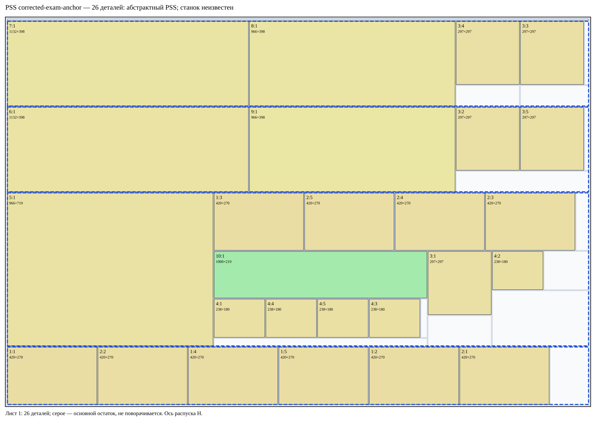
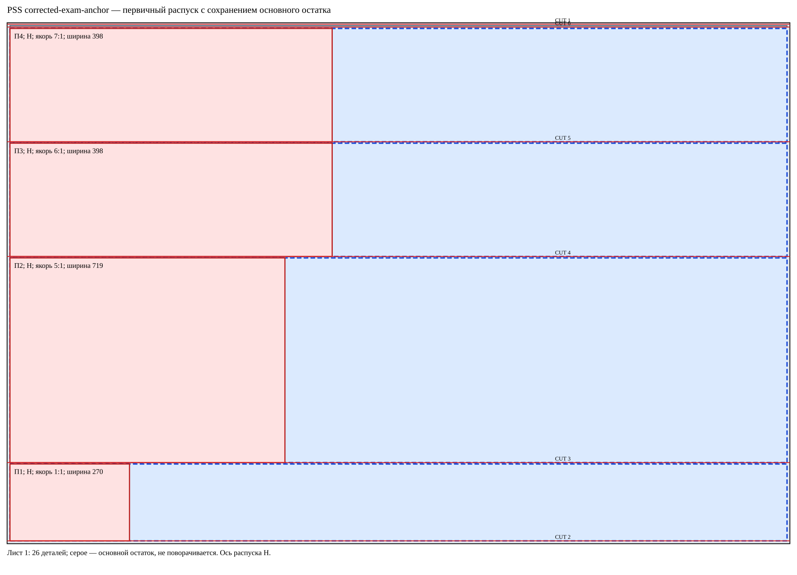
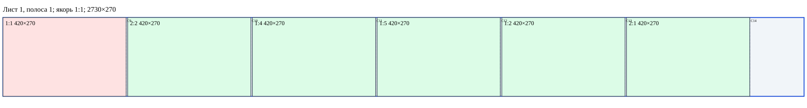
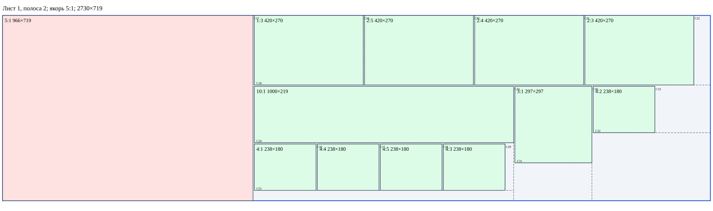
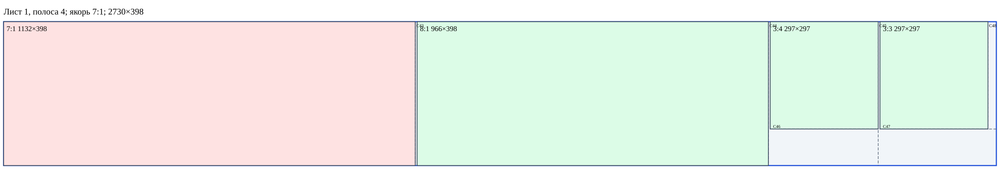

# Альтернатива: исправленный заказ, строгий якорь

Геометрия и абстрактная PSS-последовательность проверены. Реальный станок не подтверждён.

# Brain corrected-exam-anchor — PANEL_SAW_STAGED (PSS)

**Найден допустимый PSS-план на одном листе.** Все 26 деталей размещены на 1 листах. Это не доказательство минимальности.

[Дерево всех заготовок](../benchmarks/bazis-corrected-strict-blanks.svg) · [JSON](../benchmarks/bazis-corrected-strict.json)

Режим PANEL_SAW_STAGED, профиль pss-anchored-single-axis-v1. Геометрия, физическая последовательность и роли/якоря проверены независимо. Профиль абстрактный, применимость к реальному станку и БАЗИС не подтверждена.

Если выбранная ось этого требует, выполняется разрешённый предварительный поворот сырого листа; затем вся серия параллельных резов по основному остатку. Рабочие полосы снимаются с высокой стороны поперечной координаты; низкая часть остаётся PRIMARY_REMAINDER. endPrimary роли не меняет. Ширина каждой рабочей полосы равна одному реальному ведущему экземпляру; припуск 0. После каждого CUT новые дети имеют turnCount=0.

## Первичные полосы и якоря

| Лист | Полоса | Ось материала | Ширина | Якорь | Blank | Конверсия последнего остатка |
|---:|---:|---|---:|---|---|---|
| 1 | 1 | H | 270 | 1:1 | B007 | нет, физически отделена CUT |
| 1 | 2 | H | 719 | 5:1 | B009 | нет, физически отделена CUT |
| 1 | 3 | H | 398 | 6:1 | B011 | нет, физически отделена CUT |
| 1 | 4 | H | 398 | 7:1 | B013 | нет, физически отделена CUT |

## Последующий раскрой каждой полосы

Лист 1, полоса 1: реальный якорь 1:1 первым; остальные детали находятся за ним по длине.

Лист 1, полоса 2: реальный якорь 5:1 первым; остальные детали находятся за ним по длине.

Лист 1, полоса 3: реальный якорь 6:1 первым; остальные детали находятся за ним по длине.

Лист 1, полоса 4: реальный якорь 7:1 первым; остальные детали находятся за ним по длине.

## Все операции

Машинные координаты локальные для поданной заготовки, V=x const. Материальные координаты неизменны. Поворот исходного листа, если он нужен, выполняется только до первого реза. CUT №, шаги и номера деталей независимы.

| Шаг | Действие | CUT № | Вход | Роль | Размер / ориентация | Машинный рез | Выходы |
|---:|---|---:|---|---|---|---|---|
| 1 | load | — | B001 | PRIMARY_PANEL | 2750×1830 / 0° | — |  |
| 2 | ROTATE_90 | — | B001 | PRIMARY_PANEL | 1830×2750 / 0→90° | 90°; 0→1 | B001 |
| 3 | CUT | 1 | B001 | PRIMARY_PANEL | 1830×2750 / 90° | V: (1820,0)→(1820,2750) | B003, B002 |
| 4 | feed | — | B003 | PRIMARY_REMAINDER | 1820×2750 / 90° | — |  |
| 5 | CUT | 2 | B003 | PRIMARY_REMAINDER | 1820×2750 / 90° | V: (5,0)→(5,2750) | B005, B004 |
| 6 | feed | — | B004 | PRIMARY_REMAINDER | 1810×2750 / 90° | — |  |
| 7 | CUT | 3 | B004 | PRIMARY_REMAINDER | 1810×2750 / 90° | V: (270,0)→(270,2750) | B007, B006 |
| 8 | feed | — | B006 | PRIMARY_REMAINDER | 1535×2750 / 90° | — |  |
| 9 | CUT | 4 | B006 | PRIMARY_REMAINDER | 1535×2750 / 90° | V: (719,0)→(719,2750) | B009, B008 |
| 10 | feed | — | B008 | PRIMARY_REMAINDER | 811×2750 / 90° | — |  |
| 11 | CUT | 5 | B008 | PRIMARY_REMAINDER | 811×2750 / 90° | V: (398,0)→(398,2750) | B011, B010 |
| 12 | feed | — | B010 | PRIMARY_REMAINDER | 408×2750 / 90° | — |  |
| 13 | CUT | 6 | B010 | PRIMARY_REMAINDER | 408×2750 / 90° | V: (398,0)→(398,2750) | B013, B012 |
| 14 | endPrimary | — | лист 1 | — | — / —° | — | B007, B009, B011, B013 |
| 15 | feed | — | B007 | DETACHED_PRIMARY_STRIP | 270×2750 / 90° | — |  |
| 16 | ROTATE_90 | — | B007 | DETACHED_PRIMARY_STRIP | 2750×270 / 90→180° | 90°; 0→1 | B007 |
| 17 | CUT | 7 | B007 | DETACHED_PRIMARY_STRIP | 2750×270 / 180° | V: (2740,0)→(2740,270) | B015, B014 |
| 18 | feed | — | B015 | SECONDARY_BLANK | 2740×270 / 180° | — |  |
| 19 | CUT | 8 | B015 | SECONDARY_BLANK | 2740×270 / 180° | V: (5,0)→(5,270) | B017, B016 |
| 20 | feed | — | B016 | SECONDARY_BLANK | 2730×270 / 180° | — |  |
| 21 | CUT | 9 | B016 | SECONDARY_BLANK | 2730×270 / 180° | V: (2305,0)→(2305,270) | B019, B018 |
| 22 | feed | — | B019 | SECONDARY_BLANK | 2305×270 / 180° | — |  |
| 23 | CUT | 10 | B019 | SECONDARY_BLANK | 2305×270 / 180° | V: (1880,0)→(1880,270) | B021, B020 |
| 24 | feed | — | B021 | SECONDARY_BLANK | 1880×270 / 180° | — |  |
| 25 | CUT | 11 | B021 | SECONDARY_BLANK | 1880×270 / 180° | V: (1455,0)→(1455,270) | B023, B022 |
| 26 | feed | — | B023 | SECONDARY_BLANK | 1455×270 / 180° | — |  |
| 27 | CUT | 12 | B023 | SECONDARY_BLANK | 1455×270 / 180° | V: (1030,0)→(1030,270) | B025, B024 |
| 28 | feed | — | B025 | SECONDARY_BLANK | 1030×270 / 180° | — |  |
| 29 | CUT | 13 | B025 | SECONDARY_BLANK | 1030×270 / 180° | V: (605,0)→(605,270) | B027, B026 |
| 30 | feed | — | B027 | SECONDARY_BLANK | 605×270 / 180° | — |  |
| 31 | CUT | 14 | B027 | SECONDARY_BLANK | 605×270 / 180° | V: (180,0)→(180,270) | B029, B028 |
| 32 | feed | — | B009 | DETACHED_PRIMARY_STRIP | 719×2750 / 90° | — |  |
| 33 | ROTATE_90 | — | B009 | DETACHED_PRIMARY_STRIP | 2750×719 / 90→180° | 90°; 0→1 | B009 |
| 34 | CUT | 15 | B009 | DETACHED_PRIMARY_STRIP | 2750×719 / 180° | V: (2740,0)→(2740,719) | B031, B030 |
| 35 | feed | — | B031 | SECONDARY_BLANK | 2740×719 / 180° | — |  |
| 36 | CUT | 16 | B031 | SECONDARY_BLANK | 2740×719 / 180° | V: (5,0)→(5,719) | B033, B032 |
| 37 | feed | — | B032 | SECONDARY_BLANK | 2730×719 / 180° | — |  |
| 38 | CUT | 17 | B032 | SECONDARY_BLANK | 2730×719 / 180° | V: (1759,0)→(1759,719) | B035, B034 |
| 39 | feed | — | B035 | SECONDARY_BLANK | 1759×719 / 180° | — |  |
| 40 | ROTATE_90 | — | B035 | SECONDARY_BLANK | 719×1759 / 180→270° | 90°; 0→1 | B035 |
| 41 | CUT | 18 | B035 | SECONDARY_BLANK | 719×1759 / 270° | V: (270,0)→(270,1759) | B036, B037 |
| 42 | feed | — | B036 | SECONDARY_BLANK | 270×1759 / 270° | — |  |
| 43 | ROTATE_90 | — | B036 | SECONDARY_BLANK | 1759×270 / 270→0° | 90°; 0→1 | B036 |
| 44 | CUT | 19 | B036 | SECONDARY_BLANK | 1759×270 / 0° | V: (420,0)→(420,270) | B038, B039 |
| 45 | feed | — | B039 | SECONDARY_BLANK | 1334×270 / 0° | — |  |
| 46 | CUT | 20 | B039 | SECONDARY_BLANK | 1334×270 / 0° | V: (420,0)→(420,270) | B040, B041 |
| 47 | feed | — | B041 | SECONDARY_BLANK | 909×270 / 0° | — |  |
| 48 | CUT | 21 | B041 | SECONDARY_BLANK | 909×270 / 0° | V: (420,0)→(420,270) | B042, B043 |
| 49 | feed | — | B043 | SECONDARY_BLANK | 484×270 / 0° | — |  |
| 50 | CUT | 22 | B043 | SECONDARY_BLANK | 484×270 / 0° | V: (420,0)→(420,270) | B044, B045 |
| 51 | feed | — | B037 | SECONDARY_BLANK | 444×1759 / 270° | — |  |
| 52 | ROTATE_90 | — | B037 | SECONDARY_BLANK | 1759×444 / 270→0° | 90°; 0→1 | B037 |
| 53 | CUT | 23 | B037 | SECONDARY_BLANK | 1759×444 / 0° | V: (1000,0)→(1000,444) | B046, B047 |
| 54 | feed | — | B046 | SECONDARY_BLANK | 1000×444 / 0° | — |  |
| 55 | ROTATE_90 | — | B046 | SECONDARY_BLANK | 444×1000 / 0→90° | 90°; 0→1 | B046 |
| 56 | CUT | 24 | B046 | SECONDARY_BLANK | 444×1000 / 90° | V: (220,0)→(220,1000) | B049, B048 |
| 57 | feed | — | B049 | SECONDARY_BLANK | 220×1000 / 90° | — |  |
| 58 | CUT | 25 | B049 | SECONDARY_BLANK | 220×1000 / 90° | V: (35,0)→(35,1000) | B051, B050 |
| 59 | feed | — | B050 | SECONDARY_BLANK | 180×1000 / 90° | — |  |
| 60 | ROTATE_90 | — | B050 | SECONDARY_BLANK | 1000×180 / 90→180° | 90°; 0→1 | B050 |
| 61 | CUT | 26 | B050 | SECONDARY_BLANK | 1000×180 / 180° | V: (757,0)→(757,180) | B053, B052 |
| 62 | feed | — | B053 | SECONDARY_BLANK | 757×180 / 180° | — |  |
| 63 | CUT | 27 | B053 | SECONDARY_BLANK | 757×180 / 180° | V: (514,0)→(514,180) | B055, B054 |
| 64 | feed | — | B055 | SECONDARY_BLANK | 514×180 / 180° | — |  |
| 65 | CUT | 28 | B055 | SECONDARY_BLANK | 514×180 / 180° | V: (271,0)→(271,180) | B057, B056 |
| 66 | feed | — | B057 | SECONDARY_BLANK | 271×180 / 180° | — |  |
| 67 | CUT | 29 | B057 | SECONDARY_BLANK | 271×180 / 180° | V: (28,0)→(28,180) | B059, B058 |
| 68 | feed | — | B047 | SECONDARY_BLANK | 754×444 / 0° | — |  |
| 69 | CUT | 30 | B047 | SECONDARY_BLANK | 754×444 / 0° | V: (297,0)→(297,444) | B060, B061 |
| 70 | feed | — | B060 | SECONDARY_BLANK | 297×444 / 0° | — |  |
| 71 | ROTATE_90 | — | B060 | SECONDARY_BLANK | 444×297 / 0→90° | 90°; 0→1 | B060 |
| 72 | CUT | 31 | B060 | SECONDARY_BLANK | 444×297 / 90° | V: (142,0)→(142,297) | B063, B062 |
| 73 | feed | — | B061 | SECONDARY_BLANK | 452×444 / 0° | — |  |
| 74 | ROTATE_90 | — | B061 | SECONDARY_BLANK | 444×452 / 0→90° | 90°; 0→1 | B061 |
| 75 | CUT | 32 | B061 | SECONDARY_BLANK | 444×452 / 90° | V: (259,0)→(259,452) | B065, B064 |
| 76 | feed | — | B064 | SECONDARY_BLANK | 180×452 / 90° | — |  |
| 77 | ROTATE_90 | — | B064 | SECONDARY_BLANK | 452×180 / 90→180° | 90°; 0→1 | B064 |
| 78 | CUT | 33 | B064 | SECONDARY_BLANK | 452×180 / 180° | V: (209,0)→(209,180) | B067, B066 |
| 79 | feed | — | B011 | DETACHED_PRIMARY_STRIP | 398×2750 / 90° | — |  |
| 80 | ROTATE_90 | — | B011 | DETACHED_PRIMARY_STRIP | 2750×398 / 90→180° | 90°; 0→1 | B011 |
| 81 | CUT | 34 | B011 | DETACHED_PRIMARY_STRIP | 2750×398 / 180° | V: (2740,0)→(2740,398) | B069, B068 |
| 82 | feed | — | B069 | SECONDARY_BLANK | 2740×398 / 180° | — |  |
| 83 | CUT | 35 | B069 | SECONDARY_BLANK | 2740×398 / 180° | V: (5,0)→(5,398) | B071, B070 |
| 84 | feed | — | B070 | SECONDARY_BLANK | 2730×398 / 180° | — |  |
| 85 | CUT | 36 | B070 | SECONDARY_BLANK | 2730×398 / 180° | V: (1593,0)→(1593,398) | B073, B072 |
| 86 | feed | — | B073 | SECONDARY_BLANK | 1593×398 / 180° | — |  |
| 87 | CUT | 37 | B073 | SECONDARY_BLANK | 1593×398 / 180° | V: (622,0)→(622,398) | B075, B074 |
| 88 | feed | — | B075 | SECONDARY_BLANK | 622×398 / 180° | — |  |
| 89 | ROTATE_90 | — | B075 | SECONDARY_BLANK | 398×622 / 180→270° | 90°; 0→1 | B075 |
| 90 | CUT | 38 | B075 | SECONDARY_BLANK | 398×622 / 270° | V: (297,0)→(297,622) | B076, B077 |
| 91 | feed | — | B076 | SECONDARY_BLANK | 297×622 / 270° | — |  |
| 92 | ROTATE_90 | — | B076 | SECONDARY_BLANK | 622×297 / 270→0° | 90°; 0→1 | B076 |
| 93 | CUT | 39 | B076 | SECONDARY_BLANK | 622×297 / 0° | V: (297,0)→(297,297) | B078, B079 |
| 94 | feed | — | B079 | SECONDARY_BLANK | 320×297 / 0° | — |  |
| 95 | CUT | 40 | B079 | SECONDARY_BLANK | 320×297 / 0° | V: (297,0)→(297,297) | B080, B081 |
| 96 | feed | — | B013 | DETACHED_PRIMARY_STRIP | 398×2750 / 90° | — |  |
| 97 | ROTATE_90 | — | B013 | DETACHED_PRIMARY_STRIP | 2750×398 / 90→180° | 90°; 0→1 | B013 |
| 98 | CUT | 41 | B013 | DETACHED_PRIMARY_STRIP | 2750×398 / 180° | V: (2740,0)→(2740,398) | B083, B082 |
| 99 | feed | — | B083 | SECONDARY_BLANK | 2740×398 / 180° | — |  |
| 100 | CUT | 42 | B083 | SECONDARY_BLANK | 2740×398 / 180° | V: (5,0)→(5,398) | B085, B084 |
| 101 | feed | — | B084 | SECONDARY_BLANK | 2730×398 / 180° | — |  |
| 102 | CUT | 43 | B084 | SECONDARY_BLANK | 2730×398 / 180° | V: (1593,0)→(1593,398) | B087, B086 |
| 103 | feed | — | B087 | SECONDARY_BLANK | 1593×398 / 180° | — |  |
| 104 | CUT | 44 | B087 | SECONDARY_BLANK | 1593×398 / 180° | V: (622,0)→(622,398) | B089, B088 |
| 105 | feed | — | B089 | SECONDARY_BLANK | 622×398 / 180° | — |  |
| 106 | CUT | 45 | B089 | SECONDARY_BLANK | 622×398 / 180° | V: (320,0)→(320,398) | B091, B090 |
| 107 | feed | — | B090 | SECONDARY_BLANK | 297×398 / 180° | — |  |
| 108 | ROTATE_90 | — | B090 | SECONDARY_BLANK | 398×297 / 180→270° | 90°; 0→1 | B090 |
| 109 | CUT | 46 | B090 | SECONDARY_BLANK | 398×297 / 270° | V: (297,0)→(297,297) | B092, B093 |
| 110 | feed | — | B091 | SECONDARY_BLANK | 320×398 / 180° | — |  |
| 111 | ROTATE_90 | — | B091 | SECONDARY_BLANK | 398×320 / 180→270° | 90°; 0→1 | B091 |
| 112 | CUT | 47 | B091 | SECONDARY_BLANK | 398×320 / 270° | V: (297,0)→(297,320) | B094, B095 |
| 113 | feed | — | B094 | SECONDARY_BLANK | 297×320 / 270° | — |  |
| 114 | ROTATE_90 | — | B094 | SECONDARY_BLANK | 320×297 / 270→0° | 90°; 0→1 | B094 |
| 115 | CUT | 48 | B094 | SECONDARY_BLANK | 320×297 / 0° | V: (297,0)→(297,297) | B096, B097 |

## Роли и родословная всех заготовок

| B | Родитель | blankId | Материал X,Y,W,H | Роль при создании → итог | Машинная ориентация | turnCount |
|---|---|---|---|---|---|---:|
| B001 | — | s0/raw | 0, 0, 2750, 1830 | PRIMARY_PANEL → PRIMARY_PANEL | 0→90° | 1 |
| B002 | B001 | s0/side-low | 0, 0, 2750, 5 | WASTE → WASTE | 90→90° | 0 |
| B003 | B001 | s0/main0 | 0, 10, 2750, 1820 | PRIMARY_REMAINDER → PRIMARY_REMAINDER | 90→90° | 0 |
| B004 | B003 | s0/main1 | 0, 10, 2750, 1810 | PRIMARY_REMAINDER → PRIMARY_REMAINDER | 90→90° | 0 |
| B005 | B003 | s0/side-high | 0, 1825, 2750, 5 | WASTE → WASTE | 90→90° | 0 |
| B006 | B004 | s0/remainder0 | 0, 10, 2750, 1535 | PRIMARY_REMAINDER → PRIMARY_REMAINDER | 90→90° | 0 |
| B007 | B004 | s0/strip1 | 0, 1550, 2750, 270 | DETACHED_PRIMARY_STRIP → DETACHED_PRIMARY_STRIP | 90→180° | 1 |
| B008 | B006 | s0/remainder1 | 0, 10, 2750, 811 | PRIMARY_REMAINDER → PRIMARY_REMAINDER | 90→90° | 0 |
| B009 | B006 | s0/strip2 | 0, 826, 2750, 719 | DETACHED_PRIMARY_STRIP → DETACHED_PRIMARY_STRIP | 90→180° | 1 |
| B010 | B008 | s0/remainder2 | 0, 10, 2750, 408 | PRIMARY_REMAINDER → PRIMARY_REMAINDER | 90→90° | 0 |
| B011 | B008 | s0/strip3 | 0, 423, 2750, 398 | DETACHED_PRIMARY_STRIP → DETACHED_PRIMARY_STRIP | 90→180° | 1 |
| B012 | B010 | s0/remainder3 | 0, 10, 2750, 5 | PRIMARY_REMAINDER → PRIMARY_REMAINDER | 90→90° | 0 |
| B013 | B010 | s0/strip4 | 0, 20, 2750, 398 | DETACHED_PRIMARY_STRIP → DETACHED_PRIMARY_STRIP | 90→180° | 1 |
| B014 | B007 | s0/strip1/end-low | 0, 1550, 5, 270 | SECONDARY_BLANK → SECONDARY_BLANK | 180→180° | 0 |
| B015 | B007 | s0/strip1/after-low | 10, 1550, 2740, 270 | SECONDARY_BLANK → SECONDARY_BLANK | 180→180° | 0 |
| B016 | B015 | s0/strip1/work | 10, 1550, 2730, 270 | SECONDARY_BLANK → SECONDARY_BLANK | 180→180° | 0 |
| B017 | B015 | s0/strip1/end-high | 2745, 1550, 5, 270 | SECONDARY_BLANK → SECONDARY_BLANK | 180→180° | 0 |
| B018 | B016 | s0/strip1/work/0 | 10, 1550, 420, 270 | SECONDARY_BLANK → SECONDARY_BLANK | 180→180° | 0 |
| B019 | B016 | s0/strip1/work/1 | 435, 1550, 2305, 270 | SECONDARY_BLANK → SECONDARY_BLANK | 180→180° | 0 |
| B020 | B019 | s0/strip1/work/1/0 | 435, 1550, 420, 270 | SECONDARY_BLANK → SECONDARY_BLANK | 180→180° | 0 |
| B021 | B019 | s0/strip1/work/1/1 | 860, 1550, 1880, 270 | SECONDARY_BLANK → SECONDARY_BLANK | 180→180° | 0 |
| B022 | B021 | s0/strip1/work/1/1/0 | 860, 1550, 420, 270 | SECONDARY_BLANK → SECONDARY_BLANK | 180→180° | 0 |
| B023 | B021 | s0/strip1/work/1/1/1 | 1285, 1550, 1455, 270 | SECONDARY_BLANK → SECONDARY_BLANK | 180→180° | 0 |
| B024 | B023 | s0/strip1/work/1/1/1/0 | 1285, 1550, 420, 270 | SECONDARY_BLANK → SECONDARY_BLANK | 180→180° | 0 |
| B025 | B023 | s0/strip1/work/1/1/1/1 | 1710, 1550, 1030, 270 | SECONDARY_BLANK → SECONDARY_BLANK | 180→180° | 0 |
| B026 | B025 | s0/strip1/work/1/1/1/1/0 | 1710, 1550, 420, 270 | SECONDARY_BLANK → SECONDARY_BLANK | 180→180° | 0 |
| B027 | B025 | s0/strip1/work/1/1/1/1/1 | 2135, 1550, 605, 270 | SECONDARY_BLANK → SECONDARY_BLANK | 180→180° | 0 |
| B028 | B027 | s0/strip1/work/1/1/1/1/1/0 | 2135, 1550, 420, 270 | SECONDARY_BLANK → SECONDARY_BLANK | 180→180° | 0 |
| B029 | B027 | s0/strip1/work/1/1/1/1/1/1 | 2560, 1550, 180, 270 | SECONDARY_BLANK → SECONDARY_BLANK | 180→180° | 0 |
| B030 | B009 | s0/strip2/end-low | 0, 826, 5, 719 | SECONDARY_BLANK → SECONDARY_BLANK | 180→180° | 0 |
| B031 | B009 | s0/strip2/after-low | 10, 826, 2740, 719 | SECONDARY_BLANK → SECONDARY_BLANK | 180→180° | 0 |
| B032 | B031 | s0/strip2/work | 10, 826, 2730, 719 | SECONDARY_BLANK → SECONDARY_BLANK | 180→180° | 0 |
| B033 | B031 | s0/strip2/end-high | 2745, 826, 5, 719 | SECONDARY_BLANK → SECONDARY_BLANK | 180→180° | 0 |
| B034 | B032 | s0/strip2/work/0 | 10, 826, 966, 719 | SECONDARY_BLANK → SECONDARY_BLANK | 180→180° | 0 |
| B035 | B032 | s0/strip2/work/1 | 981, 826, 1759, 719 | SECONDARY_BLANK → SECONDARY_BLANK | 180→270° | 1 |
| B036 | B035 | s0/strip2/work/1/0 | 981, 826, 1759, 270 | SECONDARY_BLANK → SECONDARY_BLANK | 270→0° | 1 |
| B037 | B035 | s0/strip2/work/1/1 | 981, 1101, 1759, 444 | SECONDARY_BLANK → SECONDARY_BLANK | 270→0° | 1 |
| B038 | B036 | s0/strip2/work/1/0/0 | 981, 826, 420, 270 | SECONDARY_BLANK → SECONDARY_BLANK | 0→0° | 0 |
| B039 | B036 | s0/strip2/work/1/0/1 | 1406, 826, 1334, 270 | SECONDARY_BLANK → SECONDARY_BLANK | 0→0° | 0 |
| B040 | B039 | s0/strip2/work/1/0/1/0 | 1406, 826, 420, 270 | SECONDARY_BLANK → SECONDARY_BLANK | 0→0° | 0 |
| B041 | B039 | s0/strip2/work/1/0/1/1 | 1831, 826, 909, 270 | SECONDARY_BLANK → SECONDARY_BLANK | 0→0° | 0 |
| B042 | B041 | s0/strip2/work/1/0/1/1/0 | 1831, 826, 420, 270 | SECONDARY_BLANK → SECONDARY_BLANK | 0→0° | 0 |
| B043 | B041 | s0/strip2/work/1/0/1/1/1 | 2256, 826, 484, 270 | SECONDARY_BLANK → SECONDARY_BLANK | 0→0° | 0 |
| B044 | B043 | s0/strip2/work/1/0/1/1/1/0 | 2256, 826, 420, 270 | SECONDARY_BLANK → SECONDARY_BLANK | 0→0° | 0 |
| B045 | B043 | s0/strip2/work/1/0/1/1/1/1 | 2681, 826, 59, 270 | SECONDARY_BLANK → SECONDARY_BLANK | 0→0° | 0 |
| B046 | B037 | s0/strip2/work/1/1/0 | 981, 1101, 1000, 444 | SECONDARY_BLANK → SECONDARY_BLANK | 0→90° | 1 |
| B047 | B037 | s0/strip2/work/1/1/1 | 1986, 1101, 754, 444 | SECONDARY_BLANK → SECONDARY_BLANK | 0→0° | 0 |
| B048 | B046 | s0/strip2/work/1/1/0/0 | 981, 1101, 1000, 219 | SECONDARY_BLANK → SECONDARY_BLANK | 90→90° | 0 |
| B049 | B046 | s0/strip2/work/1/1/0/1 | 981, 1325, 1000, 220 | SECONDARY_BLANK → SECONDARY_BLANK | 90→90° | 0 |
| B050 | B049 | s0/strip2/work/1/1/0/1/0 | 981, 1325, 1000, 180 | SECONDARY_BLANK → SECONDARY_BLANK | 90→180° | 1 |
| B051 | B049 | s0/strip2/work/1/1/0/1/1 | 981, 1510, 1000, 35 | SECONDARY_BLANK → SECONDARY_BLANK | 90→90° | 0 |
| B052 | B050 | s0/strip2/work/1/1/0/1/0/0 | 981, 1325, 238, 180 | SECONDARY_BLANK → SECONDARY_BLANK | 180→180° | 0 |
| B053 | B050 | s0/strip2/work/1/1/0/1/0/1 | 1224, 1325, 757, 180 | SECONDARY_BLANK → SECONDARY_BLANK | 180→180° | 0 |
| B054 | B053 | s0/strip2/work/1/1/0/1/0/1/0 | 1224, 1325, 238, 180 | SECONDARY_BLANK → SECONDARY_BLANK | 180→180° | 0 |
| B055 | B053 | s0/strip2/work/1/1/0/1/0/1/1 | 1467, 1325, 514, 180 | SECONDARY_BLANK → SECONDARY_BLANK | 180→180° | 0 |
| B056 | B055 | s0/strip2/work/1/1/0/1/0/1/1/0 | 1467, 1325, 238, 180 | SECONDARY_BLANK → SECONDARY_BLANK | 180→180° | 0 |
| B057 | B055 | s0/strip2/work/1/1/0/1/0/1/1/1 | 1710, 1325, 271, 180 | SECONDARY_BLANK → SECONDARY_BLANK | 180→180° | 0 |
| B058 | B057 | s0/strip2/work/1/1/0/1/0/1/1/1/0 | 1710, 1325, 238, 180 | SECONDARY_BLANK → SECONDARY_BLANK | 180→180° | 0 |
| B059 | B057 | s0/strip2/work/1/1/0/1/0/1/1/1/1 | 1953, 1325, 28, 180 | SECONDARY_BLANK → SECONDARY_BLANK | 180→180° | 0 |
| B060 | B047 | s0/strip2/work/1/1/1/0 | 1986, 1101, 297, 444 | SECONDARY_BLANK → SECONDARY_BLANK | 0→90° | 1 |
| B061 | B047 | s0/strip2/work/1/1/1/1 | 2288, 1101, 452, 444 | SECONDARY_BLANK → SECONDARY_BLANK | 0→90° | 1 |
| B062 | B060 | s0/strip2/work/1/1/1/0/0 | 1986, 1101, 297, 297 | SECONDARY_BLANK → SECONDARY_BLANK | 90→90° | 0 |
| B063 | B060 | s0/strip2/work/1/1/1/0/1 | 1986, 1403, 297, 142 | SECONDARY_BLANK → SECONDARY_BLANK | 90→90° | 0 |
| B064 | B061 | s0/strip2/work/1/1/1/1/0 | 2288, 1101, 452, 180 | SECONDARY_BLANK → SECONDARY_BLANK | 90→180° | 1 |
| B065 | B061 | s0/strip2/work/1/1/1/1/1 | 2288, 1286, 452, 259 | SECONDARY_BLANK → SECONDARY_BLANK | 90→90° | 0 |
| B066 | B064 | s0/strip2/work/1/1/1/1/0/0 | 2288, 1101, 238, 180 | SECONDARY_BLANK → SECONDARY_BLANK | 180→180° | 0 |
| B067 | B064 | s0/strip2/work/1/1/1/1/0/1 | 2531, 1101, 209, 180 | SECONDARY_BLANK → SECONDARY_BLANK | 180→180° | 0 |
| B068 | B011 | s0/strip3/end-low | 0, 423, 5, 398 | SECONDARY_BLANK → SECONDARY_BLANK | 180→180° | 0 |
| B069 | B011 | s0/strip3/after-low | 10, 423, 2740, 398 | SECONDARY_BLANK → SECONDARY_BLANK | 180→180° | 0 |
| B070 | B069 | s0/strip3/work | 10, 423, 2730, 398 | SECONDARY_BLANK → SECONDARY_BLANK | 180→180° | 0 |
| B071 | B069 | s0/strip3/end-high | 2745, 423, 5, 398 | SECONDARY_BLANK → SECONDARY_BLANK | 180→180° | 0 |
| B072 | B070 | s0/strip3/work/0 | 10, 423, 1132, 398 | SECONDARY_BLANK → SECONDARY_BLANK | 180→180° | 0 |
| B073 | B070 | s0/strip3/work/1 | 1147, 423, 1593, 398 | SECONDARY_BLANK → SECONDARY_BLANK | 180→180° | 0 |
| B074 | B073 | s0/strip3/work/1/0 | 1147, 423, 966, 398 | SECONDARY_BLANK → SECONDARY_BLANK | 180→180° | 0 |
| B075 | B073 | s0/strip3/work/1/1 | 2118, 423, 622, 398 | SECONDARY_BLANK → SECONDARY_BLANK | 180→270° | 1 |
| B076 | B075 | s0/strip3/work/1/1/0 | 2118, 423, 622, 297 | SECONDARY_BLANK → SECONDARY_BLANK | 270→0° | 1 |
| B077 | B075 | s0/strip3/work/1/1/1 | 2118, 725, 622, 96 | SECONDARY_BLANK → SECONDARY_BLANK | 270→270° | 0 |
| B078 | B076 | s0/strip3/work/1/1/0/0 | 2118, 423, 297, 297 | SECONDARY_BLANK → SECONDARY_BLANK | 0→0° | 0 |
| B079 | B076 | s0/strip3/work/1/1/0/1 | 2420, 423, 320, 297 | SECONDARY_BLANK → SECONDARY_BLANK | 0→0° | 0 |
| B080 | B079 | s0/strip3/work/1/1/0/1/0 | 2420, 423, 297, 297 | SECONDARY_BLANK → SECONDARY_BLANK | 0→0° | 0 |
| B081 | B079 | s0/strip3/work/1/1/0/1/1 | 2722, 423, 18, 297 | SECONDARY_BLANK → SECONDARY_BLANK | 0→0° | 0 |
| B082 | B013 | s0/strip4/end-low | 0, 20, 5, 398 | SECONDARY_BLANK → SECONDARY_BLANK | 180→180° | 0 |
| B083 | B013 | s0/strip4/after-low | 10, 20, 2740, 398 | SECONDARY_BLANK → SECONDARY_BLANK | 180→180° | 0 |
| B084 | B083 | s0/strip4/work | 10, 20, 2730, 398 | SECONDARY_BLANK → SECONDARY_BLANK | 180→180° | 0 |
| B085 | B083 | s0/strip4/end-high | 2745, 20, 5, 398 | SECONDARY_BLANK → SECONDARY_BLANK | 180→180° | 0 |
| B086 | B084 | s0/strip4/work/0 | 10, 20, 1132, 398 | SECONDARY_BLANK → SECONDARY_BLANK | 180→180° | 0 |
| B087 | B084 | s0/strip4/work/1 | 1147, 20, 1593, 398 | SECONDARY_BLANK → SECONDARY_BLANK | 180→180° | 0 |
| B088 | B087 | s0/strip4/work/1/0 | 1147, 20, 966, 398 | SECONDARY_BLANK → SECONDARY_BLANK | 180→180° | 0 |
| B089 | B087 | s0/strip4/work/1/1 | 2118, 20, 622, 398 | SECONDARY_BLANK → SECONDARY_BLANK | 180→180° | 0 |
| B090 | B089 | s0/strip4/work/1/1/0 | 2118, 20, 297, 398 | SECONDARY_BLANK → SECONDARY_BLANK | 180→270° | 1 |
| B091 | B089 | s0/strip4/work/1/1/1 | 2420, 20, 320, 398 | SECONDARY_BLANK → SECONDARY_BLANK | 180→270° | 1 |
| B092 | B090 | s0/strip4/work/1/1/0/0 | 2118, 20, 297, 297 | SECONDARY_BLANK → SECONDARY_BLANK | 270→270° | 0 |
| B093 | B090 | s0/strip4/work/1/1/0/1 | 2118, 322, 297, 96 | SECONDARY_BLANK → SECONDARY_BLANK | 270→270° | 0 |
| B094 | B091 | s0/strip4/work/1/1/1/0 | 2420, 20, 320, 297 | SECONDARY_BLANK → SECONDARY_BLANK | 270→0° | 1 |
| B095 | B091 | s0/strip4/work/1/1/1/1 | 2420, 322, 320, 96 | SECONDARY_BLANK → SECONDARY_BLANK | 270→270° | 0 |
| B096 | B094 | s0/strip4/work/1/1/1/0/0 | 2420, 20, 297, 297 | SECONDARY_BLANK → SECONDARY_BLANK | 0→0° | 0 |
| B097 | B094 | s0/strip4/work/1/1/1/0/1 | 2722, 20, 18, 297 | SECONDARY_BLANK → SECONDARY_BLANK | 0→0° | 0 |

## Метрики

48 рез, 33905 мм, 18 поворотов (включая предварительные повороты листов), 115 операций. Включены реальные обрезки кромок; необработанный основной остаток не торцуется и не разворачивается. Полные размеры деталей, отдельные отходы, профили и replay находятся в JSON.
