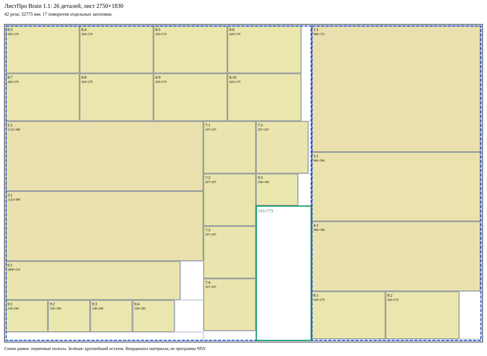

> **Историческая карта, не подтверждённый PSS-план.** Brain 1.2 отклоняет поворот основной части 1754×1830 (`B006`) на шаге 9: роль `PRIMARY_REMAINDER` не даёт права разворота. Геометрия может быть допустима для отдельного `FORMAT_SAW`. Актуальные PSS-карта и проверка: [CONTROL-26-PSS.md](CONTROL-26-PSS.md).

# Brain 1.1 — карта, полосы и все операции

[Полное дерево всех заготовок](../benchmarks/manual-26-brain-1.1-blanks.svg) · [JSON](../benchmarks/manual-26-brain-1.1.json)

Профиль abstract-staged-v-saw-v1: одна машинная ось V, собственное право одного поворота каждого blankId; исходный лист в этом плане не вращается. Геометрия, полосная последовательность и профиль независимо проверены. Применимость условная: реальный станок/БАЗИС/ЧПУ не сертифицирован.

## Первичные полосы

| Лист | Полоса | Blank | X | Ширина | Длина до / после торцовки |
|---:|---:|---|---:|---:|---|
| 1 | 1 | B006 | 10 | 1754 | 1830 / 1810 |
| 1 | 2 | B007 | 1769 | 971 | 1830 / 1810 |

Сначала боковые поля и весь первичный V-распуск. Барьер endPrimary запрещает поперечные операции до завершения первичной серии. Затем каждая полоса отдельно подаётся, поворачивается и торцуется. Дети каждого CUT — новые заготовки с turnCount=0; ориентация материала и машинная ориентация наследуются.

## Метрики

26 деталей; 2 первичные полосы; 33 обрабатываемые подполосы; максимум 5 уровней; 17 поворотов; 42 физических реза; 32775 мм; 102 операции. Включена обрезка 10 мм при керфе 5 мм. Площадь крупнейшего отдельного остатка 243495 мм².

## Нумерованная последовательность

Координаты CUT локальные машинные: V=x const, (x,0)→(x,H). Керф идёт в положительном направлении. Подача feed устанавливает локальный (0,0), сохраняя координаты материала. У rotate координаты реза null. Номера шага, CUT и деталей независимы.

| Шаг | Тип | CUT № | Уровень | Вход | Размер / ориентация | Машинные координаты | Выходы |
|---:|---|---:|---:|---|---|---|---|
| 1 | load | — | 1 | B001 | 2750×1830 / 0° | — |  |
| 2 | cut | 1 | 1 | B001 | 2750×1830 / 0° | V: (5,0)→(5,1830) | B002, B003 |
| 3 | feed | — | 1 | B003 | 2740×1830 / 0° | — |  |
| 4 | cut | 2 | 1 | B003 | 2740×1830 / 0° | V: (2730,0)→(2730,1830) | B004, B005 |
| 5 | feed | — | 1 | B004 | 2730×1830 / 0° | — |  |
| 6 | cut | 3 | 1 | B004 | 2730×1830 / 0° | V: (1754,0)→(1754,1830) | B006, B007 |
| 7 | endPrimary | — | 1 | лист 1 | — / —° | — | B006, B007 |
| 8 | feed | — | 1 | B006 | 1754×1830 / 0° | — |  |
| 9 | rotate | — | 1 | B006 | 1830×1754 / 0→90° | 90°, counter 0→1 | B006 |
| 10 | cut | 4 | 2 | B006 | 1830×1754 / 90° | V: (1820,0)→(1820,1754) | B009, B008 |
| 11 | feed | — | 2 | B009 | 1820×1754 / 90° | — |  |
| 12 | cut | 5 | 2 | B009 | 1820×1754 / 90° | V: (5,0)→(5,1754) | B011, B010 |
| 13 | feed | — | 2 | B010 | 1810×1754 / 90° | — |  |
| 14 | cut | 6 | 2 | B010 | 1810×1754 / 90° | V: (1260,0)→(1260,1754) | B013, B012 |
| 15 | feed | — | 2 | B012 | 545×1754 / 90° | — |  |
| 16 | rotate | — | 2 | B012 | 1754×545 / 90→180° | 90°, counter 0→1 | B012 |
| 17 | cut | 7 | 3 | B012 | 1754×545 / 180° | V: (54,0)→(54,545) | B015, B014 |
| 18 | feed | — | 3 | B014 | 1695×545 / 180° | — |  |
| 19 | rotate | — | 3 | B014 | 545×1695 / 180→270° | 90°, counter 0→1 | B014 |
| 20 | cut | 8 | 4 | B014 | 545×1695 / 270° | V: (270,0)→(270,1695) | B016, B017 |
| 21 | feed | — | 4 | B016 | 270×1695 / 270° | — |  |
| 22 | rotate | — | 4 | B016 | 1695×270 / 270→0° | 90°, counter 0→1 | B016 |
| 23 | cut | 9 | 5 | B016 | 1695×270 / 0° | V: (420,0)→(420,270) | B018, B019 |
| 24 | feed | — | 5 | B019 | 1270×270 / 0° | — |  |
| 25 | cut | 10 | 5 | B019 | 1270×270 / 0° | V: (420,0)→(420,270) | B020, B021 |
| 26 | feed | — | 5 | B021 | 845×270 / 0° | — |  |
| 27 | cut | 11 | 5 | B021 | 845×270 / 0° | V: (420,0)→(420,270) | B022, B023 |
| 28 | feed | — | 4 | B017 | 270×1695 / 270° | — |  |
| 29 | rotate | — | 4 | B017 | 1695×270 / 270→0° | 90°, counter 0→1 | B017 |
| 30 | cut | 12 | 5 | B017 | 1695×270 / 0° | V: (420,0)→(420,270) | B024, B025 |
| 31 | feed | — | 5 | B025 | 1270×270 / 0° | — |  |
| 32 | cut | 13 | 5 | B025 | 1270×270 / 0° | V: (420,0)→(420,270) | B026, B027 |
| 33 | feed | — | 5 | B027 | 845×270 / 0° | — |  |
| 34 | cut | 14 | 5 | B027 | 845×270 / 0° | V: (420,0)→(420,270) | B028, B029 |
| 35 | feed | — | 2 | B013 | 1260×1754 / 90° | — |  |
| 36 | rotate | — | 2 | B013 | 1754×1260 / 90→180° | 90°, counter 0→1 | B013 |
| 37 | cut | 15 | 3 | B013 | 1754×1260 / 180° | V: (617,0)→(617,1260) | B031, B030 |
| 38 | feed | — | 3 | B030 | 1132×1260 / 180° | — |  |
| 39 | rotate | — | 3 | B030 | 1260×1132 / 180→270° | 90°, counter 0→1 | B030 |
| 40 | cut | 16 | 4 | B030 | 1260×1132 / 270° | V: (398,0)→(398,1132) | B032, B033 |
| 41 | feed | — | 4 | B033 | 857×1132 / 270° | — |  |
| 42 | cut | 17 | 4 | B033 | 857×1132 / 270° | V: (398,0)→(398,1132) | B034, B035 |
| 43 | feed | — | 4 | B035 | 454×1132 / 270° | — |  |
| 44 | cut | 18 | 4 | B035 | 454×1132 / 270° | V: (219,0)→(219,1132) | B036, B037 |
| 45 | feed | — | 4 | B036 | 219×1132 / 270° | — |  |
| 46 | rotate | — | 4 | B036 | 1132×219 / 270→0° | 90°, counter 0→1 | B036 |
| 47 | cut | 19 | 5 | B036 | 1132×219 / 0° | V: (1000,0)→(1000,219) | B038, B039 |
| 48 | feed | — | 4 | B037 | 230×1132 / 270° | — |  |
| 49 | cut | 20 | 4 | B037 | 230×1132 / 270° | V: (180,0)→(180,1132) | B040, B041 |
| 50 | feed | — | 4 | B040 | 180×1132 / 270° | — |  |
| 51 | rotate | — | 4 | B040 | 1132×180 / 270→0° | 90°, counter 0→1 | B040 |
| 52 | cut | 21 | 5 | B040 | 1132×180 / 0° | V: (238,0)→(238,180) | B042, B043 |
| 53 | feed | — | 5 | B043 | 889×180 / 0° | — |  |
| 54 | cut | 22 | 5 | B043 | 889×180 / 0° | V: (238,0)→(238,180) | B044, B045 |
| 55 | feed | — | 5 | B045 | 646×180 / 0° | — |  |
| 56 | cut | 23 | 5 | B045 | 646×180 / 0° | V: (238,0)→(238,180) | B046, B047 |
| 57 | feed | — | 5 | B047 | 403×180 / 0° | — |  |
| 58 | cut | 24 | 5 | B047 | 403×180 / 0° | V: (238,0)→(238,180) | B048, B049 |
| 59 | feed | — | 3 | B031 | 617×1260 / 180° | — |  |
| 60 | cut | 25 | 3 | B031 | 617×1260 / 180° | V: (315,0)→(315,1260) | B051, B050 |
| 61 | feed | — | 3 | B050 | 297×1260 / 180° | — |  |
| 62 | rotate | — | 3 | B050 | 1260×297 / 180→270° | 90°, counter 0→1 | B050 |
| 63 | cut | 26 | 4 | B050 | 1260×297 / 270° | V: (297,0)→(297,297) | B052, B053 |
| 64 | feed | — | 4 | B053 | 958×297 / 270° | — |  |
| 65 | cut | 27 | 4 | B053 | 958×297 / 270° | V: (297,0)→(297,297) | B054, B055 |
| 66 | feed | — | 4 | B055 | 656×297 / 270° | — |  |
| 67 | cut | 28 | 4 | B055 | 656×297 / 270° | V: (297,0)→(297,297) | B056, B057 |
| 68 | feed | — | 4 | B057 | 354×297 / 270° | — |  |
| 69 | cut | 29 | 4 | B057 | 354×297 / 270° | V: (297,0)→(297,297) | B058, B059 |
| 70 | feed | — | 3 | B051 | 315×1260 / 180° | — |  |
| 71 | rotate | — | 3 | B051 | 1260×315 / 180→270° | 90°, counter 0→1 | B051 |
| 72 | cut | 30 | 4 | B051 | 1260×315 / 270° | V: (297,0)→(297,315) | B060, B061 |
| 73 | feed | — | 4 | B060 | 297×315 / 270° | — |  |
| 74 | rotate | — | 4 | B060 | 315×297 / 270→0° | 90°, counter 0→1 | B060 |
| 75 | cut | 31 | 5 | B060 | 315×297 / 0° | V: (297,0)→(297,297) | B062, B063 |
| 76 | feed | — | 4 | B061 | 958×315 / 270° | — |  |
| 77 | cut | 32 | 4 | B061 | 958×315 / 270° | V: (180,0)→(180,315) | B064, B065 |
| 78 | feed | — | 4 | B064 | 180×315 / 270° | — |  |
| 79 | rotate | — | 4 | B064 | 315×180 / 270→0° | 90°, counter 0→1 | B064 |
| 80 | cut | 33 | 5 | B064 | 315×180 / 0° | V: (238,0)→(238,180) | B066, B067 |
| 81 | feed | — | 1 | B007 | 971×1830 / 0° | — |  |
| 82 | rotate | — | 1 | B007 | 1830×971 / 0→90° | 90°, counter 0→1 | B007 |
| 83 | cut | 34 | 2 | B007 | 1830×971 / 90° | V: (1820,0)→(1820,971) | B069, B068 |
| 84 | feed | — | 2 | B069 | 1820×971 / 90° | — |  |
| 85 | cut | 35 | 2 | B069 | 1820×971 / 90° | V: (5,0)→(5,971) | B071, B070 |
| 86 | feed | — | 2 | B070 | 1810×971 / 90° | — |  |
| 87 | cut | 36 | 2 | B070 | 1810×971 / 90° | V: (280,0)→(280,971) | B073, B072 |
| 88 | feed | — | 2 | B072 | 1525×971 / 90° | — |  |
| 89 | rotate | — | 2 | B072 | 971×1525 / 90→180° | 90°, counter 0→1 | B072 |
| 90 | cut | 37 | 3 | B072 | 971×1525 / 180° | V: (0,0)→(0,1525) | B075, B074 |
| 91 | feed | — | 3 | B074 | 966×1525 / 180° | — |  |
| 92 | rotate | — | 3 | B074 | 1525×966 / 180→270° | 90°, counter 0→1 | B074 |
| 93 | cut | 38 | 4 | B074 | 1525×966 / 270° | V: (723,0)→(723,966) | B076, B077 |
| 94 | feed | — | 4 | B077 | 797×966 / 270° | — |  |
| 95 | cut | 39 | 4 | B077 | 797×966 / 270° | V: (394,0)→(394,966) | B078, B079 |
| 96 | feed | — | 2 | B073 | 280×971 / 90° | — |  |
| 97 | cut | 40 | 2 | B073 | 280×971 / 90° | V: (5,0)→(5,971) | B081, B080 |
| 98 | feed | — | 2 | B080 | 270×971 / 90° | — |  |
| 99 | rotate | — | 2 | B080 | 971×270 / 90→180° | 90°, counter 0→1 | B080 |
| 100 | cut | 41 | 3 | B080 | 971×270 / 180° | V: (546,0)→(546,270) | B083, B082 |
| 101 | feed | — | 3 | B083 | 546×270 / 180° | — |  |
| 102 | cut | 42 | 3 | B083 | 546×270 / 180° | V: (121,0)→(121,270) | B085, B084 |

## Все физические заготовки и их подполосы

B-номера используются в схеме и таблице операций; полные blankId сохранены ниже. История каждого куска находится также в verification.blanks[].history JSON. Все initialTurnCount равны 0.

| B | Родитель | blankId | Уровень | Материал: X,Y,W,H | Машинная ориентация | turnCount | Шаги истории |
|---|---|---|---:|---|---|---:|---|
| B001 | — | s0/raw | 1 | 0, 0, 2750, 1830 | 0→0° | 0 | 1, 2 |
| B002 | B001 | s0/side0 | 1 | 0, 0, 5, 1830 | 0→0° | 0 | 2 |
| B003 | B001 | s0/side-rem | 1 | 10, 0, 2740, 1830 | 0→0° | 0 | 2, 3, 4 |
| B004 | B003 | s0/body | 1 | 10, 0, 2730, 1830 | 0→0° | 0 | 4, 5, 6 |
| B005 | B003 | s0/side1 | 1 | 2745, 0, 5, 1830 | 0→0° | 0 | 4 |
| B006 | B004 | s0/strip1 | 1 | 10, 0, 1754, 1830 | 0→90° | 1 | 6, 8, 9, 10 |
| B007 | B004 | s0/rip-rem0 | 1 | 1769, 0, 971, 1830 | 0→90° | 1 | 6, 81, 82, 83 |
| B008 | B006 | s0/strip1/top | 2 | 10, 0, 1754, 5 | 90→90° | 0 | 10 |
| B009 | B006 | s0/strip1/after-top | 2 | 10, 10, 1754, 1820 | 90→90° | 0 | 10, 11, 12 |
| B010 | B009 | s0/strip1/work | 2 | 10, 10, 1754, 1810 | 90→90° | 0 | 12, 13, 14 |
| B011 | B009 | s0/strip1/bottom | 2 | 10, 1825, 1754, 5 | 90→90° | 0 | 12 |
| B012 | B010 | s0/strip1/work/0 | 2 | 10, 10, 1754, 545 | 90→180° | 1 | 14, 15, 16, 17 |
| B013 | B010 | s0/strip1/work/1 | 2 | 10, 560, 1754, 1260 | 90→180° | 1 | 14, 35, 36, 37 |
| B014 | B012 | s0/strip1/work/0/0 | 3 | 10, 10, 1695, 545 | 180→270° | 1 | 17, 18, 19, 20 |
| B015 | B012 | s0/strip1/work/0/1 | 3 | 1710, 10, 54, 545 | 180→180° | 0 | 17 |
| B016 | B014 | s0/strip1/work/0/0/0 | 4 | 10, 10, 1695, 270 | 270→0° | 1 | 20, 21, 22, 23 |
| B017 | B014 | s0/strip1/work/0/0/1 | 4 | 10, 285, 1695, 270 | 270→0° | 1 | 20, 28, 29, 30 |
| B018 | B016 | s0/strip1/work/0/0/0/0 | 5 | 10, 10, 420, 270 | 0→0° | 0 | 23 |
| B019 | B016 | s0/strip1/work/0/0/0/1 | 5 | 435, 10, 1270, 270 | 0→0° | 0 | 23, 24, 25 |
| B020 | B019 | s0/strip1/work/0/0/0/1/0 | 5 | 435, 10, 420, 270 | 0→0° | 0 | 25 |
| B021 | B019 | s0/strip1/work/0/0/0/1/1 | 5 | 860, 10, 845, 270 | 0→0° | 0 | 25, 26, 27 |
| B022 | B021 | s0/strip1/work/0/0/0/1/1/0 | 5 | 860, 10, 420, 270 | 0→0° | 0 | 27 |
| B023 | B021 | s0/strip1/work/0/0/0/1/1/1 | 5 | 1285, 10, 420, 270 | 0→0° | 0 | 27 |
| B024 | B017 | s0/strip1/work/0/0/1/0 | 5 | 10, 285, 420, 270 | 0→0° | 0 | 30 |
| B025 | B017 | s0/strip1/work/0/0/1/1 | 5 | 435, 285, 1270, 270 | 0→0° | 0 | 30, 31, 32 |
| B026 | B025 | s0/strip1/work/0/0/1/1/0 | 5 | 435, 285, 420, 270 | 0→0° | 0 | 32 |
| B027 | B025 | s0/strip1/work/0/0/1/1/1 | 5 | 860, 285, 845, 270 | 0→0° | 0 | 32, 33, 34 |
| B028 | B027 | s0/strip1/work/0/0/1/1/1/0 | 5 | 860, 285, 420, 270 | 0→0° | 0 | 34 |
| B029 | B027 | s0/strip1/work/0/0/1/1/1/1 | 5 | 1285, 285, 420, 270 | 0→0° | 0 | 34 |
| B030 | B013 | s0/strip1/work/1/0 | 3 | 10, 560, 1132, 1260 | 180→270° | 1 | 37, 38, 39, 40 |
| B031 | B013 | s0/strip1/work/1/1 | 3 | 1147, 560, 617, 1260 | 180→180° | 0 | 37, 59, 60 |
| B032 | B030 | s0/strip1/work/1/0/0 | 4 | 10, 560, 1132, 398 | 270→270° | 0 | 40 |
| B033 | B030 | s0/strip1/work/1/0/1 | 4 | 10, 963, 1132, 857 | 270→270° | 0 | 40, 41, 42 |
| B034 | B033 | s0/strip1/work/1/0/1/0 | 4 | 10, 963, 1132, 398 | 270→270° | 0 | 42 |
| B035 | B033 | s0/strip1/work/1/0/1/1 | 4 | 10, 1366, 1132, 454 | 270→270° | 0 | 42, 43, 44 |
| B036 | B035 | s0/strip1/work/1/0/1/1/0 | 4 | 10, 1366, 1132, 219 | 270→0° | 1 | 44, 45, 46, 47 |
| B037 | B035 | s0/strip1/work/1/0/1/1/1 | 4 | 10, 1590, 1132, 230 | 270→270° | 0 | 44, 48, 49 |
| B038 | B036 | s0/strip1/work/1/0/1/1/0/0 | 5 | 10, 1366, 1000, 219 | 0→0° | 0 | 47 |
| B039 | B036 | s0/strip1/work/1/0/1/1/0/1 | 5 | 1015, 1366, 127, 219 | 0→0° | 0 | 47 |
| B040 | B037 | s0/strip1/work/1/0/1/1/1/0 | 4 | 10, 1590, 1132, 180 | 270→0° | 1 | 49, 50, 51, 52 |
| B041 | B037 | s0/strip1/work/1/0/1/1/1/1 | 4 | 10, 1775, 1132, 45 | 270→270° | 0 | 49 |
| B042 | B040 | s0/strip1/work/1/0/1/1/1/0/0 | 5 | 10, 1590, 238, 180 | 0→0° | 0 | 52 |
| B043 | B040 | s0/strip1/work/1/0/1/1/1/0/1 | 5 | 253, 1590, 889, 180 | 0→0° | 0 | 52, 53, 54 |
| B044 | B043 | s0/strip1/work/1/0/1/1/1/0/1/0 | 5 | 253, 1590, 238, 180 | 0→0° | 0 | 54 |
| B045 | B043 | s0/strip1/work/1/0/1/1/1/0/1/1 | 5 | 496, 1590, 646, 180 | 0→0° | 0 | 54, 55, 56 |
| B046 | B045 | s0/strip1/work/1/0/1/1/1/0/1/1/0 | 5 | 496, 1590, 238, 180 | 0→0° | 0 | 56 |
| B047 | B045 | s0/strip1/work/1/0/1/1/1/0/1/1/1 | 5 | 739, 1590, 403, 180 | 0→0° | 0 | 56, 57, 58 |
| B048 | B047 | s0/strip1/work/1/0/1/1/1/0/1/1/1/0 | 5 | 739, 1590, 238, 180 | 0→0° | 0 | 58 |
| B049 | B047 | s0/strip1/work/1/0/1/1/1/0/1/1/1/1 | 5 | 982, 1590, 160, 180 | 0→0° | 0 | 58 |
| B050 | B031 | s0/strip1/work/1/1/0 | 3 | 1147, 560, 297, 1260 | 180→270° | 1 | 60, 61, 62, 63 |
| B051 | B031 | s0/strip1/work/1/1/1 | 3 | 1449, 560, 315, 1260 | 180→270° | 1 | 60, 70, 71, 72 |
| B052 | B050 | s0/strip1/work/1/1/0/0 | 4 | 1147, 560, 297, 297 | 270→270° | 0 | 63 |
| B053 | B050 | s0/strip1/work/1/1/0/1 | 4 | 1147, 862, 297, 958 | 270→270° | 0 | 63, 64, 65 |
| B054 | B053 | s0/strip1/work/1/1/0/1/0 | 4 | 1147, 862, 297, 297 | 270→270° | 0 | 65 |
| B055 | B053 | s0/strip1/work/1/1/0/1/1 | 4 | 1147, 1164, 297, 656 | 270→270° | 0 | 65, 66, 67 |
| B056 | B055 | s0/strip1/work/1/1/0/1/1/0 | 4 | 1147, 1164, 297, 297 | 270→270° | 0 | 67 |
| B057 | B055 | s0/strip1/work/1/1/0/1/1/1 | 4 | 1147, 1466, 297, 354 | 270→270° | 0 | 67, 68, 69 |
| B058 | B057 | s0/strip1/work/1/1/0/1/1/1/0 | 4 | 1147, 1466, 297, 297 | 270→270° | 0 | 69 |
| B059 | B057 | s0/strip1/work/1/1/0/1/1/1/1 | 4 | 1147, 1768, 297, 52 | 270→270° | 0 | 69 |
| B060 | B051 | s0/strip1/work/1/1/1/0 | 4 | 1449, 560, 315, 297 | 270→0° | 1 | 72, 73, 74, 75 |
| B061 | B051 | s0/strip1/work/1/1/1/1 | 4 | 1449, 862, 315, 958 | 270→270° | 0 | 72, 76, 77 |
| B062 | B060 | s0/strip1/work/1/1/1/0/0 | 5 | 1449, 560, 297, 297 | 0→0° | 0 | 75 |
| B063 | B060 | s0/strip1/work/1/1/1/0/1 | 5 | 1751, 560, 13, 297 | 0→0° | 0 | 75 |
| B064 | B061 | s0/strip1/work/1/1/1/1/0 | 4 | 1449, 862, 315, 180 | 270→0° | 1 | 77, 78, 79, 80 |
| B065 | B061 | s0/strip1/work/1/1/1/1/1 | 4 | 1449, 1047, 315, 773 | 270→270° | 0 | 77 |
| B066 | B064 | s0/strip1/work/1/1/1/1/0/0 | 5 | 1449, 862, 238, 180 | 0→0° | 0 | 80 |
| B067 | B064 | s0/strip1/work/1/1/1/1/0/1 | 5 | 1692, 862, 72, 180 | 0→0° | 0 | 80 |
| B068 | B007 | s0/rip-rem0/top | 2 | 1769, 0, 971, 5 | 90→90° | 0 | 83 |
| B069 | B007 | s0/rip-rem0/after-top | 2 | 1769, 10, 971, 1820 | 90→90° | 0 | 83, 84, 85 |
| B070 | B069 | s0/rip-rem0/work | 2 | 1769, 10, 971, 1810 | 90→90° | 0 | 85, 86, 87 |
| B071 | B069 | s0/rip-rem0/bottom | 2 | 1769, 1825, 971, 5 | 90→90° | 0 | 85 |
| B072 | B070 | s0/rip-rem0/work/0 | 2 | 1769, 10, 971, 1525 | 90→180° | 1 | 87, 88, 89, 90 |
| B073 | B070 | s0/rip-rem0/work/1 | 2 | 1769, 1540, 971, 280 | 90→90° | 0 | 87, 96, 97 |
| B074 | B072 | s0/rip-rem0/work/0/0 | 3 | 1769, 10, 966, 1525 | 180→270° | 1 | 90, 91, 92, 93 |
| B075 | B072 | s0/rip-rem0/work/0/1 | 3 | 2740, 10, 0, 1525 | 180→180° | 0 | 90 |
| B076 | B074 | s0/rip-rem0/work/0/0/0 | 4 | 1769, 10, 966, 723 | 270→270° | 0 | 93 |
| B077 | B074 | s0/rip-rem0/work/0/0/1 | 4 | 1769, 738, 966, 797 | 270→270° | 0 | 93, 94, 95 |
| B078 | B077 | s0/rip-rem0/work/0/0/1/0 | 4 | 1769, 738, 966, 394 | 270→270° | 0 | 95 |
| B079 | B077 | s0/rip-rem0/work/0/0/1/1 | 4 | 1769, 1137, 966, 398 | 270→270° | 0 | 95 |
| B080 | B073 | s0/rip-rem0/work/1/0 | 2 | 1769, 1540, 971, 270 | 90→180° | 1 | 97, 98, 99, 100 |
| B081 | B073 | s0/rip-rem0/work/1/1 | 2 | 1769, 1815, 971, 5 | 90→90° | 0 | 97 |
| B082 | B080 | s0/rip-rem0/work/1/0/0 | 3 | 1769, 1540, 420, 270 | 180→180° | 0 | 100 |
| B083 | B080 | s0/rip-rem0/work/1/0/1 | 3 | 2194, 1540, 546, 270 | 180→180° | 0 | 100, 101, 102 |
| B084 | B083 | s0/rip-rem0/work/1/0/1/0 | 3 | 2194, 1540, 420, 270 | 180→180° | 0 | 102 |
| B085 | B083 | s0/rip-rem0/work/1/0/1/1 | 3 | 2619, 1540, 121, 270 | 180→180° | 0 | 102 |

## Детали в материале

| Лист | Деталь:экземпляр | X | Y | W | H | Поворот относительно текстуры |
|---:|---|---:|---:|---:|---:|---|
| 1 | 8:3 | 10 | 10 | 420 | 270 | нет |
| 1 | 8:4 | 435 | 10 | 420 | 270 | нет |
| 1 | 8:5 | 860 | 10 | 420 | 270 | нет |
| 1 | 8:6 | 1285 | 10 | 420 | 270 | нет |
| 1 | 8:7 | 10 | 285 | 420 | 270 | нет |
| 1 | 8:8 | 435 | 285 | 420 | 270 | нет |
| 1 | 8:9 | 860 | 285 | 420 | 270 | нет |
| 1 | 8:10 | 1285 | 285 | 420 | 270 | нет |
| 1 | 2:1 | 10 | 560 | 1132 | 398 | нет |
| 1 | 3:1 | 10 | 963 | 1132 | 398 | нет |
| 1 | 6:1 | 10 | 1366 | 1000 | 219 | нет |
| 1 | 9:1 | 10 | 1590 | 238 | 180 | нет |
| 1 | 9:2 | 253 | 1590 | 238 | 180 | нет |
| 1 | 9:3 | 496 | 1590 | 238 | 180 | нет |
| 1 | 9:4 | 739 | 1590 | 238 | 180 | нет |
| 1 | 7:1 | 1147 | 560 | 297 | 297 | нет |
| 1 | 7:2 | 1147 | 862 | 297 | 297 | нет |
| 1 | 7:3 | 1147 | 1164 | 297 | 297 | нет |
| 1 | 7:4 | 1147 | 1466 | 297 | 297 | нет |
| 1 | 7:5 | 1449 | 560 | 297 | 297 | нет |
| 1 | 9:5 | 1449 | 862 | 238 | 180 | нет |
| 1 | 1:1 | 1769 | 10 | 966 | 723 | нет |
| 1 | 5:1 | 1769 | 738 | 966 | 394 | нет |
| 1 | 4:1 | 1769 | 1137 | 966 | 398 | нет |
| 1 | 8:1 | 1769 | 1540 | 420 | 270 | нет |
| 1 | 8:2 | 2194 | 1540 | 420 | 270 | нет |

## Цельные остатки рабочей области

| Лист | X | Y | W | H | Площадь, мм² |
|---:|---:|---:|---:|---:|---:|
| 1 | 1449 | 1047 | 315 | 773 | 243495 |
| 1 | 10 | 1775 | 1132 | 45 | 50940 |
| 1 | 2619 | 1540 | 121 | 270 | 32670 |
| 1 | 1710 | 10 | 54 | 545 | 29430 |
| 1 | 982 | 1590 | 160 | 180 | 28800 |
| 1 | 1015 | 1366 | 127 | 219 | 27813 |
| 1 | 1147 | 1768 | 297 | 52 | 15444 |
| 1 | 1692 | 862 | 72 | 180 | 12960 |
| 1 | 1769 | 1815 | 971 | 5 | 4855 |
| 1 | 1751 | 560 | 13 | 297 | 3861 |
