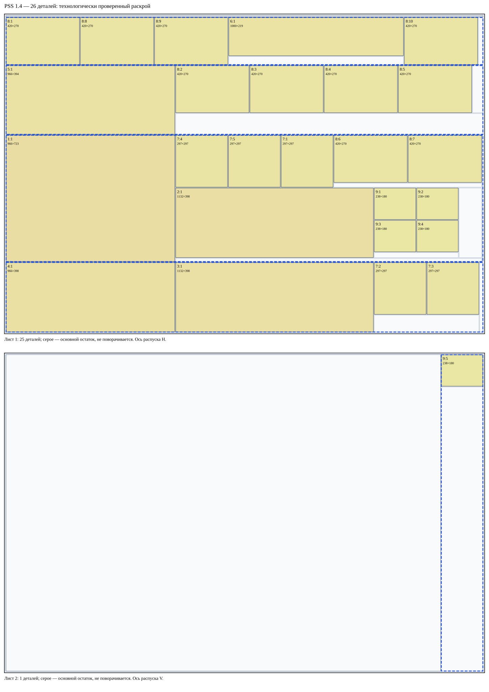
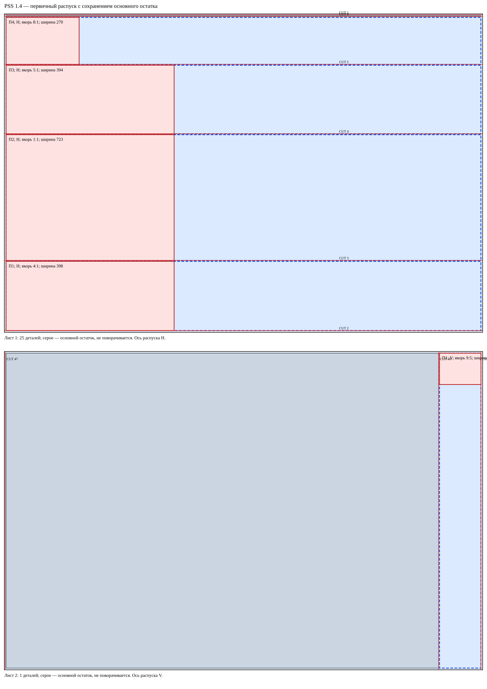
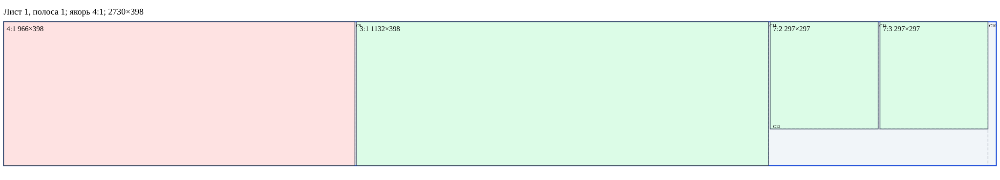
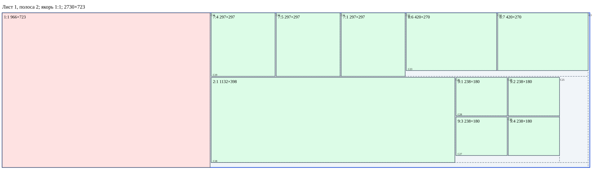
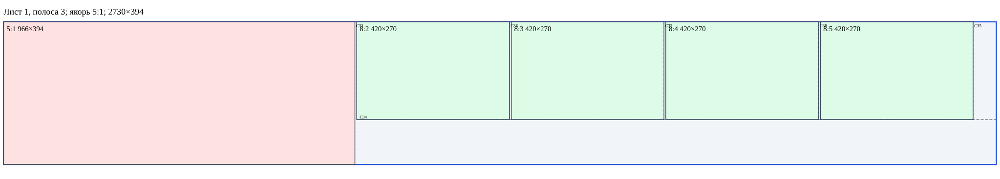
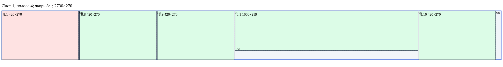

# Brain 1.4 — PANEL_SAW_STAGED (PSS)

**На одном листе допустимый PSS-план не найден.** Все 26 деталей размещены на 2 листах. Это не доказательство минимальности.

[Дерево всех заготовок](../benchmarks/manual-26-pss-1.4-blanks.svg) · [JSON](../benchmarks/manual-26-pss-1.4.json)

Режим PANEL_SAW_STAGED, профиль pss-anchored-single-axis-v1. Геометрия, физическая последовательность и роли/якоря проверены независимо. Профиль абстрактный, применимость к реальному станку и БАЗИС не подтверждена.

Если выбранная ось этого требует, выполняется разрешённый предварительный поворот сырого листа; затем вся серия параллельных резов по основному остатку. Рабочие полосы снимаются с высокой стороны поперечной координаты; низкая часть остаётся PRIMARY_REMAINDER. endPrimary роли не меняет. Ширина каждой рабочей полосы равна одному реальному ведущему экземпляру; припуск 0. После каждого CUT новые дети имеют turnCount=0.

## Первичные полосы и якоря

| Лист | Полоса | Ось материала | Ширина | Якорь | Blank | Конверсия последнего остатка |
|---:|---:|---|---:|---|---|---|
| 1 | 1 | H | 398 | 4:1 | B007 | нет, физически отделена CUT |
| 1 | 2 | H | 723 | 1:1 | B009 | нет, физически отделена CUT |
| 1 | 3 | H | 394 | 5:1 | B011 | нет, физически отделена CUT |
| 1 | 4 | H | 270 | 8:1 | B013 | нет, физически отделена CUT |
| 2 | 1 | V | 238 | 9:5 | B100 | нет, физически отделена CUT |

## Последующий раскрой каждой полосы

Лист 1, полоса 1: реальный якорь 4:1 первым; остальные детали находятся за ним по длине.

Лист 1, полоса 2: реальный якорь 1:1 первым; остальные детали находятся за ним по длине.

Лист 1, полоса 3: реальный якорь 5:1 первым; остальные детали находятся за ним по длине.

Лист 1, полоса 4: реальный якорь 8:1 первым; остальные детали находятся за ним по длине.

Лист 2, полоса 1: реальный якорь 9:5 первым; остальные детали находятся за ним по длине.

## Все операции

Машинные координаты локальные для поданной заготовки, V=x const. Материальные координаты неизменны. Поворот исходного листа, если он нужен, выполняется только до первого реза. CUT №, шаги и номера деталей независимы.

| Шаг | Действие | CUT № | Вход | Роль | Размер / ориентация | Машинный рез | Выходы |
|---:|---|---:|---|---|---|---|---|
| 1 | load | — | B001 | PRIMARY_PANEL | 2750×1830 / 0° | — |  |
| 2 | ROTATE_90 | — | B001 | PRIMARY_PANEL | 1830×2750 / 0→90° | 90°; 0→1 | B001 |
| 3 | CUT | 1 | B001 | PRIMARY_PANEL | 1830×2750 / 90° | V: (1820,0)→(1820,2750) | B003, B002 |
| 4 | feed | — | B003 | PRIMARY_REMAINDER | 1820×2750 / 90° | — |  |
| 5 | CUT | 2 | B003 | PRIMARY_REMAINDER | 1820×2750 / 90° | V: (5,0)→(5,2750) | B005, B004 |
| 6 | feed | — | B004 | PRIMARY_REMAINDER | 1810×2750 / 90° | — |  |
| 7 | CUT | 3 | B004 | PRIMARY_REMAINDER | 1810×2750 / 90° | V: (398,0)→(398,2750) | B007, B006 |
| 8 | feed | — | B006 | PRIMARY_REMAINDER | 1407×2750 / 90° | — |  |
| 9 | CUT | 4 | B006 | PRIMARY_REMAINDER | 1407×2750 / 90° | V: (723,0)→(723,2750) | B009, B008 |
| 10 | feed | — | B008 | PRIMARY_REMAINDER | 679×2750 / 90° | — |  |
| 11 | CUT | 5 | B008 | PRIMARY_REMAINDER | 679×2750 / 90° | V: (394,0)→(394,2750) | B011, B010 |
| 12 | feed | — | B010 | PRIMARY_REMAINDER | 280×2750 / 90° | — |  |
| 13 | CUT | 6 | B010 | PRIMARY_REMAINDER | 280×2750 / 90° | V: (270,0)→(270,2750) | B013, B012 |
| 14 | endPrimary | — | лист 1 | — | — / —° | — | B007, B009, B011, B013 |
| 15 | feed | — | B007 | DETACHED_PRIMARY_STRIP | 398×2750 / 90° | — |  |
| 16 | ROTATE_90 | — | B007 | DETACHED_PRIMARY_STRIP | 2750×398 / 90→180° | 90°; 0→1 | B007 |
| 17 | CUT | 7 | B007 | DETACHED_PRIMARY_STRIP | 2750×398 / 180° | V: (2740,0)→(2740,398) | B015, B014 |
| 18 | feed | — | B015 | SECONDARY_BLANK | 2740×398 / 180° | — |  |
| 19 | CUT | 8 | B015 | SECONDARY_BLANK | 2740×398 / 180° | V: (5,0)→(5,398) | B017, B016 |
| 20 | feed | — | B016 | SECONDARY_BLANK | 2730×398 / 180° | — |  |
| 21 | CUT | 9 | B016 | SECONDARY_BLANK | 2730×398 / 180° | V: (1759,0)→(1759,398) | B019, B018 |
| 22 | feed | — | B019 | SECONDARY_BLANK | 1759×398 / 180° | — |  |
| 23 | CUT | 10 | B019 | SECONDARY_BLANK | 1759×398 / 180° | V: (18,0)→(18,398) | B021, B020 |
| 24 | feed | — | B020 | SECONDARY_BLANK | 1736×398 / 180° | — |  |
| 25 | CUT | 11 | B020 | SECONDARY_BLANK | 1736×398 / 180° | V: (599,0)→(599,398) | B023, B022 |
| 26 | feed | — | B023 | SECONDARY_BLANK | 599×398 / 180° | — |  |
| 27 | ROTATE_90 | — | B023 | SECONDARY_BLANK | 398×599 / 180→270° | 90°; 0→1 | B023 |
| 28 | CUT | 12 | B023 | SECONDARY_BLANK | 398×599 / 270° | V: (297,0)→(297,599) | B024, B025 |
| 29 | feed | — | B024 | SECONDARY_BLANK | 297×599 / 270° | — |  |
| 30 | ROTATE_90 | — | B024 | SECONDARY_BLANK | 599×297 / 270→0° | 90°; 0→1 | B024 |
| 31 | CUT | 13 | B024 | SECONDARY_BLANK | 599×297 / 0° | V: (297,0)→(297,297) | B026, B027 |
| 32 | feed | — | B009 | DETACHED_PRIMARY_STRIP | 723×2750 / 90° | — |  |
| 33 | ROTATE_90 | — | B009 | DETACHED_PRIMARY_STRIP | 2750×723 / 90→180° | 90°; 0→1 | B009 |
| 34 | CUT | 14 | B009 | DETACHED_PRIMARY_STRIP | 2750×723 / 180° | V: (2740,0)→(2740,723) | B029, B028 |
| 35 | feed | — | B029 | SECONDARY_BLANK | 2740×723 / 180° | — |  |
| 36 | CUT | 15 | B029 | SECONDARY_BLANK | 2740×723 / 180° | V: (5,0)→(5,723) | B031, B030 |
| 37 | feed | — | B030 | SECONDARY_BLANK | 2730×723 / 180° | — |  |
| 38 | CUT | 16 | B030 | SECONDARY_BLANK | 2730×723 / 180° | V: (1759,0)→(1759,723) | B033, B032 |
| 39 | feed | — | B033 | SECONDARY_BLANK | 1759×723 / 180° | — |  |
| 40 | CUT | 17 | B033 | SECONDARY_BLANK | 1759×723 / 180° | V: (3,0)→(3,723) | B035, B034 |
| 41 | feed | — | B034 | SECONDARY_BLANK | 1751×723 / 180° | — |  |
| 42 | ROTATE_90 | — | B034 | SECONDARY_BLANK | 723×1751 / 180→270° | 90°; 0→1 | B034 |
| 43 | CUT | 18 | B034 | SECONDARY_BLANK | 723×1751 / 270° | V: (700,0)→(700,1751) | B036, B037 |
| 44 | feed | — | B036 | SECONDARY_BLANK | 700×1751 / 270° | — |  |
| 45 | CUT | 19 | B036 | SECONDARY_BLANK | 700×1751 / 270° | V: (297,0)→(297,1751) | B038, B039 |
| 46 | feed | — | B038 | SECONDARY_BLANK | 297×1751 / 270° | — |  |
| 47 | ROTATE_90 | — | B038 | SECONDARY_BLANK | 1751×297 / 270→0° | 90°; 0→1 | B038 |
| 48 | CUT | 20 | B038 | SECONDARY_BLANK | 1751×297 / 0° | V: (297,0)→(297,297) | B040, B041 |
| 49 | feed | — | B041 | SECONDARY_BLANK | 1449×297 / 0° | — |  |
| 50 | CUT | 21 | B041 | SECONDARY_BLANK | 1449×297 / 0° | V: (297,0)→(297,297) | B042, B043 |
| 51 | feed | — | B043 | SECONDARY_BLANK | 1147×297 / 0° | — |  |
| 52 | CUT | 22 | B043 | SECONDARY_BLANK | 1147×297 / 0° | V: (297,0)→(297,297) | B044, B045 |
| 53 | feed | — | B045 | SECONDARY_BLANK | 845×297 / 0° | — |  |
| 54 | ROTATE_90 | — | B045 | SECONDARY_BLANK | 297×845 / 0→90° | 90°; 0→1 | B045 |
| 55 | CUT | 23 | B045 | SECONDARY_BLANK | 297×845 / 90° | V: (22,0)→(22,845) | B047, B046 |
| 56 | feed | — | B046 | SECONDARY_BLANK | 270×845 / 90° | — |  |
| 57 | ROTATE_90 | — | B046 | SECONDARY_BLANK | 845×270 / 90→180° | 90°; 0→1 | B046 |
| 58 | CUT | 24 | B046 | SECONDARY_BLANK | 845×270 / 180° | V: (420,0)→(420,270) | B049, B048 |
| 59 | feed | — | B039 | SECONDARY_BLANK | 398×1751 / 270° | — |  |
| 60 | ROTATE_90 | — | B039 | SECONDARY_BLANK | 1751×398 / 270→0° | 90°; 0→1 | B039 |
| 61 | CUT | 25 | B039 | SECONDARY_BLANK | 1751×398 / 0° | V: (1618,0)→(1618,398) | B050, B051 |
| 62 | feed | — | B050 | SECONDARY_BLANK | 1618×398 / 0° | — |  |
| 63 | CUT | 26 | B050 | SECONDARY_BLANK | 1618×398 / 0° | V: (1132,0)→(1132,398) | B052, B053 |
| 64 | feed | — | B053 | SECONDARY_BLANK | 481×398 / 0° | — |  |
| 65 | ROTATE_90 | — | B053 | SECONDARY_BLANK | 398×481 / 0→90° | 90°; 0→1 | B053 |
| 66 | CUT | 27 | B053 | SECONDARY_BLANK | 398×481 / 90° | V: (28,0)→(28,481) | B055, B054 |
| 67 | feed | — | B054 | SECONDARY_BLANK | 365×481 / 90° | — |  |
| 68 | CUT | 28 | B054 | SECONDARY_BLANK | 365×481 / 90° | V: (180,0)→(180,481) | B057, B056 |
| 69 | feed | — | B056 | SECONDARY_BLANK | 180×481 / 90° | — |  |
| 70 | ROTATE_90 | — | B056 | SECONDARY_BLANK | 481×180 / 90→180° | 90°; 0→1 | B056 |
| 71 | CUT | 29 | B056 | SECONDARY_BLANK | 481×180 / 180° | V: (238,0)→(238,180) | B059, B058 |
| 72 | feed | — | B057 | SECONDARY_BLANK | 180×481 / 90° | — |  |
| 73 | ROTATE_90 | — | B057 | SECONDARY_BLANK | 481×180 / 90→180° | 90°; 0→1 | B057 |
| 74 | CUT | 30 | B057 | SECONDARY_BLANK | 481×180 / 180° | V: (238,0)→(238,180) | B061, B060 |
| 75 | feed | — | B011 | DETACHED_PRIMARY_STRIP | 394×2750 / 90° | — |  |
| 76 | ROTATE_90 | — | B011 | DETACHED_PRIMARY_STRIP | 2750×394 / 90→180° | 90°; 0→1 | B011 |
| 77 | CUT | 31 | B011 | DETACHED_PRIMARY_STRIP | 2750×394 / 180° | V: (2740,0)→(2740,394) | B063, B062 |
| 78 | feed | — | B063 | SECONDARY_BLANK | 2740×394 / 180° | — |  |
| 79 | CUT | 32 | B063 | SECONDARY_BLANK | 2740×394 / 180° | V: (5,0)→(5,394) | B065, B064 |
| 80 | feed | — | B064 | SECONDARY_BLANK | 2730×394 / 180° | — |  |
| 81 | CUT | 33 | B064 | SECONDARY_BLANK | 2730×394 / 180° | V: (1759,0)→(1759,394) | B067, B066 |
| 82 | feed | — | B067 | SECONDARY_BLANK | 1759×394 / 180° | — |  |
| 83 | ROTATE_90 | — | B067 | SECONDARY_BLANK | 394×1759 / 180→270° | 90°; 0→1 | B067 |
| 84 | CUT | 34 | B067 | SECONDARY_BLANK | 394×1759 / 270° | V: (270,0)→(270,1759) | B068, B069 |
| 85 | feed | — | B068 | SECONDARY_BLANK | 270×1759 / 270° | — |  |
| 86 | ROTATE_90 | — | B068 | SECONDARY_BLANK | 1759×270 / 270→0° | 90°; 0→1 | B068 |
| 87 | CUT | 35 | B068 | SECONDARY_BLANK | 1759×270 / 0° | V: (1695,0)→(1695,270) | B070, B071 |
| 88 | feed | — | B070 | SECONDARY_BLANK | 1695×270 / 0° | — |  |
| 89 | CUT | 36 | B070 | SECONDARY_BLANK | 1695×270 / 0° | V: (420,0)→(420,270) | B072, B073 |
| 90 | feed | — | B073 | SECONDARY_BLANK | 1270×270 / 0° | — |  |
| 91 | CUT | 37 | B073 | SECONDARY_BLANK | 1270×270 / 0° | V: (420,0)→(420,270) | B074, B075 |
| 92 | feed | — | B075 | SECONDARY_BLANK | 845×270 / 0° | — |  |
| 93 | CUT | 38 | B075 | SECONDARY_BLANK | 845×270 / 0° | V: (420,0)→(420,270) | B076, B077 |
| 94 | feed | — | B013 | DETACHED_PRIMARY_STRIP | 270×2750 / 90° | — |  |
| 95 | ROTATE_90 | — | B013 | DETACHED_PRIMARY_STRIP | 2750×270 / 90→180° | 90°; 0→1 | B013 |
| 96 | CUT | 39 | B013 | DETACHED_PRIMARY_STRIP | 2750×270 / 180° | V: (2740,0)→(2740,270) | B079, B078 |
| 97 | feed | — | B079 | SECONDARY_BLANK | 2740×270 / 180° | — |  |
| 98 | CUT | 40 | B079 | SECONDARY_BLANK | 2740×270 / 180° | V: (5,0)→(5,270) | B081, B080 |
| 99 | feed | — | B080 | SECONDARY_BLANK | 2730×270 / 180° | — |  |
| 100 | CUT | 41 | B080 | SECONDARY_BLANK | 2730×270 / 180° | V: (2305,0)→(2305,270) | B083, B082 |
| 101 | feed | — | B083 | SECONDARY_BLANK | 2305×270 / 180° | — |  |
| 102 | CUT | 42 | B083 | SECONDARY_BLANK | 2305×270 / 180° | V: (25,0)→(25,270) | B085, B084 |
| 103 | feed | — | B084 | SECONDARY_BLANK | 2275×270 / 180° | — |  |
| 104 | CUT | 43 | B084 | SECONDARY_BLANK | 2275×270 / 180° | V: (1850,0)→(1850,270) | B087, B086 |
| 105 | feed | — | B087 | SECONDARY_BLANK | 1850×270 / 180° | — |  |
| 106 | CUT | 44 | B087 | SECONDARY_BLANK | 1850×270 / 180° | V: (1425,0)→(1425,270) | B089, B088 |
| 107 | feed | — | B089 | SECONDARY_BLANK | 1425×270 / 180° | — |  |
| 108 | CUT | 45 | B089 | SECONDARY_BLANK | 1425×270 / 180° | V: (420,0)→(420,270) | B091, B090 |
| 109 | feed | — | B090 | SECONDARY_BLANK | 1000×270 / 180° | — |  |
| 110 | ROTATE_90 | — | B090 | SECONDARY_BLANK | 270×1000 / 180→270° | 90°; 0→1 | B090 |
| 111 | CUT | 46 | B090 | SECONDARY_BLANK | 270×1000 / 270° | V: (219,0)→(219,1000) | B092, B093 |
| 112 | load | — | B094 | PRIMARY_PANEL | 2750×1830 / 0° | — |  |
| 113 | CUT | 47 | B094 | PRIMARY_PANEL | 2750×1830 / 0° | V: (5,0)→(5,1830) | B095, B096 |
| 114 | feed | — | B096 | PRIMARY_REMAINDER | 2740×1830 / 0° | — |  |
| 115 | CUT | 48 | B096 | PRIMARY_REMAINDER | 2740×1830 / 0° | V: (2730,0)→(2730,1830) | B097, B098 |
| 116 | feed | — | B097 | PRIMARY_REMAINDER | 2730×1830 / 0° | — |  |
| 117 | CUT | 49 | B097 | PRIMARY_REMAINDER | 2730×1830 / 0° | V: (2487,0)→(2487,1830) | B099, B100 |
| 118 | endPrimary | — | лист 2 | — | — / —° | — | B100 |
| 119 | feed | — | B100 | DETACHED_PRIMARY_STRIP | 238×1830 / 0° | — |  |
| 120 | ROTATE_90 | — | B100 | DETACHED_PRIMARY_STRIP | 1830×238 / 0→90° | 90°; 0→1 | B100 |
| 121 | CUT | 50 | B100 | DETACHED_PRIMARY_STRIP | 1830×238 / 90° | V: (1820,0)→(1820,238) | B102, B101 |
| 122 | feed | — | B102 | SECONDARY_BLANK | 1820×238 / 90° | — |  |
| 123 | CUT | 51 | B102 | SECONDARY_BLANK | 1820×238 / 90° | V: (5,0)→(5,238) | B104, B103 |
| 124 | feed | — | B103 | SECONDARY_BLANK | 1810×238 / 90° | — |  |
| 125 | CUT | 52 | B103 | SECONDARY_BLANK | 1810×238 / 90° | V: (1625,0)→(1625,238) | B106, B105 |

## Роли и родословная всех заготовок

| B | Родитель | blankId | Материал X,Y,W,H | Роль при создании → итог | Машинная ориентация | turnCount |
|---|---|---|---|---|---|---:|
| B001 | — | s0/raw | 0, 0, 2750, 1830 | PRIMARY_PANEL → PRIMARY_PANEL | 0→90° | 1 |
| B002 | B001 | s0/side-low | 0, 0, 2750, 5 | WASTE → WASTE | 90→90° | 0 |
| B003 | B001 | s0/main0 | 0, 10, 2750, 1820 | PRIMARY_REMAINDER → PRIMARY_REMAINDER | 90→90° | 0 |
| B004 | B003 | s0/main1 | 0, 10, 2750, 1810 | PRIMARY_REMAINDER → PRIMARY_REMAINDER | 90→90° | 0 |
| B005 | B003 | s0/side-high | 0, 1825, 2750, 5 | WASTE → WASTE | 90→90° | 0 |
| B006 | B004 | s0/remainder0 | 0, 10, 2750, 1407 | PRIMARY_REMAINDER → PRIMARY_REMAINDER | 90→90° | 0 |
| B007 | B004 | s0/strip1 | 0, 1422, 2750, 398 | DETACHED_PRIMARY_STRIP → DETACHED_PRIMARY_STRIP | 90→180° | 1 |
| B008 | B006 | s0/remainder1 | 0, 10, 2750, 679 | PRIMARY_REMAINDER → PRIMARY_REMAINDER | 90→90° | 0 |
| B009 | B006 | s0/strip2 | 0, 694, 2750, 723 | DETACHED_PRIMARY_STRIP → DETACHED_PRIMARY_STRIP | 90→180° | 1 |
| B010 | B008 | s0/remainder2 | 0, 10, 2750, 280 | PRIMARY_REMAINDER → PRIMARY_REMAINDER | 90→90° | 0 |
| B011 | B008 | s0/strip3 | 0, 295, 2750, 394 | DETACHED_PRIMARY_STRIP → DETACHED_PRIMARY_STRIP | 90→180° | 1 |
| B012 | B010 | s0/remainder3 | 0, 10, 2750, 5 | PRIMARY_REMAINDER → PRIMARY_REMAINDER | 90→90° | 0 |
| B013 | B010 | s0/strip4 | 0, 20, 2750, 270 | DETACHED_PRIMARY_STRIP → DETACHED_PRIMARY_STRIP | 90→180° | 1 |
| B014 | B007 | s0/strip1/end-low | 0, 1422, 5, 398 | SECONDARY_BLANK → SECONDARY_BLANK | 180→180° | 0 |
| B015 | B007 | s0/strip1/after-low | 10, 1422, 2740, 398 | SECONDARY_BLANK → SECONDARY_BLANK | 180→180° | 0 |
| B016 | B015 | s0/strip1/work | 10, 1422, 2730, 398 | SECONDARY_BLANK → SECONDARY_BLANK | 180→180° | 0 |
| B017 | B015 | s0/strip1/end-high | 2745, 1422, 5, 398 | SECONDARY_BLANK → SECONDARY_BLANK | 180→180° | 0 |
| B018 | B016 | s0/strip1/work/0 | 10, 1422, 966, 398 | SECONDARY_BLANK → SECONDARY_BLANK | 180→180° | 0 |
| B019 | B016 | s0/strip1/work/1 | 981, 1422, 1759, 398 | SECONDARY_BLANK → SECONDARY_BLANK | 180→180° | 0 |
| B020 | B019 | s0/strip1/work/1/0 | 981, 1422, 1736, 398 | SECONDARY_BLANK → SECONDARY_BLANK | 180→180° | 0 |
| B021 | B019 | s0/strip1/work/1/1 | 2722, 1422, 18, 398 | SECONDARY_BLANK → SECONDARY_BLANK | 180→180° | 0 |
| B022 | B020 | s0/strip1/work/1/0/0 | 981, 1422, 1132, 398 | SECONDARY_BLANK → SECONDARY_BLANK | 180→180° | 0 |
| B023 | B020 | s0/strip1/work/1/0/1 | 2118, 1422, 599, 398 | SECONDARY_BLANK → SECONDARY_BLANK | 180→270° | 1 |
| B024 | B023 | s0/strip1/work/1/0/1/0 | 2118, 1422, 599, 297 | SECONDARY_BLANK → SECONDARY_BLANK | 270→0° | 1 |
| B025 | B023 | s0/strip1/work/1/0/1/1 | 2118, 1724, 599, 96 | SECONDARY_BLANK → SECONDARY_BLANK | 270→270° | 0 |
| B026 | B024 | s0/strip1/work/1/0/1/0/0 | 2118, 1422, 297, 297 | SECONDARY_BLANK → SECONDARY_BLANK | 0→0° | 0 |
| B027 | B024 | s0/strip1/work/1/0/1/0/1 | 2420, 1422, 297, 297 | SECONDARY_BLANK → SECONDARY_BLANK | 0→0° | 0 |
| B028 | B009 | s0/strip2/end-low | 0, 694, 5, 723 | SECONDARY_BLANK → SECONDARY_BLANK | 180→180° | 0 |
| B029 | B009 | s0/strip2/after-low | 10, 694, 2740, 723 | SECONDARY_BLANK → SECONDARY_BLANK | 180→180° | 0 |
| B030 | B029 | s0/strip2/work | 10, 694, 2730, 723 | SECONDARY_BLANK → SECONDARY_BLANK | 180→180° | 0 |
| B031 | B029 | s0/strip2/end-high | 2745, 694, 5, 723 | SECONDARY_BLANK → SECONDARY_BLANK | 180→180° | 0 |
| B032 | B030 | s0/strip2/work/0 | 10, 694, 966, 723 | SECONDARY_BLANK → SECONDARY_BLANK | 180→180° | 0 |
| B033 | B030 | s0/strip2/work/1 | 981, 694, 1759, 723 | SECONDARY_BLANK → SECONDARY_BLANK | 180→180° | 0 |
| B034 | B033 | s0/strip2/work/1/0 | 981, 694, 1751, 723 | SECONDARY_BLANK → SECONDARY_BLANK | 180→270° | 1 |
| B035 | B033 | s0/strip2/work/1/1 | 2737, 694, 3, 723 | SECONDARY_BLANK → SECONDARY_BLANK | 180→180° | 0 |
| B036 | B034 | s0/strip2/work/1/0/0 | 981, 694, 1751, 700 | SECONDARY_BLANK → SECONDARY_BLANK | 270→270° | 0 |
| B037 | B034 | s0/strip2/work/1/0/1 | 981, 1399, 1751, 18 | SECONDARY_BLANK → SECONDARY_BLANK | 270→270° | 0 |
| B038 | B036 | s0/strip2/work/1/0/0/0 | 981, 694, 1751, 297 | SECONDARY_BLANK → SECONDARY_BLANK | 270→0° | 1 |
| B039 | B036 | s0/strip2/work/1/0/0/1 | 981, 996, 1751, 398 | SECONDARY_BLANK → SECONDARY_BLANK | 270→0° | 1 |
| B040 | B038 | s0/strip2/work/1/0/0/0/0 | 981, 694, 297, 297 | SECONDARY_BLANK → SECONDARY_BLANK | 0→0° | 0 |
| B041 | B038 | s0/strip2/work/1/0/0/0/1 | 1283, 694, 1449, 297 | SECONDARY_BLANK → SECONDARY_BLANK | 0→0° | 0 |
| B042 | B041 | s0/strip2/work/1/0/0/0/1/0 | 1283, 694, 297, 297 | SECONDARY_BLANK → SECONDARY_BLANK | 0→0° | 0 |
| B043 | B041 | s0/strip2/work/1/0/0/0/1/1 | 1585, 694, 1147, 297 | SECONDARY_BLANK → SECONDARY_BLANK | 0→0° | 0 |
| B044 | B043 | s0/strip2/work/1/0/0/0/1/1/0 | 1585, 694, 297, 297 | SECONDARY_BLANK → SECONDARY_BLANK | 0→0° | 0 |
| B045 | B043 | s0/strip2/work/1/0/0/0/1/1/1 | 1887, 694, 845, 297 | SECONDARY_BLANK → SECONDARY_BLANK | 0→90° | 1 |
| B046 | B045 | s0/strip2/work/1/0/0/0/1/1/1/0 | 1887, 694, 845, 270 | SECONDARY_BLANK → SECONDARY_BLANK | 90→180° | 1 |
| B047 | B045 | s0/strip2/work/1/0/0/0/1/1/1/1 | 1887, 969, 845, 22 | SECONDARY_BLANK → SECONDARY_BLANK | 90→90° | 0 |
| B048 | B046 | s0/strip2/work/1/0/0/0/1/1/1/0/0 | 1887, 694, 420, 270 | SECONDARY_BLANK → SECONDARY_BLANK | 180→180° | 0 |
| B049 | B046 | s0/strip2/work/1/0/0/0/1/1/1/0/1 | 2312, 694, 420, 270 | SECONDARY_BLANK → SECONDARY_BLANK | 180→180° | 0 |
| B050 | B039 | s0/strip2/work/1/0/0/1/0 | 981, 996, 1618, 398 | SECONDARY_BLANK → SECONDARY_BLANK | 0→0° | 0 |
| B051 | B039 | s0/strip2/work/1/0/0/1/1 | 2604, 996, 128, 398 | SECONDARY_BLANK → SECONDARY_BLANK | 0→0° | 0 |
| B052 | B050 | s0/strip2/work/1/0/0/1/0/0 | 981, 996, 1132, 398 | SECONDARY_BLANK → SECONDARY_BLANK | 0→0° | 0 |
| B053 | B050 | s0/strip2/work/1/0/0/1/0/1 | 2118, 996, 481, 398 | SECONDARY_BLANK → SECONDARY_BLANK | 0→90° | 1 |
| B054 | B053 | s0/strip2/work/1/0/0/1/0/1/0 | 2118, 996, 481, 365 | SECONDARY_BLANK → SECONDARY_BLANK | 90→90° | 0 |
| B055 | B053 | s0/strip2/work/1/0/0/1/0/1/1 | 2118, 1366, 481, 28 | SECONDARY_BLANK → SECONDARY_BLANK | 90→90° | 0 |
| B056 | B054 | s0/strip2/work/1/0/0/1/0/1/0/0 | 2118, 996, 481, 180 | SECONDARY_BLANK → SECONDARY_BLANK | 90→180° | 1 |
| B057 | B054 | s0/strip2/work/1/0/0/1/0/1/0/1 | 2118, 1181, 481, 180 | SECONDARY_BLANK → SECONDARY_BLANK | 90→180° | 1 |
| B058 | B056 | s0/strip2/work/1/0/0/1/0/1/0/0/0 | 2118, 996, 238, 180 | SECONDARY_BLANK → SECONDARY_BLANK | 180→180° | 0 |
| B059 | B056 | s0/strip2/work/1/0/0/1/0/1/0/0/1 | 2361, 996, 238, 180 | SECONDARY_BLANK → SECONDARY_BLANK | 180→180° | 0 |
| B060 | B057 | s0/strip2/work/1/0/0/1/0/1/0/1/0 | 2118, 1181, 238, 180 | SECONDARY_BLANK → SECONDARY_BLANK | 180→180° | 0 |
| B061 | B057 | s0/strip2/work/1/0/0/1/0/1/0/1/1 | 2361, 1181, 238, 180 | SECONDARY_BLANK → SECONDARY_BLANK | 180→180° | 0 |
| B062 | B011 | s0/strip3/end-low | 0, 295, 5, 394 | SECONDARY_BLANK → SECONDARY_BLANK | 180→180° | 0 |
| B063 | B011 | s0/strip3/after-low | 10, 295, 2740, 394 | SECONDARY_BLANK → SECONDARY_BLANK | 180→180° | 0 |
| B064 | B063 | s0/strip3/work | 10, 295, 2730, 394 | SECONDARY_BLANK → SECONDARY_BLANK | 180→180° | 0 |
| B065 | B063 | s0/strip3/end-high | 2745, 295, 5, 394 | SECONDARY_BLANK → SECONDARY_BLANK | 180→180° | 0 |
| B066 | B064 | s0/strip3/work/0 | 10, 295, 966, 394 | SECONDARY_BLANK → SECONDARY_BLANK | 180→180° | 0 |
| B067 | B064 | s0/strip3/work/1 | 981, 295, 1759, 394 | SECONDARY_BLANK → SECONDARY_BLANK | 180→270° | 1 |
| B068 | B067 | s0/strip3/work/1/0 | 981, 295, 1759, 270 | SECONDARY_BLANK → SECONDARY_BLANK | 270→0° | 1 |
| B069 | B067 | s0/strip3/work/1/1 | 981, 570, 1759, 119 | SECONDARY_BLANK → SECONDARY_BLANK | 270→270° | 0 |
| B070 | B068 | s0/strip3/work/1/0/0 | 981, 295, 1695, 270 | SECONDARY_BLANK → SECONDARY_BLANK | 0→0° | 0 |
| B071 | B068 | s0/strip3/work/1/0/1 | 2681, 295, 59, 270 | SECONDARY_BLANK → SECONDARY_BLANK | 0→0° | 0 |
| B072 | B070 | s0/strip3/work/1/0/0/0 | 981, 295, 420, 270 | SECONDARY_BLANK → SECONDARY_BLANK | 0→0° | 0 |
| B073 | B070 | s0/strip3/work/1/0/0/1 | 1406, 295, 1270, 270 | SECONDARY_BLANK → SECONDARY_BLANK | 0→0° | 0 |
| B074 | B073 | s0/strip3/work/1/0/0/1/0 | 1406, 295, 420, 270 | SECONDARY_BLANK → SECONDARY_BLANK | 0→0° | 0 |
| B075 | B073 | s0/strip3/work/1/0/0/1/1 | 1831, 295, 845, 270 | SECONDARY_BLANK → SECONDARY_BLANK | 0→0° | 0 |
| B076 | B075 | s0/strip3/work/1/0/0/1/1/0 | 1831, 295, 420, 270 | SECONDARY_BLANK → SECONDARY_BLANK | 0→0° | 0 |
| B077 | B075 | s0/strip3/work/1/0/0/1/1/1 | 2256, 295, 420, 270 | SECONDARY_BLANK → SECONDARY_BLANK | 0→0° | 0 |
| B078 | B013 | s0/strip4/end-low | 0, 20, 5, 270 | SECONDARY_BLANK → SECONDARY_BLANK | 180→180° | 0 |
| B079 | B013 | s0/strip4/after-low | 10, 20, 2740, 270 | SECONDARY_BLANK → SECONDARY_BLANK | 180→180° | 0 |
| B080 | B079 | s0/strip4/work | 10, 20, 2730, 270 | SECONDARY_BLANK → SECONDARY_BLANK | 180→180° | 0 |
| B081 | B079 | s0/strip4/end-high | 2745, 20, 5, 270 | SECONDARY_BLANK → SECONDARY_BLANK | 180→180° | 0 |
| B082 | B080 | s0/strip4/work/0 | 10, 20, 420, 270 | SECONDARY_BLANK → SECONDARY_BLANK | 180→180° | 0 |
| B083 | B080 | s0/strip4/work/1 | 435, 20, 2305, 270 | SECONDARY_BLANK → SECONDARY_BLANK | 180→180° | 0 |
| B084 | B083 | s0/strip4/work/1/0 | 435, 20, 2275, 270 | SECONDARY_BLANK → SECONDARY_BLANK | 180→180° | 0 |
| B085 | B083 | s0/strip4/work/1/1 | 2715, 20, 25, 270 | SECONDARY_BLANK → SECONDARY_BLANK | 180→180° | 0 |
| B086 | B084 | s0/strip4/work/1/0/0 | 435, 20, 420, 270 | SECONDARY_BLANK → SECONDARY_BLANK | 180→180° | 0 |
| B087 | B084 | s0/strip4/work/1/0/1 | 860, 20, 1850, 270 | SECONDARY_BLANK → SECONDARY_BLANK | 180→180° | 0 |
| B088 | B087 | s0/strip4/work/1/0/1/0 | 860, 20, 420, 270 | SECONDARY_BLANK → SECONDARY_BLANK | 180→180° | 0 |
| B089 | B087 | s0/strip4/work/1/0/1/1 | 1285, 20, 1425, 270 | SECONDARY_BLANK → SECONDARY_BLANK | 180→180° | 0 |
| B090 | B089 | s0/strip4/work/1/0/1/1/0 | 1285, 20, 1000, 270 | SECONDARY_BLANK → SECONDARY_BLANK | 180→270° | 1 |
| B091 | B089 | s0/strip4/work/1/0/1/1/1 | 2290, 20, 420, 270 | SECONDARY_BLANK → SECONDARY_BLANK | 180→180° | 0 |
| B092 | B090 | s0/strip4/work/1/0/1/1/0/0 | 1285, 20, 1000, 219 | SECONDARY_BLANK → SECONDARY_BLANK | 270→270° | 0 |
| B093 | B090 | s0/strip4/work/1/0/1/1/0/1 | 1285, 244, 1000, 46 | SECONDARY_BLANK → SECONDARY_BLANK | 270→270° | 0 |
| B094 | — | s1/raw | 0, 0, 2750, 1830 | PRIMARY_PANEL → PRIMARY_PANEL | 0→0° | 0 |
| B095 | B094 | s1/side-low | 0, 0, 5, 1830 | WASTE → WASTE | 0→0° | 0 |
| B096 | B094 | s1/main0 | 10, 0, 2740, 1830 | PRIMARY_REMAINDER → PRIMARY_REMAINDER | 0→0° | 0 |
| B097 | B096 | s1/main1 | 10, 0, 2730, 1830 | PRIMARY_REMAINDER → PRIMARY_REMAINDER | 0→0° | 0 |
| B098 | B096 | s1/side-high | 2745, 0, 5, 1830 | WASTE → WASTE | 0→0° | 0 |
| B099 | B097 | s1/remainder0 | 10, 0, 2487, 1830 | PRIMARY_REMAINDER → PRIMARY_REMAINDER | 0→0° | 0 |
| B100 | B097 | s1/strip1 | 2502, 0, 238, 1830 | DETACHED_PRIMARY_STRIP → DETACHED_PRIMARY_STRIP | 0→90° | 1 |
| B101 | B100 | s1/strip1/end-low | 2502, 0, 238, 5 | SECONDARY_BLANK → SECONDARY_BLANK | 90→90° | 0 |
| B102 | B100 | s1/strip1/after-low | 2502, 10, 238, 1820 | SECONDARY_BLANK → SECONDARY_BLANK | 90→90° | 0 |
| B103 | B102 | s1/strip1/work | 2502, 10, 238, 1810 | SECONDARY_BLANK → SECONDARY_BLANK | 90→90° | 0 |
| B104 | B102 | s1/strip1/end-high | 2502, 1825, 238, 5 | SECONDARY_BLANK → SECONDARY_BLANK | 90→90° | 0 |
| B105 | B103 | s1/strip1/work/0 | 2502, 10, 238, 180 | SECONDARY_BLANK → SECONDARY_BLANK | 90→90° | 0 |
| B106 | B103 | s1/strip1/work/1 | 2502, 195, 238, 1625 | SECONDARY_BLANK → SECONDARY_BLANK | 90→90° | 0 |

## Метрики

52 рез, 43019 мм, 19 поворотов (включая предварительные повороты листов), 125 операций. Включены реальные обрезки кромок; необработанный основной остаток не торцуется и не разворачивается. Полные размеры деталей, отдельные отходы, профили и replay находятся в JSON.
