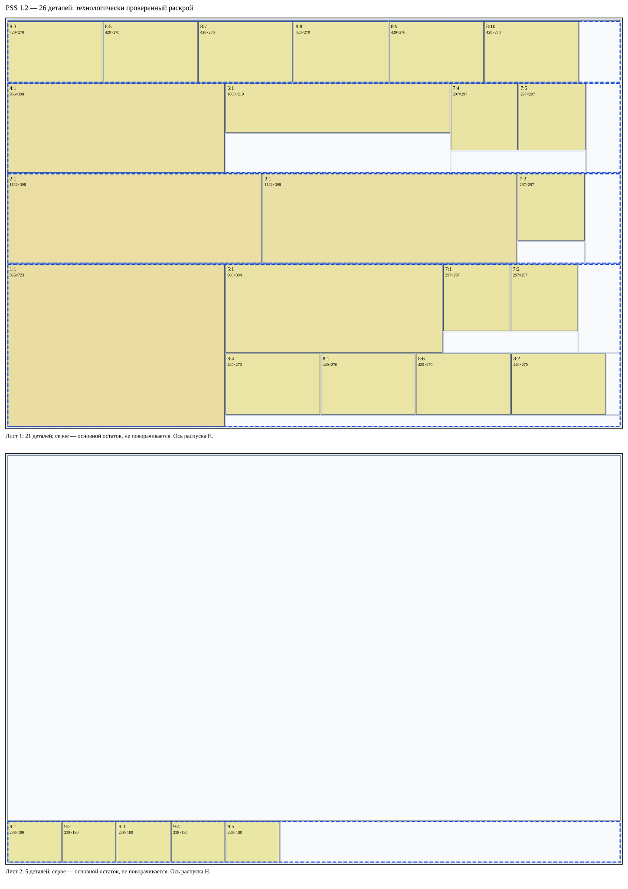
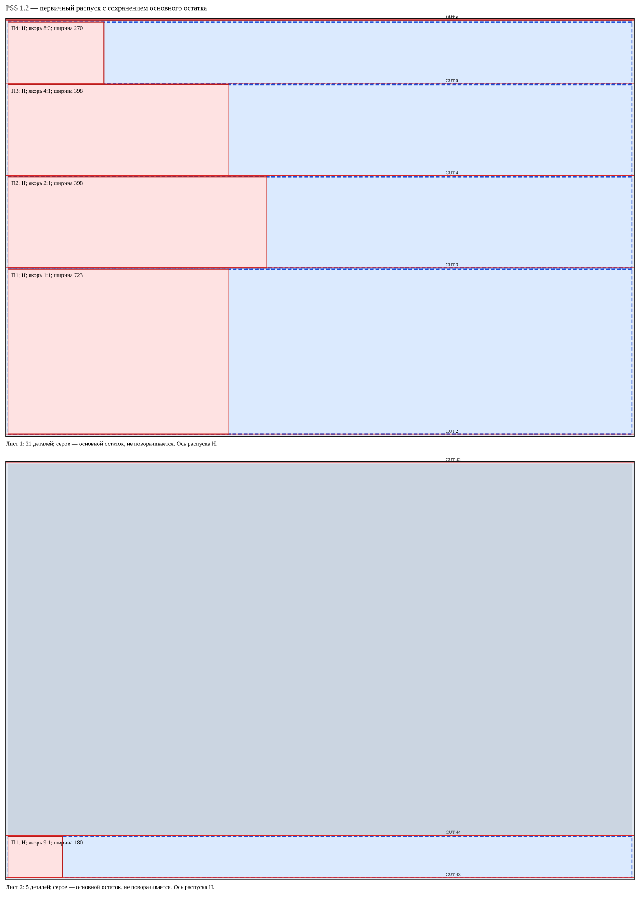
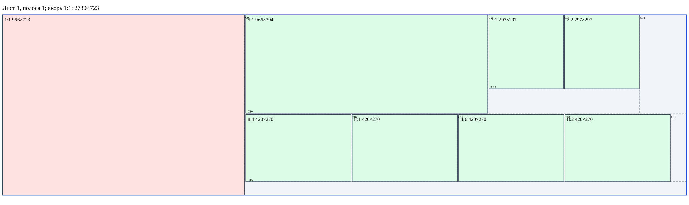
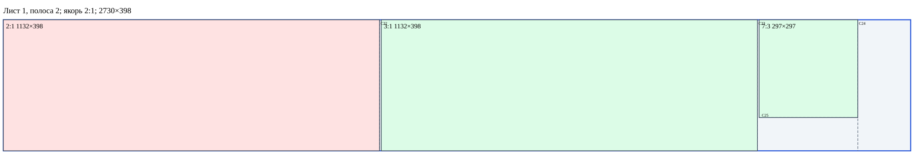
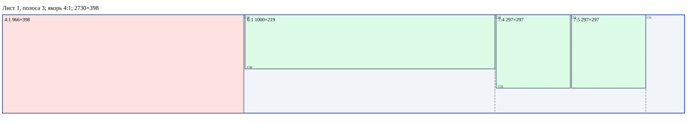
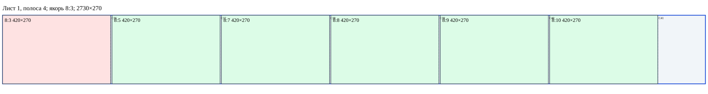
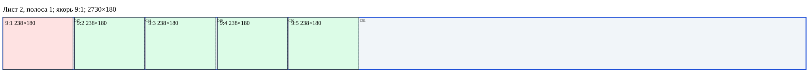

# Brain 1.2 — PANEL_SAW_STAGED (PSS)

**На одном листе допустимый PSS-план в этом поиске не найден.** Все 26 деталей размещены на 2 листах. Это не доказательство минимальности.

[Дерево всех заготовок](../benchmarks/manual-26-pss-blanks.svg) · [JSON](../benchmarks/manual-26-pss.json)

Режим PANEL_SAW_STAGED, профиль pss-anchored-single-axis-v1. Геометрия, физическая последовательность и роли/якоря проверены независимо. Профиль абстрактный, применимость к реальному станку и БАЗИС не подтверждена.

Сначала выполняется разрешённый предварительный поворот сырого листа, затем вся серия параллельных резов по основному остатку. Рабочие полосы снимаются с высокой стороны поперечной координаты; низкая часть остаётся PRIMARY_REMAINDER. endPrimary роли не меняет. Ширина каждой рабочей полосы равна одному реальному ведущему экземпляру; припуск 0. После каждого CUT новые дети имеют turnCount=0.

## Первичные полосы и якоря

| Лист | Полоса | Ось материала | Ширина | Якорь | Blank | Конверсия последнего остатка |
|---:|---:|---|---:|---|---|---|
| 1 | 1 | H | 723 | 1:1 | B007 | нет, физически отделена CUT |
| 1 | 2 | H | 398 | 2:1 | B009 | нет, физически отделена CUT |
| 1 | 3 | H | 398 | 4:1 | B011 | нет, физически отделена CUT |
| 1 | 4 | H | 270 | 8:3 | B013 | нет, физически отделена CUT |
| 2 | 1 | H | 180 | 9:1 | B090 | нет, физически отделена CUT |

## Последующий раскрой каждой полосы

Лист 1, полоса 1: реальный якорь 1:1 первым; остальные детали находятся за ним по длине.

Лист 1, полоса 2: реальный якорь 2:1 первым; остальные детали находятся за ним по длине.

Лист 1, полоса 3: реальный якорь 4:1 первым; остальные детали находятся за ним по длине.

Лист 1, полоса 4: реальный якорь 8:3 первым; остальные детали находятся за ним по длине.

Лист 2, полоса 1: реальный якорь 9:1 первым; остальные детали находятся за ним по длине.

## Все операции

Машинные координаты локальные для поданной заготовки, V=x const. Материальные координаты неизменны. Исходные листы повёрнуты только до первого реза. CUT №, шаги и номера деталей независимы.

| Шаг | Действие | CUT № | Вход | Роль | Размер / ориентация | Машинный рез | Выходы |
|---:|---|---:|---|---|---|---|---|
| 1 | load | — | B001 | PRIMARY_PANEL | 2750×1830 / 0° | — |  |
| 2 | ROTATE_90 | — | B001 | PRIMARY_PANEL | 1830×2750 / 0→90° | 90°; 0→1 | B001 |
| 3 | CUT | 1 | B001 | PRIMARY_PANEL | 1830×2750 / 90° | V: (1820,0)→(1820,2750) | B003, B002 |
| 4 | feed | — | B003 | PRIMARY_REMAINDER | 1820×2750 / 90° | — |  |
| 5 | CUT | 2 | B003 | PRIMARY_REMAINDER | 1820×2750 / 90° | V: (5,0)→(5,2750) | B005, B004 |
| 6 | feed | — | B004 | PRIMARY_REMAINDER | 1810×2750 / 90° | — |  |
| 7 | CUT | 3 | B004 | PRIMARY_REMAINDER | 1810×2750 / 90° | V: (723,0)→(723,2750) | B007, B006 |
| 8 | feed | — | B006 | PRIMARY_REMAINDER | 1082×2750 / 90° | — |  |
| 9 | CUT | 4 | B006 | PRIMARY_REMAINDER | 1082×2750 / 90° | V: (398,0)→(398,2750) | B009, B008 |
| 10 | feed | — | B008 | PRIMARY_REMAINDER | 679×2750 / 90° | — |  |
| 11 | CUT | 5 | B008 | PRIMARY_REMAINDER | 679×2750 / 90° | V: (398,0)→(398,2750) | B011, B010 |
| 12 | feed | — | B010 | PRIMARY_REMAINDER | 276×2750 / 90° | — |  |
| 13 | CUT | 6 | B010 | PRIMARY_REMAINDER | 276×2750 / 90° | V: (270,0)→(270,2750) | B013, B012 |
| 14 | endPrimary | — | лист 1 | — | — / —° | — | B007, B009, B011, B013 |
| 15 | feed | — | B007 | DETACHED_PRIMARY_STRIP | 723×2750 / 90° | — |  |
| 16 | ROTATE_90 | — | B007 | DETACHED_PRIMARY_STRIP | 2750×723 / 90→180° | 90°; 0→1 | B007 |
| 17 | CUT | 7 | B007 | DETACHED_PRIMARY_STRIP | 2750×723 / 180° | V: (2740,0)→(2740,723) | B015, B014 |
| 18 | feed | — | B015 | SECONDARY_BLANK | 2740×723 / 180° | — |  |
| 19 | CUT | 8 | B015 | SECONDARY_BLANK | 2740×723 / 180° | V: (5,0)→(5,723) | B017, B016 |
| 20 | feed | — | B016 | SECONDARY_BLANK | 2730×723 / 180° | — |  |
| 21 | CUT | 9 | B016 | SECONDARY_BLANK | 2730×723 / 180° | V: (1759,0)→(1759,723) | B019, B018 |
| 22 | feed | — | B019 | SECONDARY_BLANK | 1759×723 / 180° | — |  |
| 23 | ROTATE_90 | — | B019 | SECONDARY_BLANK | 723×1759 / 180→270° | 90°; 0→1 | B019 |
| 24 | CUT | 10 | B019 | SECONDARY_BLANK | 723×1759 / 270° | V: (394,0)→(394,1759) | B020, B021 |
| 25 | feed | — | B020 | SECONDARY_BLANK | 394×1759 / 270° | — |  |
| 26 | ROTATE_90 | — | B020 | SECONDARY_BLANK | 1759×394 / 270→0° | 90°; 0→1 | B020 |
| 27 | CUT | 11 | B020 | SECONDARY_BLANK | 1759×394 / 0° | V: (966,0)→(966,394) | B022, B023 |
| 28 | feed | — | B023 | SECONDARY_BLANK | 788×394 / 0° | — |  |
| 29 | CUT | 12 | B023 | SECONDARY_BLANK | 788×394 / 0° | V: (599,0)→(599,394) | B024, B025 |
| 30 | feed | — | B024 | SECONDARY_BLANK | 599×394 / 0° | — |  |
| 31 | ROTATE_90 | — | B024 | SECONDARY_BLANK | 394×599 / 0→90° | 90°; 0→1 | B024 |
| 32 | CUT | 13 | B024 | SECONDARY_BLANK | 394×599 / 90° | V: (92,0)→(92,599) | B027, B026 |
| 33 | feed | — | B026 | SECONDARY_BLANK | 297×599 / 90° | — |  |
| 34 | ROTATE_90 | — | B026 | SECONDARY_BLANK | 599×297 / 90→180° | 90°; 0→1 | B026 |
| 35 | CUT | 14 | B026 | SECONDARY_BLANK | 599×297 / 180° | V: (297,0)→(297,297) | B029, B028 |
| 36 | feed | — | B021 | SECONDARY_BLANK | 324×1759 / 270° | — |  |
| 37 | CUT | 15 | B021 | SECONDARY_BLANK | 324×1759 / 270° | V: (270,0)→(270,1759) | B030, B031 |
| 38 | feed | — | B030 | SECONDARY_BLANK | 270×1759 / 270° | — |  |
| 39 | ROTATE_90 | — | B030 | SECONDARY_BLANK | 1759×270 / 270→0° | 90°; 0→1 | B030 |
| 40 | CUT | 16 | B030 | SECONDARY_BLANK | 1759×270 / 0° | V: (420,0)→(420,270) | B032, B033 |
| 41 | feed | — | B033 | SECONDARY_BLANK | 1334×270 / 0° | — |  |
| 42 | CUT | 17 | B033 | SECONDARY_BLANK | 1334×270 / 0° | V: (420,0)→(420,270) | B034, B035 |
| 43 | feed | — | B035 | SECONDARY_BLANK | 909×270 / 0° | — |  |
| 44 | CUT | 18 | B035 | SECONDARY_BLANK | 909×270 / 0° | V: (420,0)→(420,270) | B036, B037 |
| 45 | feed | — | B037 | SECONDARY_BLANK | 484×270 / 0° | — |  |
| 46 | CUT | 19 | B037 | SECONDARY_BLANK | 484×270 / 0° | V: (420,0)→(420,270) | B038, B039 |
| 47 | feed | — | B009 | DETACHED_PRIMARY_STRIP | 398×2750 / 90° | — |  |
| 48 | ROTATE_90 | — | B009 | DETACHED_PRIMARY_STRIP | 2750×398 / 90→180° | 90°; 0→1 | B009 |
| 49 | CUT | 20 | B009 | DETACHED_PRIMARY_STRIP | 2750×398 / 180° | V: (2740,0)→(2740,398) | B041, B040 |
| 50 | feed | — | B041 | SECONDARY_BLANK | 2740×398 / 180° | — |  |
| 51 | CUT | 21 | B041 | SECONDARY_BLANK | 2740×398 / 180° | V: (5,0)→(5,398) | B043, B042 |
| 52 | feed | — | B042 | SECONDARY_BLANK | 2730×398 / 180° | — |  |
| 53 | CUT | 22 | B042 | SECONDARY_BLANK | 2730×398 / 180° | V: (1593,0)→(1593,398) | B045, B044 |
| 54 | feed | — | B045 | SECONDARY_BLANK | 1593×398 / 180° | — |  |
| 55 | CUT | 23 | B045 | SECONDARY_BLANK | 1593×398 / 180° | V: (456,0)→(456,398) | B047, B046 |
| 56 | feed | — | B047 | SECONDARY_BLANK | 456×398 / 180° | — |  |
| 57 | CUT | 24 | B047 | SECONDARY_BLANK | 456×398 / 180° | V: (154,0)→(154,398) | B049, B048 |
| 58 | feed | — | B048 | SECONDARY_BLANK | 297×398 / 180° | — |  |
| 59 | ROTATE_90 | — | B048 | SECONDARY_BLANK | 398×297 / 180→270° | 90°; 0→1 | B048 |
| 60 | CUT | 25 | B048 | SECONDARY_BLANK | 398×297 / 270° | V: (297,0)→(297,297) | B050, B051 |
| 61 | feed | — | B011 | DETACHED_PRIMARY_STRIP | 398×2750 / 90° | — |  |
| 62 | ROTATE_90 | — | B011 | DETACHED_PRIMARY_STRIP | 2750×398 / 90→180° | 90°; 0→1 | B011 |
| 63 | CUT | 26 | B011 | DETACHED_PRIMARY_STRIP | 2750×398 / 180° | V: (2740,0)→(2740,398) | B053, B052 |
| 64 | feed | — | B053 | SECONDARY_BLANK | 2740×398 / 180° | — |  |
| 65 | CUT | 27 | B053 | SECONDARY_BLANK | 2740×398 / 180° | V: (5,0)→(5,398) | B055, B054 |
| 66 | feed | — | B054 | SECONDARY_BLANK | 2730×398 / 180° | — |  |
| 67 | CUT | 28 | B054 | SECONDARY_BLANK | 2730×398 / 180° | V: (1759,0)→(1759,398) | B057, B056 |
| 68 | feed | — | B057 | SECONDARY_BLANK | 1759×398 / 180° | — |  |
| 69 | CUT | 29 | B057 | SECONDARY_BLANK | 1759×398 / 180° | V: (754,0)→(754,398) | B059, B058 |
| 70 | feed | — | B058 | SECONDARY_BLANK | 1000×398 / 180° | — |  |
| 71 | ROTATE_90 | — | B058 | SECONDARY_BLANK | 398×1000 / 180→270° | 90°; 0→1 | B058 |
| 72 | CUT | 30 | B058 | SECONDARY_BLANK | 398×1000 / 270° | V: (219,0)→(219,1000) | B060, B061 |
| 73 | feed | — | B059 | SECONDARY_BLANK | 754×398 / 180° | — |  |
| 74 | CUT | 31 | B059 | SECONDARY_BLANK | 754×398 / 180° | V: (150,0)→(150,398) | B063, B062 |
| 75 | feed | — | B062 | SECONDARY_BLANK | 599×398 / 180° | — |  |
| 76 | ROTATE_90 | — | B062 | SECONDARY_BLANK | 398×599 / 180→270° | 90°; 0→1 | B062 |
| 77 | CUT | 32 | B062 | SECONDARY_BLANK | 398×599 / 270° | V: (297,0)→(297,599) | B064, B065 |
| 78 | feed | — | B064 | SECONDARY_BLANK | 297×599 / 270° | — |  |
| 79 | ROTATE_90 | — | B064 | SECONDARY_BLANK | 599×297 / 270→0° | 90°; 0→1 | B064 |
| 80 | CUT | 33 | B064 | SECONDARY_BLANK | 599×297 / 0° | V: (297,0)→(297,297) | B066, B067 |
| 81 | feed | — | B013 | DETACHED_PRIMARY_STRIP | 270×2750 / 90° | — |  |
| 82 | ROTATE_90 | — | B013 | DETACHED_PRIMARY_STRIP | 2750×270 / 90→180° | 90°; 0→1 | B013 |
| 83 | CUT | 34 | B013 | DETACHED_PRIMARY_STRIP | 2750×270 / 180° | V: (2740,0)→(2740,270) | B069, B068 |
| 84 | feed | — | B069 | SECONDARY_BLANK | 2740×270 / 180° | — |  |
| 85 | CUT | 35 | B069 | SECONDARY_BLANK | 2740×270 / 180° | V: (5,0)→(5,270) | B071, B070 |
| 86 | feed | — | B070 | SECONDARY_BLANK | 2730×270 / 180° | — |  |
| 87 | CUT | 36 | B070 | SECONDARY_BLANK | 2730×270 / 180° | V: (2305,0)→(2305,270) | B073, B072 |
| 88 | feed | — | B073 | SECONDARY_BLANK | 2305×270 / 180° | — |  |
| 89 | CUT | 37 | B073 | SECONDARY_BLANK | 2305×270 / 180° | V: (1880,0)→(1880,270) | B075, B074 |
| 90 | feed | — | B075 | SECONDARY_BLANK | 1880×270 / 180° | — |  |
| 91 | CUT | 38 | B075 | SECONDARY_BLANK | 1880×270 / 180° | V: (1455,0)→(1455,270) | B077, B076 |
| 92 | feed | — | B077 | SECONDARY_BLANK | 1455×270 / 180° | — |  |
| 93 | CUT | 39 | B077 | SECONDARY_BLANK | 1455×270 / 180° | V: (1030,0)→(1030,270) | B079, B078 |
| 94 | feed | — | B079 | SECONDARY_BLANK | 1030×270 / 180° | — |  |
| 95 | CUT | 40 | B079 | SECONDARY_BLANK | 1030×270 / 180° | V: (605,0)→(605,270) | B081, B080 |
| 96 | feed | — | B081 | SECONDARY_BLANK | 605×270 / 180° | — |  |
| 97 | CUT | 41 | B081 | SECONDARY_BLANK | 605×270 / 180° | V: (180,0)→(180,270) | B083, B082 |
| 98 | load | — | B084 | PRIMARY_PANEL | 2750×1830 / 0° | — |  |
| 99 | ROTATE_90 | — | B084 | PRIMARY_PANEL | 1830×2750 / 0→90° | 90°; 0→1 | B084 |
| 100 | CUT | 42 | B084 | PRIMARY_PANEL | 1830×2750 / 90° | V: (1820,0)→(1820,2750) | B086, B085 |
| 101 | feed | — | B086 | PRIMARY_REMAINDER | 1820×2750 / 90° | — |  |
| 102 | CUT | 43 | B086 | PRIMARY_REMAINDER | 1820×2750 / 90° | V: (5,0)→(5,2750) | B088, B087 |
| 103 | feed | — | B087 | PRIMARY_REMAINDER | 1810×2750 / 90° | — |  |
| 104 | CUT | 44 | B087 | PRIMARY_REMAINDER | 1810×2750 / 90° | V: (180,0)→(180,2750) | B090, B089 |
| 105 | endPrimary | — | лист 2 | — | — / —° | — | B090 |
| 106 | feed | — | B090 | DETACHED_PRIMARY_STRIP | 180×2750 / 90° | — |  |
| 107 | ROTATE_90 | — | B090 | DETACHED_PRIMARY_STRIP | 2750×180 / 90→180° | 90°; 0→1 | B090 |
| 108 | CUT | 45 | B090 | DETACHED_PRIMARY_STRIP | 2750×180 / 180° | V: (2740,0)→(2740,180) | B092, B091 |
| 109 | feed | — | B092 | SECONDARY_BLANK | 2740×180 / 180° | — |  |
| 110 | CUT | 46 | B092 | SECONDARY_BLANK | 2740×180 / 180° | V: (5,0)→(5,180) | B094, B093 |
| 111 | feed | — | B093 | SECONDARY_BLANK | 2730×180 / 180° | — |  |
| 112 | CUT | 47 | B093 | SECONDARY_BLANK | 2730×180 / 180° | V: (2487,0)→(2487,180) | B096, B095 |
| 113 | feed | — | B096 | SECONDARY_BLANK | 2487×180 / 180° | — |  |
| 114 | CUT | 48 | B096 | SECONDARY_BLANK | 2487×180 / 180° | V: (2244,0)→(2244,180) | B098, B097 |
| 115 | feed | — | B098 | SECONDARY_BLANK | 2244×180 / 180° | — |  |
| 116 | CUT | 49 | B098 | SECONDARY_BLANK | 2244×180 / 180° | V: (2001,0)→(2001,180) | B100, B099 |
| 117 | feed | — | B100 | SECONDARY_BLANK | 2001×180 / 180° | — |  |
| 118 | CUT | 50 | B100 | SECONDARY_BLANK | 2001×180 / 180° | V: (1758,0)→(1758,180) | B102, B101 |
| 119 | feed | — | B102 | SECONDARY_BLANK | 1758×180 / 180° | — |  |
| 120 | CUT | 51 | B102 | SECONDARY_BLANK | 1758×180 / 180° | V: (1515,0)→(1515,180) | B104, B103 |

## Роли и родословная всех заготовок

| B | Родитель | blankId | Материал X,Y,W,H | Роль при создании → итог | Машинная ориентация | turnCount |
|---|---|---|---|---|---|---:|
| B001 | — | s0/raw | 0, 0, 2750, 1830 | PRIMARY_PANEL → PRIMARY_PANEL | 0→90° | 1 |
| B002 | B001 | s0/side-low | 0, 0, 2750, 5 | WASTE → WASTE | 90→90° | 0 |
| B003 | B001 | s0/main0 | 0, 10, 2750, 1820 | PRIMARY_REMAINDER → PRIMARY_REMAINDER | 90→90° | 0 |
| B004 | B003 | s0/main1 | 0, 10, 2750, 1810 | PRIMARY_REMAINDER → PRIMARY_REMAINDER | 90→90° | 0 |
| B005 | B003 | s0/side-high | 0, 1825, 2750, 5 | WASTE → WASTE | 90→90° | 0 |
| B006 | B004 | s0/remainder0 | 0, 10, 2750, 1082 | PRIMARY_REMAINDER → PRIMARY_REMAINDER | 90→90° | 0 |
| B007 | B004 | s0/strip1 | 0, 1097, 2750, 723 | DETACHED_PRIMARY_STRIP → DETACHED_PRIMARY_STRIP | 90→180° | 1 |
| B008 | B006 | s0/remainder1 | 0, 10, 2750, 679 | PRIMARY_REMAINDER → PRIMARY_REMAINDER | 90→90° | 0 |
| B009 | B006 | s0/strip2 | 0, 694, 2750, 398 | DETACHED_PRIMARY_STRIP → DETACHED_PRIMARY_STRIP | 90→180° | 1 |
| B010 | B008 | s0/remainder2 | 0, 10, 2750, 276 | PRIMARY_REMAINDER → PRIMARY_REMAINDER | 90→90° | 0 |
| B011 | B008 | s0/strip3 | 0, 291, 2750, 398 | DETACHED_PRIMARY_STRIP → DETACHED_PRIMARY_STRIP | 90→180° | 1 |
| B012 | B010 | s0/remainder3 | 0, 10, 2750, 1 | PRIMARY_REMAINDER → PRIMARY_REMAINDER | 90→90° | 0 |
| B013 | B010 | s0/strip4 | 0, 16, 2750, 270 | DETACHED_PRIMARY_STRIP → DETACHED_PRIMARY_STRIP | 90→180° | 1 |
| B014 | B007 | s0/strip1/end-low | 0, 1097, 5, 723 | SECONDARY_BLANK → SECONDARY_BLANK | 180→180° | 0 |
| B015 | B007 | s0/strip1/after-low | 10, 1097, 2740, 723 | SECONDARY_BLANK → SECONDARY_BLANK | 180→180° | 0 |
| B016 | B015 | s0/strip1/work | 10, 1097, 2730, 723 | SECONDARY_BLANK → SECONDARY_BLANK | 180→180° | 0 |
| B017 | B015 | s0/strip1/end-high | 2745, 1097, 5, 723 | SECONDARY_BLANK → SECONDARY_BLANK | 180→180° | 0 |
| B018 | B016 | s0/strip1/work/0 | 10, 1097, 966, 723 | SECONDARY_BLANK → SECONDARY_BLANK | 180→180° | 0 |
| B019 | B016 | s0/strip1/work/1 | 981, 1097, 1759, 723 | SECONDARY_BLANK → SECONDARY_BLANK | 180→270° | 1 |
| B020 | B019 | s0/strip1/work/1/0 | 981, 1097, 1759, 394 | SECONDARY_BLANK → SECONDARY_BLANK | 270→0° | 1 |
| B021 | B019 | s0/strip1/work/1/1 | 981, 1496, 1759, 324 | SECONDARY_BLANK → SECONDARY_BLANK | 270→270° | 0 |
| B022 | B020 | s0/strip1/work/1/0/0 | 981, 1097, 966, 394 | SECONDARY_BLANK → SECONDARY_BLANK | 0→0° | 0 |
| B023 | B020 | s0/strip1/work/1/0/1 | 1952, 1097, 788, 394 | SECONDARY_BLANK → SECONDARY_BLANK | 0→0° | 0 |
| B024 | B023 | s0/strip1/work/1/0/1/0 | 1952, 1097, 599, 394 | SECONDARY_BLANK → SECONDARY_BLANK | 0→90° | 1 |
| B025 | B023 | s0/strip1/work/1/0/1/1 | 2556, 1097, 184, 394 | SECONDARY_BLANK → SECONDARY_BLANK | 0→0° | 0 |
| B026 | B024 | s0/strip1/work/1/0/1/0/0 | 1952, 1097, 599, 297 | SECONDARY_BLANK → SECONDARY_BLANK | 90→180° | 1 |
| B027 | B024 | s0/strip1/work/1/0/1/0/1 | 1952, 1399, 599, 92 | SECONDARY_BLANK → SECONDARY_BLANK | 90→90° | 0 |
| B028 | B026 | s0/strip1/work/1/0/1/0/0/0 | 1952, 1097, 297, 297 | SECONDARY_BLANK → SECONDARY_BLANK | 180→180° | 0 |
| B029 | B026 | s0/strip1/work/1/0/1/0/0/1 | 2254, 1097, 297, 297 | SECONDARY_BLANK → SECONDARY_BLANK | 180→180° | 0 |
| B030 | B021 | s0/strip1/work/1/1/0 | 981, 1496, 1759, 270 | SECONDARY_BLANK → SECONDARY_BLANK | 270→0° | 1 |
| B031 | B021 | s0/strip1/work/1/1/1 | 981, 1771, 1759, 49 | SECONDARY_BLANK → SECONDARY_BLANK | 270→270° | 0 |
| B032 | B030 | s0/strip1/work/1/1/0/0 | 981, 1496, 420, 270 | SECONDARY_BLANK → SECONDARY_BLANK | 0→0° | 0 |
| B033 | B030 | s0/strip1/work/1/1/0/1 | 1406, 1496, 1334, 270 | SECONDARY_BLANK → SECONDARY_BLANK | 0→0° | 0 |
| B034 | B033 | s0/strip1/work/1/1/0/1/0 | 1406, 1496, 420, 270 | SECONDARY_BLANK → SECONDARY_BLANK | 0→0° | 0 |
| B035 | B033 | s0/strip1/work/1/1/0/1/1 | 1831, 1496, 909, 270 | SECONDARY_BLANK → SECONDARY_BLANK | 0→0° | 0 |
| B036 | B035 | s0/strip1/work/1/1/0/1/1/0 | 1831, 1496, 420, 270 | SECONDARY_BLANK → SECONDARY_BLANK | 0→0° | 0 |
| B037 | B035 | s0/strip1/work/1/1/0/1/1/1 | 2256, 1496, 484, 270 | SECONDARY_BLANK → SECONDARY_BLANK | 0→0° | 0 |
| B038 | B037 | s0/strip1/work/1/1/0/1/1/1/0 | 2256, 1496, 420, 270 | SECONDARY_BLANK → SECONDARY_BLANK | 0→0° | 0 |
| B039 | B037 | s0/strip1/work/1/1/0/1/1/1/1 | 2681, 1496, 59, 270 | SECONDARY_BLANK → SECONDARY_BLANK | 0→0° | 0 |
| B040 | B009 | s0/strip2/end-low | 0, 694, 5, 398 | SECONDARY_BLANK → SECONDARY_BLANK | 180→180° | 0 |
| B041 | B009 | s0/strip2/after-low | 10, 694, 2740, 398 | SECONDARY_BLANK → SECONDARY_BLANK | 180→180° | 0 |
| B042 | B041 | s0/strip2/work | 10, 694, 2730, 398 | SECONDARY_BLANK → SECONDARY_BLANK | 180→180° | 0 |
| B043 | B041 | s0/strip2/end-high | 2745, 694, 5, 398 | SECONDARY_BLANK → SECONDARY_BLANK | 180→180° | 0 |
| B044 | B042 | s0/strip2/work/0 | 10, 694, 1132, 398 | SECONDARY_BLANK → SECONDARY_BLANK | 180→180° | 0 |
| B045 | B042 | s0/strip2/work/1 | 1147, 694, 1593, 398 | SECONDARY_BLANK → SECONDARY_BLANK | 180→180° | 0 |
| B046 | B045 | s0/strip2/work/1/0 | 1147, 694, 1132, 398 | SECONDARY_BLANK → SECONDARY_BLANK | 180→180° | 0 |
| B047 | B045 | s0/strip2/work/1/1 | 2284, 694, 456, 398 | SECONDARY_BLANK → SECONDARY_BLANK | 180→180° | 0 |
| B048 | B047 | s0/strip2/work/1/1/0 | 2284, 694, 297, 398 | SECONDARY_BLANK → SECONDARY_BLANK | 180→270° | 1 |
| B049 | B047 | s0/strip2/work/1/1/1 | 2586, 694, 154, 398 | SECONDARY_BLANK → SECONDARY_BLANK | 180→180° | 0 |
| B050 | B048 | s0/strip2/work/1/1/0/0 | 2284, 694, 297, 297 | SECONDARY_BLANK → SECONDARY_BLANK | 270→270° | 0 |
| B051 | B048 | s0/strip2/work/1/1/0/1 | 2284, 996, 297, 96 | SECONDARY_BLANK → SECONDARY_BLANK | 270→270° | 0 |
| B052 | B011 | s0/strip3/end-low | 0, 291, 5, 398 | SECONDARY_BLANK → SECONDARY_BLANK | 180→180° | 0 |
| B053 | B011 | s0/strip3/after-low | 10, 291, 2740, 398 | SECONDARY_BLANK → SECONDARY_BLANK | 180→180° | 0 |
| B054 | B053 | s0/strip3/work | 10, 291, 2730, 398 | SECONDARY_BLANK → SECONDARY_BLANK | 180→180° | 0 |
| B055 | B053 | s0/strip3/end-high | 2745, 291, 5, 398 | SECONDARY_BLANK → SECONDARY_BLANK | 180→180° | 0 |
| B056 | B054 | s0/strip3/work/0 | 10, 291, 966, 398 | SECONDARY_BLANK → SECONDARY_BLANK | 180→180° | 0 |
| B057 | B054 | s0/strip3/work/1 | 981, 291, 1759, 398 | SECONDARY_BLANK → SECONDARY_BLANK | 180→180° | 0 |
| B058 | B057 | s0/strip3/work/1/0 | 981, 291, 1000, 398 | SECONDARY_BLANK → SECONDARY_BLANK | 180→270° | 1 |
| B059 | B057 | s0/strip3/work/1/1 | 1986, 291, 754, 398 | SECONDARY_BLANK → SECONDARY_BLANK | 180→180° | 0 |
| B060 | B058 | s0/strip3/work/1/0/0 | 981, 291, 1000, 219 | SECONDARY_BLANK → SECONDARY_BLANK | 270→270° | 0 |
| B061 | B058 | s0/strip3/work/1/0/1 | 981, 515, 1000, 174 | SECONDARY_BLANK → SECONDARY_BLANK | 270→270° | 0 |
| B062 | B059 | s0/strip3/work/1/1/0 | 1986, 291, 599, 398 | SECONDARY_BLANK → SECONDARY_BLANK | 180→270° | 1 |
| B063 | B059 | s0/strip3/work/1/1/1 | 2590, 291, 150, 398 | SECONDARY_BLANK → SECONDARY_BLANK | 180→180° | 0 |
| B064 | B062 | s0/strip3/work/1/1/0/0 | 1986, 291, 599, 297 | SECONDARY_BLANK → SECONDARY_BLANK | 270→0° | 1 |
| B065 | B062 | s0/strip3/work/1/1/0/1 | 1986, 593, 599, 96 | SECONDARY_BLANK → SECONDARY_BLANK | 270→270° | 0 |
| B066 | B064 | s0/strip3/work/1/1/0/0/0 | 1986, 291, 297, 297 | SECONDARY_BLANK → SECONDARY_BLANK | 0→0° | 0 |
| B067 | B064 | s0/strip3/work/1/1/0/0/1 | 2288, 291, 297, 297 | SECONDARY_BLANK → SECONDARY_BLANK | 0→0° | 0 |
| B068 | B013 | s0/strip4/end-low | 0, 16, 5, 270 | SECONDARY_BLANK → SECONDARY_BLANK | 180→180° | 0 |
| B069 | B013 | s0/strip4/after-low | 10, 16, 2740, 270 | SECONDARY_BLANK → SECONDARY_BLANK | 180→180° | 0 |
| B070 | B069 | s0/strip4/work | 10, 16, 2730, 270 | SECONDARY_BLANK → SECONDARY_BLANK | 180→180° | 0 |
| B071 | B069 | s0/strip4/end-high | 2745, 16, 5, 270 | SECONDARY_BLANK → SECONDARY_BLANK | 180→180° | 0 |
| B072 | B070 | s0/strip4/work/0 | 10, 16, 420, 270 | SECONDARY_BLANK → SECONDARY_BLANK | 180→180° | 0 |
| B073 | B070 | s0/strip4/work/1 | 435, 16, 2305, 270 | SECONDARY_BLANK → SECONDARY_BLANK | 180→180° | 0 |
| B074 | B073 | s0/strip4/work/1/0 | 435, 16, 420, 270 | SECONDARY_BLANK → SECONDARY_BLANK | 180→180° | 0 |
| B075 | B073 | s0/strip4/work/1/1 | 860, 16, 1880, 270 | SECONDARY_BLANK → SECONDARY_BLANK | 180→180° | 0 |
| B076 | B075 | s0/strip4/work/1/1/0 | 860, 16, 420, 270 | SECONDARY_BLANK → SECONDARY_BLANK | 180→180° | 0 |
| B077 | B075 | s0/strip4/work/1/1/1 | 1285, 16, 1455, 270 | SECONDARY_BLANK → SECONDARY_BLANK | 180→180° | 0 |
| B078 | B077 | s0/strip4/work/1/1/1/0 | 1285, 16, 420, 270 | SECONDARY_BLANK → SECONDARY_BLANK | 180→180° | 0 |
| B079 | B077 | s0/strip4/work/1/1/1/1 | 1710, 16, 1030, 270 | SECONDARY_BLANK → SECONDARY_BLANK | 180→180° | 0 |
| B080 | B079 | s0/strip4/work/1/1/1/1/0 | 1710, 16, 420, 270 | SECONDARY_BLANK → SECONDARY_BLANK | 180→180° | 0 |
| B081 | B079 | s0/strip4/work/1/1/1/1/1 | 2135, 16, 605, 270 | SECONDARY_BLANK → SECONDARY_BLANK | 180→180° | 0 |
| B082 | B081 | s0/strip4/work/1/1/1/1/1/0 | 2135, 16, 420, 270 | SECONDARY_BLANK → SECONDARY_BLANK | 180→180° | 0 |
| B083 | B081 | s0/strip4/work/1/1/1/1/1/1 | 2560, 16, 180, 270 | SECONDARY_BLANK → SECONDARY_BLANK | 180→180° | 0 |
| B084 | — | s1/raw | 0, 0, 2750, 1830 | PRIMARY_PANEL → PRIMARY_PANEL | 0→90° | 1 |
| B085 | B084 | s1/side-low | 0, 0, 2750, 5 | WASTE → WASTE | 90→90° | 0 |
| B086 | B084 | s1/main0 | 0, 10, 2750, 1820 | PRIMARY_REMAINDER → PRIMARY_REMAINDER | 90→90° | 0 |
| B087 | B086 | s1/main1 | 0, 10, 2750, 1810 | PRIMARY_REMAINDER → PRIMARY_REMAINDER | 90→90° | 0 |
| B088 | B086 | s1/side-high | 0, 1825, 2750, 5 | WASTE → WASTE | 90→90° | 0 |
| B089 | B087 | s1/remainder0 | 0, 10, 2750, 1625 | PRIMARY_REMAINDER → PRIMARY_REMAINDER | 90→90° | 0 |
| B090 | B087 | s1/strip1 | 0, 1640, 2750, 180 | DETACHED_PRIMARY_STRIP → DETACHED_PRIMARY_STRIP | 90→180° | 1 |
| B091 | B090 | s1/strip1/end-low | 0, 1640, 5, 180 | SECONDARY_BLANK → SECONDARY_BLANK | 180→180° | 0 |
| B092 | B090 | s1/strip1/after-low | 10, 1640, 2740, 180 | SECONDARY_BLANK → SECONDARY_BLANK | 180→180° | 0 |
| B093 | B092 | s1/strip1/work | 10, 1640, 2730, 180 | SECONDARY_BLANK → SECONDARY_BLANK | 180→180° | 0 |
| B094 | B092 | s1/strip1/end-high | 2745, 1640, 5, 180 | SECONDARY_BLANK → SECONDARY_BLANK | 180→180° | 0 |
| B095 | B093 | s1/strip1/work/0 | 10, 1640, 238, 180 | SECONDARY_BLANK → SECONDARY_BLANK | 180→180° | 0 |
| B096 | B093 | s1/strip1/work/1 | 253, 1640, 2487, 180 | SECONDARY_BLANK → SECONDARY_BLANK | 180→180° | 0 |
| B097 | B096 | s1/strip1/work/1/0 | 253, 1640, 238, 180 | SECONDARY_BLANK → SECONDARY_BLANK | 180→180° | 0 |
| B098 | B096 | s1/strip1/work/1/1 | 496, 1640, 2244, 180 | SECONDARY_BLANK → SECONDARY_BLANK | 180→180° | 0 |
| B099 | B098 | s1/strip1/work/1/1/0 | 496, 1640, 238, 180 | SECONDARY_BLANK → SECONDARY_BLANK | 180→180° | 0 |
| B100 | B098 | s1/strip1/work/1/1/1 | 739, 1640, 2001, 180 | SECONDARY_BLANK → SECONDARY_BLANK | 180→180° | 0 |
| B101 | B100 | s1/strip1/work/1/1/1/0 | 739, 1640, 238, 180 | SECONDARY_BLANK → SECONDARY_BLANK | 180→180° | 0 |
| B102 | B100 | s1/strip1/work/1/1/1/1 | 982, 1640, 1758, 180 | SECONDARY_BLANK → SECONDARY_BLANK | 180→180° | 0 |
| B103 | B102 | s1/strip1/work/1/1/1/1/0 | 982, 1640, 238, 180 | SECONDARY_BLANK → SECONDARY_BLANK | 180→180° | 0 |
| B104 | B102 | s1/strip1/work/1/1/1/1/1 | 1225, 1640, 1515, 180 | SECONDARY_BLANK → SECONDARY_BLANK | 180→180° | 0 |

## Метрики

51 рез, 42794 мм, 16 поворотов (включая предварительные повороты листов), 120 операций. Включены реальные обрезки кромок; необработанный основной остаток не торцуется и не разворачивается. Полные размеры деталей, отдельные отходы, профили и replay находятся в JSON.
