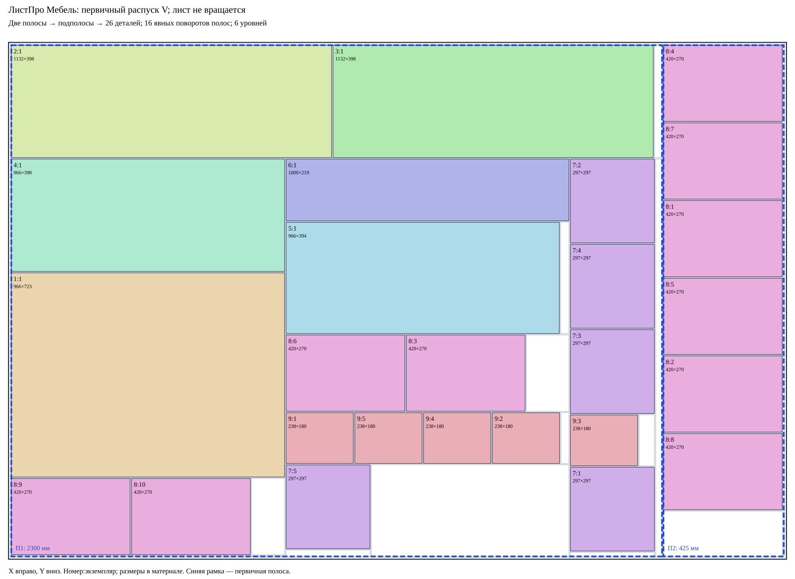

# ЛистПро Мебель — контрольный многостадийный раскрой

Профиль: `abstract-staged-v-saw-v1`. Одна машинная ось V (x=const). Исходный лист не поворачивается; отделённые полосы и подполосы допускают поворот на 90° по часовой стрелке и повторную подачу. Это абстрактный пильный центр, не подтверждённая модель БАЗИС/ЧПУ.

## Независимые статусы

- Геометрия/гильотина: **допустимо**, 26/26 деталей, один лист, поворотов деталей в материале нет.
- Полосная последовательность: **допустимо**, весь первичный распуск завершён до обработки полос.
- Профиль оборудования: **условно допустимо** только при записанных допущениях профиля. Реальные зажимы, столкновения и подача не сертифицированы.

## Первичный распуск и обрезка

Лист 2750×1830; керф 5; отступы по 10 мм. Первичные резы имеют только V, ориентация листа 0°. Сначала снимаются боковые поля (5 мм отхода + 5 мм керфа на каждой стороне), затем отделяется полоса П1. Остаток исходного распуска становится П2. Только после операции `endPrimary` начинаются повороты и поперечная обработка полос. Верхнее/нижнее поле снимается на каждой полосе отдельно, после её подачи и поворота.

| Полоса | Blank ID | X материала | Ширина | Длина до торцовки | Рабочая длина | Путь в геометрическом дереве |
|---|---|---:|---:|---:|---:|---|
| П1 | s0/strip1 | 10 | 2300 | 1830 | 1810 | r/0 |
| П2 | s0/rip-rem0 | 2315 | 425 | 1830 | 1810 | r/1 |

## Стадии и метрики

2 первичные полосы; 35 обрабатываемых подполос; максимальный уровень стадии 6; 16 физических поворотов полос/подполос; 26 готовых деталей. Уровень увеличивается при переходе к поперечному направлению в материале; повторные параллельные резы сохраняют уровень. 35 подполос — число различных входных заготовок внутренних резов после корня первичной полосы (торцовочные заготовки не включены).

44 физических реза, 33965 мм: 3 первичных (включая боковые поля), 4 торцовки полос и 37 внутренних. В геометрическом дереве рабочей области — 38 резов, 24835 мм. 43 повторные подачи, 16 поворотов, загрузка, барьер стадий и 44 реза дают 105 операций. Число стадий — максимальный уровень ветви, а не сумма всех независимых проходов.

Площадь прямоугольных остатков рабочей области 444318 мм²; крупнейший цельный остаток 226152 мм². Каждый остаток — отдельный выход операций, пустые области не объединяются.

## Пошаговая последовательность

Все шаги нумеруются последовательно; отдельный cutIndex нумерует только резы. При подаче заготовка устанавливается в локальный машинный (0,0); координаты материала при этом сохраняются. V-рез проходит от (x,0) до (x,H) через всю текущую поданную заготовку. Керф занимает [x,x+5]. `rotate 90°` изменяет машинную ориентацию, размеры и вектор текстуры, но не материальный прямоугольник. Имена /0 и /1 относятся к материальным детям; машинный порядок выходов после поворота может меняться.

| Шаг | Операция | Рез № | Уровень | Вход / полоса | Машинные данные | Материальные данные / выходы |
|---:|---|---:|---:|---|---|---|
| 1 | load | — | 1 | s0/raw | 2750×1830, 0° |  |
| 2 | cut | 1 | 1 | s0/raw | V: (5,0) → (5,1830), 0° | V=5; s0/side0; s0/side-rem |
| 3 | feed | — | 1 | s0/side-rem | 2740×1830, 0° | 10,0; 2740×1830 |
| 4 | cut | 2 | 1 | s0/side-rem | V: (2730,0) → (2730,1830), 0° | V=2740; s0/body; s0/side1 |
| 5 | feed | — | 1 | s0/body | 2730×1830, 0° | 10,0; 2730×1830 |
| 6 | cut | 3 | 1 | s0/body | V: (2300,0) → (2300,1830), 0° | V=2310; s0/strip1; s0/rip-rem0 |
| 7 | endPrimary | — | 1 | лист 1 | Первичный распуск завершён | s0/strip1; s0/rip-rem0 |
| 8 | feed | — | 1 | s0/strip1 | 2300×1830, 0° | 10,0; 2300×1830 |
| 9 | rotate | — | 1 | s0/strip1 | 0° → 90°, 1830×2300 |  |
| 10 | cut | 4 | 2 | s0/strip1 | V: (1820,0) → (1820,2300), 90° | H=5; s0/strip1/after-top; s0/strip1/top |
| 11 | feed | — | 2 | s0/strip1/after-top | 1820×2300, 90° | 10,10; 2300×1820 |
| 12 | cut | 5 | 2 | s0/strip1/after-top | V: (5,0) → (5,2300), 90° | H=1820; s0/strip1/bottom; s0/strip1/work |
| 13 | feed | — | 2 | s0/strip1/work | 1810×2300, 90° | 10,10; 2300×1810 |
| 14 | cut | 6 | 2 | s0/strip1/work | V: (1407,0) → (1407,2300), 90° | H=408; s0/strip1/work/1; s0/strip1/work/0 |
| 15 | feed | — | 2 | s0/strip1/work/0 | 398×2300, 90° | 10,10; 2300×398 |
| 16 | rotate | — | 2 | s0/strip1/work/0 | 90° → 180°, 2300×398 |  |
| 17 | cut | 7 | 3 | s0/strip1/work/0 | V: (1163,0) → (1163,398), 180° | V=1142; s0/strip1/work/0/1; s0/strip1/work/0/0 |
| 18 | feed | — | 3 | s0/strip1/work/0/1 | 1163×398, 180° | 1147,10; 1163×398 |
| 19 | cut | 8 | 3 | s0/strip1/work/0/1 | V: (26,0) → (26,398), 180° | V=2279; s0/strip1/work/0/1/1; s0/strip1/work/0/1/0 |
| 20 | feed | — | 2 | s0/strip1/work/1 | 1407×2300, 90° | 10,413; 2300×1407 |
| 21 | rotate | — | 2 | s0/strip1/work/1 | 90° → 180°, 2300×1407 |  |
| 22 | cut | 9 | 3 | s0/strip1/work/1 | V: (1329,0) → (1329,1407), 180° | V=976; s0/strip1/work/1/1; s0/strip1/work/1/0 |
| 23 | feed | — | 3 | s0/strip1/work/1/0 | 966×1407, 180° | 10,413; 966×1407 |
| 24 | rotate | — | 3 | s0/strip1/work/1/0 | 180° → 270°, 1407×966 |  |
| 25 | cut | 10 | 4 | s0/strip1/work/1/0 | V: (398,0) → (398,966), 270° | H=811; s0/strip1/work/1/0/0; s0/strip1/work/1/0/1 |
| 26 | feed | — | 4 | s0/strip1/work/1/0/1 | 1004×966, 270° | 10,816; 966×1004 |
| 27 | cut | 11 | 4 | s0/strip1/work/1/0/1 | V: (723,0) → (723,966), 270° | H=1539; s0/strip1/work/1/0/1/0; s0/strip1/work/1/0/1/1 |
| 28 | feed | — | 4 | s0/strip1/work/1/0/1/1 | 276×966, 270° | 10,1544; 966×276 |
| 29 | cut | 12 | 4 | s0/strip1/work/1/0/1/1 | V: (270,0) → (270,966), 270° | H=1814; s0/strip1/work/1/0/1/1/0; s0/strip1/work/1/0/1/1/1 |
| 30 | feed | — | 4 | s0/strip1/work/1/0/1/1/0 | 270×966, 270° | 10,1544; 966×270 |
| 31 | rotate | — | 4 | s0/strip1/work/1/0/1/1/0 | 270° → 0°, 966×270 |  |
| 32 | cut | 13 | 5 | s0/strip1/work/1/0/1/1/0 | V: (420,0) → (420,270), 0° | V=430; s0/strip1/work/1/0/1/1/0/0; s0/strip1/work/1/0/1/1/0/1 |
| 33 | feed | — | 5 | s0/strip1/work/1/0/1/1/0/1 | 541×270, 0° | 435,1544; 541×270 |
| 34 | cut | 14 | 5 | s0/strip1/work/1/0/1/1/0/1 | V: (420,0) → (420,270), 0° | V=855; s0/strip1/work/1/0/1/1/0/1/0; s0/strip1/work/1/0/1/1/0/1/1 |
| 35 | feed | — | 3 | s0/strip1/work/1/1 | 1329×1407, 180° | 981,413; 1329×1407 |
| 36 | cut | 15 | 3 | s0/strip1/work/1/1 | V: (324,0) → (324,1407), 180° | V=1981; s0/strip1/work/1/1/1; s0/strip1/work/1/1/0 |
| 37 | feed | — | 3 | s0/strip1/work/1/1/0 | 1000×1407, 180° | 981,413; 1000×1407 |
| 38 | rotate | — | 3 | s0/strip1/work/1/1/0 | 180° → 270°, 1407×1000 |  |
| 39 | cut | 16 | 4 | s0/strip1/work/1/1/0 | V: (219,0) → (219,1000), 270° | H=632; s0/strip1/work/1/1/0/0; s0/strip1/work/1/1/0/1 |
| 40 | feed | — | 4 | s0/strip1/work/1/1/0/1 | 1183×1000, 270° | 981,637; 1000×1183 |
| 41 | cut | 17 | 4 | s0/strip1/work/1/1/0/1 | V: (394,0) → (394,1000), 270° | H=1031; s0/strip1/work/1/1/0/1/0; s0/strip1/work/1/1/0/1/1 |
| 42 | feed | — | 4 | s0/strip1/work/1/1/0/1/0 | 394×1000, 270° | 981,637; 1000×394 |
| 43 | rotate | — | 4 | s0/strip1/work/1/1/0/1/0 | 270° → 0°, 1000×394 |  |
| 44 | cut | 18 | 5 | s0/strip1/work/1/1/0/1/0 | V: (966,0) → (966,394), 0° | V=1947; s0/strip1/work/1/1/0/1/0/0; s0/strip1/work/1/1/0/1/0/1 |
| 45 | feed | — | 4 | s0/strip1/work/1/1/0/1/1 | 784×1000, 270° | 981,1036; 1000×784 |
| 46 | cut | 19 | 4 | s0/strip1/work/1/1/0/1/1 | V: (270,0) → (270,1000), 270° | H=1306; s0/strip1/work/1/1/0/1/1/0; s0/strip1/work/1/1/0/1/1/1 |
| 47 | feed | — | 4 | s0/strip1/work/1/1/0/1/1/0 | 270×1000, 270° | 981,1036; 1000×270 |
| 48 | rotate | — | 4 | s0/strip1/work/1/1/0/1/1/0 | 270° → 0°, 1000×270 |  |
| 49 | cut | 20 | 5 | s0/strip1/work/1/1/0/1/1/0 | V: (420,0) → (420,270), 0° | V=1401; s0/strip1/work/1/1/0/1/1/0/0; s0/strip1/work/1/1/0/1/1/0/1 |
| 50 | feed | — | 5 | s0/strip1/work/1/1/0/1/1/0/1 | 575×270, 0° | 1406,1036; 575×270 |
| 51 | cut | 21 | 5 | s0/strip1/work/1/1/0/1/1/0/1 | V: (420,0) → (420,270), 0° | V=1826; s0/strip1/work/1/1/0/1/1/0/1/0; s0/strip1/work/1/1/0/1/1/0/1/1 |
| 52 | feed | — | 4 | s0/strip1/work/1/1/0/1/1/1 | 509×1000, 270° | 981,1311; 1000×509 |
| 53 | cut | 22 | 4 | s0/strip1/work/1/1/0/1/1/1 | V: (180,0) → (180,1000), 270° | H=1491; s0/strip1/work/1/1/0/1/1/1/0; s0/strip1/work/1/1/0/1/1/1/1 |
| 54 | feed | — | 4 | s0/strip1/work/1/1/0/1/1/1/0 | 180×1000, 270° | 981,1311; 1000×180 |
| 55 | rotate | — | 4 | s0/strip1/work/1/1/0/1/1/1/0 | 270° → 0°, 1000×180 |  |
| 56 | cut | 23 | 5 | s0/strip1/work/1/1/0/1/1/1/0 | V: (238,0) → (238,180), 0° | V=1219; s0/strip1/work/1/1/0/1/1/1/0/0; s0/strip1/work/1/1/0/1/1/1/0/1 |
| 57 | feed | — | 5 | s0/strip1/work/1/1/0/1/1/1/0/1 | 757×180, 0° | 1224,1311; 757×180 |
| 58 | cut | 24 | 5 | s0/strip1/work/1/1/0/1/1/1/0/1 | V: (238,0) → (238,180), 0° | V=1462; s0/strip1/work/1/1/0/1/1/1/0/1/0; s0/strip1/work/1/1/0/1/1/1/0/1/1 |
| 59 | feed | — | 5 | s0/strip1/work/1/1/0/1/1/1/0/1/1 | 514×180, 0° | 1467,1311; 514×180 |
| 60 | cut | 25 | 5 | s0/strip1/work/1/1/0/1/1/1/0/1/1 | V: (238,0) → (238,180), 0° | V=1705; s0/strip1/work/1/1/0/1/1/1/0/1/1/0; s0/strip1/work/1/1/0/1/1/1/0/1/1/1 |
| 61 | feed | — | 5 | s0/strip1/work/1/1/0/1/1/1/0/1/1/1 | 271×180, 0° | 1710,1311; 271×180 |
| 62 | cut | 26 | 5 | s0/strip1/work/1/1/0/1/1/1/0/1/1/1 | V: (238,0) → (238,180), 0° | V=1948; s0/strip1/work/1/1/0/1/1/1/0/1/1/1/0; s0/strip1/work/1/1/0/1/1/1/0/1/1/1/1 |
| 63 | feed | — | 4 | s0/strip1/work/1/1/0/1/1/1/1 | 324×1000, 270° | 981,1496; 1000×324 |
| 64 | rotate | — | 4 | s0/strip1/work/1/1/0/1/1/1/1 | 270° → 0°, 1000×324 |  |
| 65 | cut | 27 | 5 | s0/strip1/work/1/1/0/1/1/1/1 | V: (297,0) → (297,324), 0° | V=1278; s0/strip1/work/1/1/0/1/1/1/1/0; s0/strip1/work/1/1/0/1/1/1/1/1 |
| 66 | feed | — | 5 | s0/strip1/work/1/1/0/1/1/1/1/0 | 297×324, 0° | 981,1496; 297×324 |
| 67 | rotate | — | 5 | s0/strip1/work/1/1/0/1/1/1/1/0 | 0° → 90°, 324×297 |  |
| 68 | cut | 28 | 6 | s0/strip1/work/1/1/0/1/1/1/1/0 | V: (22,0) → (22,297), 90° | H=1793; s0/strip1/work/1/1/0/1/1/1/1/0/1; s0/strip1/work/1/1/0/1/1/1/1/0/0 |
| 69 | feed | — | 3 | s0/strip1/work/1/1/1 | 324×1407, 180° | 1986,413; 324×1407 |
| 70 | cut | 29 | 3 | s0/strip1/work/1/1/1 | V: (22,0) → (22,1407), 180° | V=2283; s0/strip1/work/1/1/1/1; s0/strip1/work/1/1/1/0 |
| 71 | feed | — | 3 | s0/strip1/work/1/1/1/0 | 297×1407, 180° | 1986,413; 297×1407 |
| 72 | rotate | — | 3 | s0/strip1/work/1/1/1/0 | 180° → 270°, 1407×297 |  |
| 73 | cut | 30 | 4 | s0/strip1/work/1/1/1/0 | V: (297,0) → (297,297), 270° | H=710; s0/strip1/work/1/1/1/0/0; s0/strip1/work/1/1/1/0/1 |
| 74 | feed | — | 4 | s0/strip1/work/1/1/1/0/1 | 1105×297, 270° | 1986,715; 297×1105 |
| 75 | cut | 31 | 4 | s0/strip1/work/1/1/1/0/1 | V: (297,0) → (297,297), 270° | H=1012; s0/strip1/work/1/1/1/0/1/0; s0/strip1/work/1/1/1/0/1/1 |
| 76 | feed | — | 4 | s0/strip1/work/1/1/1/0/1/1 | 803×297, 270° | 1986,1017; 297×803 |
| 77 | cut | 32 | 4 | s0/strip1/work/1/1/1/0/1/1 | V: (297,0) → (297,297), 270° | H=1314; s0/strip1/work/1/1/1/0/1/1/0; s0/strip1/work/1/1/1/0/1/1/1 |
| 78 | feed | — | 4 | s0/strip1/work/1/1/1/0/1/1/1 | 501×297, 270° | 1986,1319; 297×501 |
| 79 | cut | 33 | 4 | s0/strip1/work/1/1/1/0/1/1/1 | V: (180,0) → (180,297), 270° | H=1499; s0/strip1/work/1/1/1/0/1/1/1/0; s0/strip1/work/1/1/1/0/1/1/1/1 |
| 80 | feed | — | 4 | s0/strip1/work/1/1/1/0/1/1/1/0 | 180×297, 270° | 1986,1319; 297×180 |
| 81 | rotate | — | 4 | s0/strip1/work/1/1/1/0/1/1/1/0 | 270° → 0°, 297×180 |  |
| 82 | cut | 34 | 5 | s0/strip1/work/1/1/1/0/1/1/1/0 | V: (238,0) → (238,180), 0° | V=2224; s0/strip1/work/1/1/1/0/1/1/1/0/0; s0/strip1/work/1/1/1/0/1/1/1/0/1 |
| 83 | feed | — | 4 | s0/strip1/work/1/1/1/0/1/1/1/1 | 316×297, 270° | 1986,1504; 297×316 |
| 84 | cut | 35 | 4 | s0/strip1/work/1/1/1/0/1/1/1/1 | V: (297,0) → (297,297), 270° | H=1801; s0/strip1/work/1/1/1/0/1/1/1/1/0; s0/strip1/work/1/1/1/0/1/1/1/1/1 |
| 85 | feed | — | 1 | s0/rip-rem0 | 425×1830, 0° | 2315,0; 425×1830 |
| 86 | rotate | — | 1 | s0/rip-rem0 | 0° → 90°, 1830×425 |  |
| 87 | cut | 36 | 2 | s0/rip-rem0 | V: (1820,0) → (1820,425), 90° | H=5; s0/rip-rem0/after-top; s0/rip-rem0/top |
| 88 | feed | — | 2 | s0/rip-rem0/after-top | 1820×425, 90° | 2315,10; 425×1820 |
| 89 | cut | 37 | 2 | s0/rip-rem0/after-top | V: (5,0) → (5,425), 90° | H=1820; s0/rip-rem0/bottom; s0/rip-rem0/work |
| 90 | feed | — | 2 | s0/rip-rem0/work | 1810×425, 90° | 2315,10; 425×1810 |
| 91 | rotate | — | 2 | s0/rip-rem0/work | 90° → 180°, 425×1810 |  |
| 92 | cut | 38 | 3 | s0/rip-rem0/work | V: (0,0) → (0,1810), 180° | V=2735; s0/rip-rem0/work/1; s0/rip-rem0/work/0 |
| 93 | feed | — | 3 | s0/rip-rem0/work/0 | 420×1810, 180° | 2315,10; 420×1810 |
| 94 | rotate | — | 3 | s0/rip-rem0/work/0 | 180° → 270°, 1810×420 |  |
| 95 | cut | 39 | 4 | s0/rip-rem0/work/0 | V: (270,0) → (270,420), 270° | H=280; s0/rip-rem0/work/0/0; s0/rip-rem0/work/0/1 |
| 96 | feed | — | 4 | s0/rip-rem0/work/0/1 | 1535×420, 270° | 2315,285; 420×1535 |
| 97 | cut | 40 | 4 | s0/rip-rem0/work/0/1 | V: (270,0) → (270,420), 270° | H=555; s0/rip-rem0/work/0/1/0; s0/rip-rem0/work/0/1/1 |
| 98 | feed | — | 4 | s0/rip-rem0/work/0/1/1 | 1260×420, 270° | 2315,560; 420×1260 |
| 99 | cut | 41 | 4 | s0/rip-rem0/work/0/1/1 | V: (270,0) → (270,420), 270° | H=830; s0/rip-rem0/work/0/1/1/0; s0/rip-rem0/work/0/1/1/1 |
| 100 | feed | — | 4 | s0/rip-rem0/work/0/1/1/1 | 985×420, 270° | 2315,835; 420×985 |
| 101 | cut | 42 | 4 | s0/rip-rem0/work/0/1/1/1 | V: (270,0) → (270,420), 270° | H=1105; s0/rip-rem0/work/0/1/1/1/0; s0/rip-rem0/work/0/1/1/1/1 |
| 102 | feed | — | 4 | s0/rip-rem0/work/0/1/1/1/1 | 710×420, 270° | 2315,1110; 420×710 |
| 103 | cut | 43 | 4 | s0/rip-rem0/work/0/1/1/1/1 | V: (270,0) → (270,420), 270° | H=1380; s0/rip-rem0/work/0/1/1/1/1/0; s0/rip-rem0/work/0/1/1/1/1/1 |
| 104 | feed | — | 4 | s0/rip-rem0/work/0/1/1/1/1/1 | 435×420, 270° | 2315,1385; 420×435 |
| 105 | cut | 44 | 4 | s0/rip-rem0/work/0/1/1/1/1/1 | V: (270,0) → (270,420), 270° | H=1655; s0/rip-rem0/work/0/1/1/1/1/1/0; s0/rip-rem0/work/0/1/1/1/1/1/1 |

## Детали в координатах материала

| Деталь:экземпляр | X | Y | Размер X×Y | Поворот относительно материала |
|---|---:|---:|---|---|
| 2:1 | 10 | 10 | 1132×398 | нет |
| 3:1 | 1147 | 10 | 1132×398 | нет |
| 4:1 | 10 | 413 | 966×398 | нет |
| 1:1 | 10 | 816 | 966×723 | нет |
| 8:9 | 10 | 1544 | 420×270 | нет |
| 8:10 | 435 | 1544 | 420×270 | нет |
| 6:1 | 981 | 413 | 1000×219 | нет |
| 5:1 | 981 | 637 | 966×394 | нет |
| 8:6 | 981 | 1036 | 420×270 | нет |
| 8:3 | 1406 | 1036 | 420×270 | нет |
| 9:1 | 981 | 1311 | 238×180 | нет |
| 9:5 | 1224 | 1311 | 238×180 | нет |
| 9:4 | 1467 | 1311 | 238×180 | нет |
| 9:2 | 1710 | 1311 | 238×180 | нет |
| 7:5 | 981 | 1496 | 297×297 | нет |
| 7:2 | 1986 | 413 | 297×297 | нет |
| 7:4 | 1986 | 715 | 297×297 | нет |
| 7:3 | 1986 | 1017 | 297×297 | нет |
| 9:3 | 1986 | 1319 | 238×180 | нет |
| 7:1 | 1986 | 1504 | 297×297 | нет |
| 8:4 | 2315 | 10 | 420×270 | нет |
| 8:7 | 2315 | 285 | 420×270 | нет |
| 8:1 | 2315 | 560 | 420×270 | нет |
| 8:5 | 2315 | 835 | 420×270 | нет |
| 8:2 | 2315 | 1110 | 420×270 | нет |
| 8:8 | 2315 | 1385 | 420×270 | нет |

## Цельные остатки

| X | Y | Ширина | Высота | Площадь, мм² |
|---:|---:|---:|---:|---:|
| 1283 | 1496 | 698 | 324 | 226152 |
| 2315 | 1660 | 420 | 160 | 67200 |
| 1831 | 1036 | 150 | 270 | 40500 |
| 860 | 1544 | 116 | 270 | 31320 |
| 2288 | 413 | 22 | 1407 | 30954 |
| 1952 | 637 | 29 | 394 | 11426 |
| 2284 | 10 | 26 | 398 | 10348 |
| 2229 | 1319 | 54 | 180 | 9720 |
| 981 | 1798 | 297 | 22 | 6534 |
| 1953 | 1311 | 28 | 180 | 5040 |
| 1986 | 1806 | 297 | 14 | 4158 |
| 10 | 1819 | 966 | 1 | 966 |

Независимый replay хранится в `benchmarks/manual-26-staged.json`: trace операций и blanks с parentBlankId, materialOrientation, машинной ориентацией и историей всех 89 заготовок. Валидатор не импортирует staged-оптимизатор или планировщик. Отдельно проверяет топологию первичных полос, барьер первичного распуска, наследование ориентаций, обратное преобразование координат, текстуру, подачу, ограничения профиля и все конечные детали/остатки.

## Право одного поворота на заготовку

Исходный лист в этом плане не вращается. Основной профиль допускает максимум один предварительный поворот листа, строгий профиль abstract-staged-v-no-sheet-turn-v1 — ноль; проверенный план удовлетворяет обоим.

Для каждого созданного blankId initialTurnCount=0. ROTATE_90 разрешён только при turnCount=0 и устанавливает 1. CUT удаляет родителя и создаёт две новые физические заготовки с собственными turnCount=0 и унаследованной машинной ориентацией. Поэтому в одной ветви возможны повороты предка и потомка, но никогда два поворота одного и того же куска. Независимый replay заново ведёт эти счётчики, не доверяя JSON.

В каждой операции cut записаны размеры w/h, machineOrientation, materialRect, axis, start/end, inputBlankId, outputBlankIds и outputTurnCounts=[0,0]. В rotate — те же идентификаторы (выход равен входу), beforeSize/afterSize, fromOrientation/toOrientation и переход turnCountBefore=0 → turnCountAfter=1. Координаты реза у rotate равны null.
