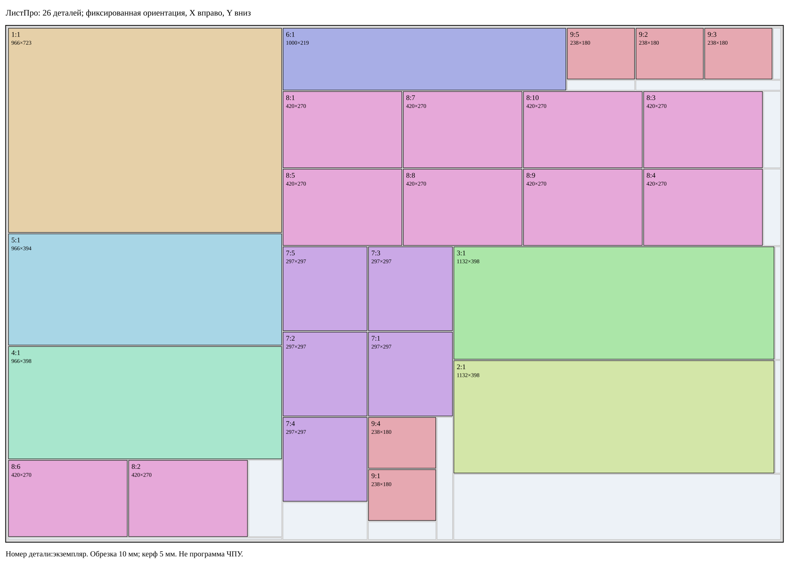

# Контрольный заказ — технологический план

Профиль: `abstract-fixed-xy-v1`, условный двухосевой стол. Это не модель БАЗИС или конкретного станка. Все координаты в мм от верхнего левого угла исходного листа: X вправо, Y вниз. Ось V: x=const, H: y=const. Координата реза задаёт ближнюю границу полосы керфа, занимающей 5 мм в положительном направлении.

Поворот листа: запрещён. Поворот полос: запрещён. Перемещение и перебазирование заготовок: запрещены. Отдельные заготовки остаются на столе и фиксируются независимо; инструмент должен иметь доступ по обеим осям к каждой из них. Эти возможности являются допущениями абстрактного профиля.

Геометрия/гильотина: **допустимо**, 26/26, один лист, 38 внутренних резов, 22769 мм.

Технология для указанного профиля: **условно допустимо**, 42 реза с обрезкой, 31889 мм; 0 поворотов, 0 перемещений. Один шаг загрузки + 42 шага резки = 43 операции. Номер шага, номер физического реза и номер внутреннего геометрического реза различаются.

Для профиля только V: **отклонено**, первый недоступный рез H на шаге 4 (верхняя обрезка). Даже при заранее обрезанном листе заказ невозможен при V-only и без вращений: V-рез не изменяет высоту заготовки, а всем деталям нужны внутренние границы по Y. Дополнительные листы этого не исправляют.

## Последовательность

Каждый рез проходит от указанной начальной до конечной точки через всю текущую заготовку. Исходная заготовка поглощается; доступны только два указанных потомка. Ориентация каждой заготовки до и после операции — 0°.

| Шаг | Рез | Фаза / геом. № | Входная заготовка | Ось, координата | От → до | Дочерние заготовки |
|---:|---:|---|---|---|---|---|
| 1 | — | загрузка | s0/raw | 0° | (0,0), 2750×1830 | — |
| 2 | 1 | обрезка | s0/raw | V, 5 | (5,0) → (5,1830) | s0/scrap0; s0/trim0 |
| 3 | 2 | обрезка | s0/trim0 | V, 2740 | (2740,0) → (2740,1830) | s0/trim1; s0/scrap1 |
| 4 | 3 | обрезка | s0/trim1 | H, 5 | (10,5) → (2740,5) | s0/scrap2; s0/trim2 |
| 5 | 4 | обрезка | s0/trim2 | H, 1820 | (10,1820) → (2740,1820) | s0/r; s0/scrap3 |
| 6 | 5 | раскрой / 1 | s0/r | V, 976 | (976,10) → (976,1820) | s0/r/0; s0/r/1 |
| 7 | 6 | раскрой / 2 | s0/r/0 | H, 733 | (10,733) → (976,733) | s0/r/0/0; s0/r/0/1 |
| 8 | 7 | раскрой / 3 | s0/r/0/1 | H, 1132 | (10,1132) → (976,1132) | s0/r/0/1/0; s0/r/0/1/1 |
| 9 | 8 | раскрой / 4 | s0/r/0/1/1 | H, 1535 | (10,1535) → (976,1535) | s0/r/0/1/1/0; s0/r/0/1/1/1 |
| 10 | 9 | раскрой / 5 | s0/r/0/1/1/1 | H, 1810 | (10,1810) → (976,1810) | s0/r/0/1/1/1/0; s0/r/0/1/1/1/1 |
| 11 | 10 | раскрой / 6 | s0/r/0/1/1/1/0 | V, 430 | (430,1540) → (430,1810) | s0/r/0/1/1/1/0/0; s0/r/0/1/1/1/0/1 |
| 12 | 11 | раскрой / 7 | s0/r/0/1/1/1/0/1 | V, 855 | (855,1540) → (855,1810) | s0/r/0/1/1/1/0/1/0; s0/r/0/1/1/1/0/1/1 |
| 13 | 12 | раскрой / 8 | s0/r/1 | H, 229 | (981,229) → (2740,229) | s0/r/1/0; s0/r/1/1 |
| 14 | 13 | раскрой / 9 | s0/r/1/0 | V, 1981 | (1981,10) → (1981,229) | s0/r/1/0/0; s0/r/1/0/1 |
| 15 | 14 | раскрой / 10 | s0/r/1/0/1 | V, 2224 | (2224,10) → (2224,229) | s0/r/1/0/1/0; s0/r/1/0/1/1 |
| 16 | 15 | раскрой / 11 | s0/r/1/0/1/0 | H, 190 | (1986,190) → (2224,190) | s0/r/1/0/1/0/0; s0/r/1/0/1/0/1 |
| 17 | 16 | раскрой / 12 | s0/r/1/0/1/1 | H, 190 | (2229,190) → (2740,190) | s0/r/1/0/1/1/0; s0/r/1/0/1/1/1 |
| 18 | 17 | раскрой / 13 | s0/r/1/0/1/1/0 | V, 2467 | (2467,10) → (2467,190) | s0/r/1/0/1/1/0/0; s0/r/1/0/1/1/0/1 |
| 19 | 18 | раскрой / 14 | s0/r/1/0/1/1/0/1 | V, 2710 | (2710,10) → (2710,190) | s0/r/1/0/1/1/0/1/0; s0/r/1/0/1/1/0/1/1 |
| 20 | 19 | раскрой / 15 | s0/r/1/1 | H, 504 | (981,504) → (2740,504) | s0/r/1/1/0; s0/r/1/1/1 |
| 21 | 20 | раскрой / 16 | s0/r/1/1/0 | V, 1401 | (1401,234) → (1401,504) | s0/r/1/1/0/0; s0/r/1/1/0/1 |
| 22 | 21 | раскрой / 17 | s0/r/1/1/0/1 | V, 1826 | (1826,234) → (1826,504) | s0/r/1/1/0/1/0; s0/r/1/1/0/1/1 |
| 23 | 22 | раскрой / 18 | s0/r/1/1/0/1/1 | V, 2251 | (2251,234) → (2251,504) | s0/r/1/1/0/1/1/0; s0/r/1/1/0/1/1/1 |
| 24 | 23 | раскрой / 19 | s0/r/1/1/0/1/1/1 | V, 2676 | (2676,234) → (2676,504) | s0/r/1/1/0/1/1/1/0; s0/r/1/1/0/1/1/1/1 |
| 25 | 24 | раскрой / 20 | s0/r/1/1/1 | H, 779 | (981,779) → (2740,779) | s0/r/1/1/1/0; s0/r/1/1/1/1 |
| 26 | 25 | раскрой / 21 | s0/r/1/1/1/0 | V, 1401 | (1401,509) → (1401,779) | s0/r/1/1/1/0/0; s0/r/1/1/1/0/1 |
| 27 | 26 | раскрой / 22 | s0/r/1/1/1/0/1 | V, 1826 | (1826,509) → (1826,779) | s0/r/1/1/1/0/1/0; s0/r/1/1/1/0/1/1 |
| 28 | 27 | раскрой / 23 | s0/r/1/1/1/0/1/1 | V, 2251 | (2251,509) → (2251,779) | s0/r/1/1/1/0/1/1/0; s0/r/1/1/1/0/1/1/1 |
| 29 | 28 | раскрой / 24 | s0/r/1/1/1/0/1/1/1 | V, 2676 | (2676,509) → (2676,779) | s0/r/1/1/1/0/1/1/1/0; s0/r/1/1/1/0/1/1/1/1 |
| 30 | 29 | раскрой / 25 | s0/r/1/1/1/1 | V, 1278 | (1278,784) → (1278,1820) | s0/r/1/1/1/1/0; s0/r/1/1/1/1/1 |
| 31 | 30 | раскрой / 26 | s0/r/1/1/1/1/0 | H, 1081 | (981,1081) → (1278,1081) | s0/r/1/1/1/1/0/0; s0/r/1/1/1/1/0/1 |
| 32 | 31 | раскрой / 27 | s0/r/1/1/1/1/0/1 | H, 1383 | (981,1383) → (1278,1383) | s0/r/1/1/1/1/0/1/0; s0/r/1/1/1/1/0/1/1 |
| 33 | 32 | раскрой / 28 | s0/r/1/1/1/1/0/1/1 | H, 1685 | (981,1685) → (1278,1685) | s0/r/1/1/1/1/0/1/1/0; s0/r/1/1/1/1/0/1/1/1 |
| 34 | 33 | раскрой / 29 | s0/r/1/1/1/1/1 | V, 1580 | (1580,784) → (1580,1820) | s0/r/1/1/1/1/1/0; s0/r/1/1/1/1/1/1 |
| 35 | 34 | раскрой / 30 | s0/r/1/1/1/1/1/0 | H, 1081 | (1283,1081) → (1580,1081) | s0/r/1/1/1/1/1/0/0; s0/r/1/1/1/1/1/0/1 |
| 36 | 35 | раскрой / 31 | s0/r/1/1/1/1/1/0/1 | H, 1383 | (1283,1383) → (1580,1383) | s0/r/1/1/1/1/1/0/1/0; s0/r/1/1/1/1/1/0/1/1 |
| 37 | 36 | раскрой / 32 | s0/r/1/1/1/1/1/0/1/1 | V, 1521 | (1521,1388) → (1521,1820) | s0/r/1/1/1/1/1/0/1/1/0; s0/r/1/1/1/1/1/0/1/1/1 |
| 38 | 37 | раскрой / 33 | s0/r/1/1/1/1/1/0/1/1/0 | H, 1568 | (1283,1568) → (1521,1568) | s0/r/1/1/1/1/1/0/1/1/0/0; s0/r/1/1/1/1/1/0/1/1/0/1 |
| 39 | 38 | раскрой / 34 | s0/r/1/1/1/1/1/0/1/1/0/1 | H, 1753 | (1283,1753) → (1521,1753) | s0/r/1/1/1/1/1/0/1/1/0/1/0; s0/r/1/1/1/1/1/0/1/1/0/1/1 |
| 40 | 39 | раскрой / 35 | s0/r/1/1/1/1/1/1 | H, 1182 | (1585,1182) → (2740,1182) | s0/r/1/1/1/1/1/1/0; s0/r/1/1/1/1/1/1/1 |
| 41 | 40 | раскрой / 36 | s0/r/1/1/1/1/1/1/0 | V, 2717 | (2717,784) → (2717,1182) | s0/r/1/1/1/1/1/1/0/0; s0/r/1/1/1/1/1/1/0/1 |
| 42 | 41 | раскрой / 37 | s0/r/1/1/1/1/1/1/1 | H, 1585 | (1585,1585) → (2740,1585) | s0/r/1/1/1/1/1/1/1/0; s0/r/1/1/1/1/1/1/1/1 |
| 43 | 42 | раскрой / 38 | s0/r/1/1/1/1/1/1/1/0 | V, 2717 | (2717,1187) → (2717,1585) | s0/r/1/1/1/1/1/1/1/0/0; s0/r/1/1/1/1/1/1/1/0/1 |

## Детали

| Деталь:экземпляр | X | Y | Длина X | Ширина Y | Поворот |
|---|---:|---:|---:|---:|---|
| 1:1 | 10 | 10 | 966 | 723 | нет |
| 5:1 | 10 | 738 | 966 | 394 | нет |
| 4:1 | 10 | 1137 | 966 | 398 | нет |
| 8:6 | 10 | 1540 | 420 | 270 | нет |
| 8:2 | 435 | 1540 | 420 | 270 | нет |
| 6:1 | 981 | 10 | 1000 | 219 | нет |
| 9:5 | 1986 | 10 | 238 | 180 | нет |
| 9:2 | 2229 | 10 | 238 | 180 | нет |
| 9:3 | 2472 | 10 | 238 | 180 | нет |
| 8:1 | 981 | 234 | 420 | 270 | нет |
| 8:7 | 1406 | 234 | 420 | 270 | нет |
| 8:10 | 1831 | 234 | 420 | 270 | нет |
| 8:3 | 2256 | 234 | 420 | 270 | нет |
| 8:5 | 981 | 509 | 420 | 270 | нет |
| 8:8 | 1406 | 509 | 420 | 270 | нет |
| 8:9 | 1831 | 509 | 420 | 270 | нет |
| 8:4 | 2256 | 509 | 420 | 270 | нет |
| 7:5 | 981 | 784 | 297 | 297 | нет |
| 7:2 | 981 | 1086 | 297 | 297 | нет |
| 7:4 | 981 | 1388 | 297 | 297 | нет |
| 7:3 | 1283 | 784 | 297 | 297 | нет |
| 7:1 | 1283 | 1086 | 297 | 297 | нет |
| 9:4 | 1283 | 1388 | 238 | 180 | нет |
| 9:1 | 1283 | 1573 | 238 | 180 | нет |
| 3:1 | 1585 | 784 | 1132 | 398 | нет |
| 2:1 | 1585 | 1187 | 1132 | 398 | нет |

## Независимое воспроизведение

`src/technology-validator.js` не импортирует планировщик или оптимизатор. Он проверяет геометрию отдельным валидатором, затем загружает исходные листы и последовательно выполняет операции. Проверяются доступность входной заготовки, ориентация, ось, рабочий ход, базирование, керф, координаты обоих концов реза и состояния потомков. Конечные заготовки сверяются с деталями и остатками; нельзя пропустить, повторно использовать или подменить заготовку.

Полные состояния replay и точные выходные прямоугольники: `benchmarks/manual-26-technology.json`. Профиль и ограничения: `profiles/abstract-fixed-xy-v1.json`. Проверка не моделирует реальные зажимы, столкновения, толщину и подачу; необходима отдельная проверка реального оборудования.
